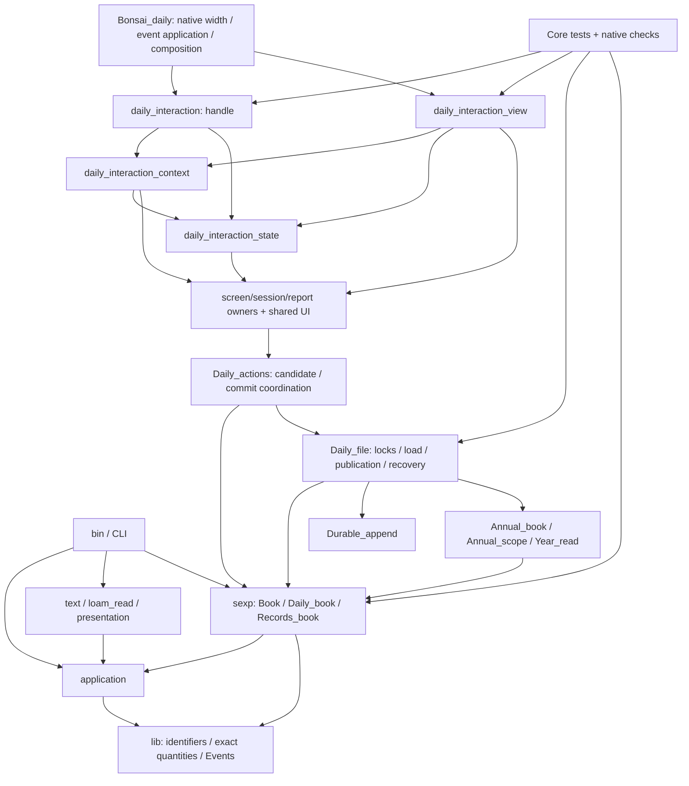

# Bakhlo 全体アーキテクチャ監査

What this repo does: BakhloはOCamlの家計Core、明示的publication、複数の保存表現、Bonsai TUIを持つ個人用家計簿。想定負荷は一人の利用者と最大二つの作業エージェント。正データの運用authorityは引き続きLOAMである。

## 1. 結論

**継続開発の土台は健全。ただし中央TUIへの追記を5年間続ける設計は推奨しない。全面再設計もScheduled前の追加大分割も不要。**

- **根本原因**：画面を縦に閉じず、state／Context／handle／View／統合checksの横断箇所へ機能を追加している。層別分割は読取入口を小さくしたが、変更ownerを画面単位にはしていない。全画面alias、推論インターフェース、native最適化の実装依存が波及を重ねる。
- **5年以上**：exact数量、抽象Core、単一admission、明示的writer、独立model/oracleは維持すべき資産。ただし履歴は約16日しかなく、5年の安定性を実証したとは言えない。次の機能から局所ownerを守る運用が条件となる。
- **Mac/OMP**：既存の限定テスト実行とsymbol/range読取を先に使う。次の機能で局所state・query組立・描画をownerへ閉じる。行数分割、全体への-opaque、キャッシュ・framework追加では速度改善を立証できていない。
- **Scheduled**：次の一単位「明示監視ルール＋月別Review＋Series Calendar」を開始してよい。#38/#39完了待ちは不要。ただし新Series処理をContext／巨大handleへ積み増すのではなく、局所ownerと接続契約を最初に定める。
- **別の実害**：Recordsの未知拡張がDaily経由の変換で無言消失することを再現した。[#40](https://github.com/shumoku88-bit/bakhlo/issues/40)に限定して記録。形式拡張／converter追加前の修正であり、通常Records追記が毎回拡張を消すという指摘ではない。

## 2. 基準・方法・証拠の区別

**[事実]** source／履歴／compiler成果物、**[測定]** 今回実行、**[既存測定]** 過去の記録、**[推定]** 未実装変更の影響、**[提案]** 今後の判断。

[事実] 開始時のmain、remote HEADはともに`4d7b431859501fe0bfe48e73494cdc1c8ac83da0`、作業ツリーclean。compiled sourceの基準は`f80f39f79667c39c94453d287459109e57f169fb`、後続は証跡文書のみ。open #28/#38/#39を確認。製品source、会計意味、writer、保存形式は変更しない。

tracked OCaml **278ファイル／186モジュール（うち92に.mli）**を棚卸しした。製品、tests、tools、保存済み研究sourceを区別した全件表は付録。全実装の逐行バグ監査ではなく、依存・所有境界を優先した監査である。

README、HANDOFF、tasks/todo、UI差分台帳、VERIFICATION、SEMANTIC_CONTRACT、CANONICAL_DATA_DESIGN、YEAR_READ_BOUNDARY、LANGUAGE_AWARE_DESIGN_REVIEW、UI_DIRECTION／共有UI責務資料、近傍.mliとDuneを参照した。歴史資料の「未解決」は現在の実装状態を上書きしない。画面F/O/V/Qは既存台帳、受入順はtasks、実装検証はVERIFICATIONが所有し、このレポートを第二の進捗表にしない。

機械情報は、toolchainに合う`ocamldep -modules`、実際の`.cmx`の`Interfaces imported`／`Implementations imported`、Dune compiler trace、Git履歴から取得。static module参照、型依存、native実装依存、実再コンパイル数を区別する。CoreとTUIで同じsourceがビルドされるものはsource単位へ統合した。

## 3. 現行アーキテクチャと維持する境界

矢印は**利用元→依存先**。実行順ではない。下図は責務単位へ縮約したもの、全moduleのエッジは付録にある。



| 境界 | 責務・安全上の難しさ | テスト所有・判断 |
| --- | --- | --- |
| lib/domain | Identifier、Quantity、Effect、Event、correction/root。exact量・通貨・identity | quantity/movement/effect_key/lineage等。小型・比較的低頻度、維持 |
| application | Actual_source/validity、quantity query/group/support、Merchant/OriginalAmount/Exchange/relations | 専用testsと独立model/oracle。UI/codecへの逆依存なし、維持 |
| Daily_book | corrected entries、plans、supportの一体admission、更新・pace照会、codec、入力parser | daily_book_tests、incremental oracle、storage/annual。広いが単一不変条件のowner |
| Records_book / Durable_append | CRC/LSN・未知拡張の純粋表現とI/O追記を分離 | records_codec/durable_append/recovery。分離済みの責務を維持 |
| Daily_actions / Daily_file | draft→候補とcommit調停／bytes・locks・保存結果 | storage integration、session/recovery。Records置換・plan支払リンクは拒否を維持 |
| annual | wire/source参照、履歴範囲、検証供給源、連鎖ロック、exact-byte backup | annual_file/lifecycle/backup/year_read。前年原本と現在authorityの境界を維持 |
| UI leaf | Record/Scheduled/Actual各session、calendar/months、reports、panel/form/overlays | 各session_checks＋統合。controllerへの逆依存を作らない |
| controller 4層 | 全画面state、query/config/form、入力、描画 | 中央checksとBonsai self-check。画面ごとの局所性は未達 |
| LOAM境界 | loam_readは限定read-only input。./uiは比較copy入口で全移行APIではない | loam_read/CLI/cram。今回は比較copyもLOAM原本も読まない |
| CLI/presentation/text | 引数、入力・表示adapter。旧Bookと新Dailyは別契約 | command/fixture_input/text_read/sexp_book/cram。重複に見えるだけで旧Bookを消さない |

[事実] `lib/dune`と`application/dune`は内向き。sexpライブラリはdomain/application/parsexp/**unix**を使うため、ライブラリ全体が純粋ではない。Daily_book／Records_bookは純粋、Durable_appendはI/O。`Daily_file`／`Annual_backup`はtui/にあるがBonsaiに依存せず、`test/dune:7-10`が同じproduction sourceをcopy_filesする。保存実装の二重化ではない。directoryを美しくするためだけの移動は不要。

Coreとnative TUIは別ABI。`tools/build-bonsai-tui:29-62`は同じtracked sourceを別rootへコピーし、明示module一覧を持つ。新module時の登録点はここ。通常Core `@all`だけでBonsaiは検証されない。

## 4. 責務集中・変更波及・根本原因

### Should fix 1：機能追加のたび中央の横断箇所を増やす

- **What this is:** Stateのrecordは34 fieldでsession、overlay、reports、共通scrollとpublication状態を持つ（`daily_interaction_state.ml:142-176`）。ContextにはPace解決、Balances/Print、config I/Oとformが同居する（`:197-295,347-623,696-745,1039-1135`）。
- **Problem:** 表示だけならViewのPace77行／Balances41行で終わる場合があるが、選択・preset・viewport・復帰変更はContextとroute別handleへ広がる（`daily_interaction.ml:1007-1068`等）。state全体を渡す別ファイルへ移しても結合は消えない。
- **Fix:** 次に触る画面のquery組立、描画、局所選択更新を既存ownerへ閉じる。book、明示設定、局所state、寸法だけを受ける。保存結果、held Record draft、親復帰の調停は中央へ残す。
- **If we skip it:** 次画面も4層＋checksを編集し、並列ownerを分離できない。実際のmerge conflict回数は未測定で、衝突頻度増加は[推定]。

### Should fix 2：広い推論IFとalias集約は変更遮断にならない

[事実] State／Context／input／Viewには.mliなし。State`:3-32`に30 module aliasがあり、helper/typeも暗黙公開。Contextは89、State48、View14のトップレベルletを持つ（字句上のlower bound。type/constructor/module/includeは別）。Daily_bookは195行／33 val、Trendは130行／14 valの明示IFを持つ。

[測定] 以下は当該compiled unitを**importするsource unit数**。テストを含む。毎回の再コンパイル数ではない。

| 中心module | 実装import利用元 | IF import利用元 | 判断 |
| --- | ---: | ---: | --- |
| lib/identifier | 97 | 137 | stable基礎型の正当な中心、分割不要 |
| lib/quantity | 74 | 136 | exact数量の契約を複製しない |
| lib/effect | 67 | 133 | 同上 |
| sexp/daily_book | 47 | 58 | facadeとshared records、型変更時は広い |
| application/current_quantity_query | 38 | 98 | 会計query基盤として妥当。UI型を入れない |
| tui/daily_actions | 27 | 37 | 候補とpublisher調停の中心 |
| tui/daily_overlays | 26 | 33 | 共通表示変更は利用元横断受入が必要 |
| tui/daily_interaction_state | 8 | 8 | 中央4層と巨大checksへ到達 |
| tui/daily_interaction_context | 4 | 7 | 入力/描画/複数checksへの結合点 |
| tui/daily_pace_trend | 5 | 9 | leafでもState alias経由の依存あり |

source参照／compiled実装import／IF importの観測グラフにcycleなし。lib/applicationからtui/sexp/CLI/presentation/text/loam_readへの逆参照もなし。**高水準controller型が会計Coreへ漏れる証拠はない。** shared UI内の表示責務の広さは別問題であり、循環回避functorやservice locatorが必要という根拠はない。

[提案] .mliは現在のconsumerに必要な公開面を決める時に使う。全moduleへ一括追加しない。Daily_bookのcodec/admission/mutation/query/Annual_internalには実consumerがあり、狭いwrapper群を増やすだけでは改善しない。.mliはnative .cmx最適化依存を自動では切らない。全体の-opaque／最適化停止はruntime影響も測らず採用しない。

### Should fix 3：統合checksが画面単体の作業ownerも兼ねる

`daily_interaction_checks.ml`は4,713行／280,506bytes。Pace`:2080-3042`、Balances/Observe`:3043-3465`に局所入口がある一方、`self_check:3466-4713`にも統合シナリオが残る。独立したrecord/scheduled/actual/bulk/generation checksは既に存在する（`bonsai_daily.ml:368-377`）。

「毎回全4,713行を読む必要がある」のではない。検索と範囲読取は可能。問題は局所回帰追加も同一編集ownerへ集まり、公開native実行入口は一括であること。assertionを移すだけで実行量は減らない。

[提案] #39どおり、変更時に画面に閉じた検査だけownerへ。親復帰、draft、stale/uncertain、保存/coldは統合側へ残す。新test frameworkや全assertion移設は不要。限定native runnerも反復待ちの実害が示された場合に既存関数を呼ぶ最小入口から測る。

### 履歴の裏付けと限界

HEADまで336 commit、2026-10-02〜10-18。以下は現pathの.ml変更commit数、rename追跡なし。同時変更は因果や衝突の証明ではない。

| source | commit数 | 同時変更 |
| --- | ---: | --- |
| daily_interaction.ml | 67 | controller checks44、Bonsai24、overlays19、actions14 |
| daily_book.ml | 19 | .mli13、controller11、controller checks10、daily_book_tests8 |
| daily_pace_trend.ml | 6 | controller5、.mli5、controller checks4 |

新State/Context/Viewは各1 commit。これを「安定」と呼ばない。旧controller履歴を移設先へ配分していない。短期開発密度を5年間へ外挿しない。

## 5. Must fix：Records→Daily変換の情報消失

**4. 保持不能な未知拡張をDaily入場が成功扱いする。**

- **What this is:** `Records_book.mli:6-9`は未知拡張保持を契約に含む。header opaqueと独立Opaque frameを持つCRC/LSN正常な合成logを作った。
- **Problem:** `Daily_book.of_records:529-595`はopaqueを表現せず、of_stringはOk。逆変換`:605-670`はopaque=[]。情報が消える。`CANONICAL_DATA_DESIGN:83-94`の保持または拒否と不整合。
- **Fix:** [提案] 現在の最小安全策は保持不能opaqueをDaily入場で明示拒否。必要性がある場合のみlossless保持を設計する。今回実装しない。
- **If we skip it:** 将来converterやformat拡張を重ねると、成功のまま欠落する。通常Records追記でも消える、とはこの再現から主張しない。

[測定] 既存Core .cmxaにthrowaway OCamlをリンクし実行。結果：

```text
Records before: header_opaque=1 frames_opaque=1
Daily roundtrip: header_opaque=0 frames_opaque=0
REPRODUCED: admitted opaque extensions disappear across Daily_book conversion
```

再現材料：version=1、measures=[jpy,0]、approved_loci=[wallet]、空support、header opaque=(custom-extension payload-data)、LSN1にOpaque(plugin-configuration x)。RB.encode_frame/serialize_frameでLSN0 Headerとともに正常logを生成。RB.of_string→DB.of_string→DB.to_records_string→RB.of_stringを呼び、文字列検索ではなく両側のopaque accessorで検査した。

RB単体の既存roundtrip testsではこの表現境界を拾えない。通常writerは`daily_actions.ml:653-703`から既存sourceへappendし、Daily.to_records全体変換は使わない。budgetは既存の明示拒否。新Issueはこの[#40](https://github.com/shumoku88-bit/bakhlo/issues/40)一件のみ。**P0はF／converter追加前の限定gateであり、Scheduledの独立config/UI開発を止める構造P0ではない。**

## 6. MacとCIの実測

### 条件と生値

MacBookPro15,2、x86_64、8 logical CPU、16GiB、macOS15.7.9/24G830、Core5.3.0、TUI5.2.0+ox、Dune3.24.2。依存install／global環境変更なし。build/testは逐次実行。

公開HEAD archiveを新規mode-0700の/private/tmpへ展開。Coreは元tools/opam execからdune --root snapshot。TUIは公開build scriptそのままをBAKHLO_BONSAI_CI=1で実行し、一時opam launcherだけを既存Mac隔離Ox switchへ向けた。Linux CIではない。TUI source copyとlinkを時間に含む。DUNE_CACHE=disabled、installed依存はwarm、OS cache未消去、熱・host負荷は未制御。

| 操作 | wall秒・生値 | 回数／意味 |
| --- | --- | --- |
| Core project-cold @all | 10.586 | 1、project _buildなし、依存install除外 |
| Core warm no-op @all | 0.350 / 0.355 / 0.356 | 3 |
| TUI project-cold | 38.499 | 1、別ABIで同じ公開sourceを再build |
| TUI warm no-op | 0.838 / 0.833 / 0.852 | 3、source copy込み |
| 現worktree tools/check | 7.44 | 1、@all＋forced tests、rtk/time wrapper込み |
| forced Core runtest | 6.87 | 1、rtk wrapper込み |
| Daily_book限定inline runner | 0.096 | 1、25 tests、build除外 |
| 現worktree tools/build-bonsai-tui | 1.05 | 1、warm |
| tools/tui --self-check | 4.55 | 1、wrapper/build込み |
| native binary --self-check | 3.639 / 3.452 / 3.452 | 3、新process、build除外 |
| native --check public examples/daily-book.sexp | 0.030 | 1、PASS、payload出力なし |

forced Core logではlineage_testsのgenerated disjoint pathsだけで5.118秒、全体wall6.87秒。user CPU17.99秒は並列testのCPU合計でwallと別。**分割より、無関係なmodel検査を反復から外し最後に全件実行する方が既存機構だけで待ち時間を減らせる。** この1サンプルから恒常比率は算出しない。

### 増分の実compile範囲

変更はsnapshotだけ。Core error文字列、View title、Context messageはsignature不変。Core変更はTUI probe前に戻した。TUI probesは直前buildから一変更ずつ。後続probeに先行probeの文字列変更は残る。各1回で速度順位は付けない。

| 実験 | wall秒 | native実装compile（link別） |
| --- | ---: | --- |
| Core Daily_book実装文字列 | 1.023 | Daily_bookのみ、library再archive／CLI link。@allはforced testsを実行しない |
| TUI View title文字列 | 6.119 | Viewのみ＋link |
| TUI Context message文字列 | 5.422 | Contextのみ＋link |
| TUI Trend公開IF追加 | 23.292 | Trend、State、Context、input、View、controller checks、Recovery checks、Scheduled bulk/generation checks、Bonsai_daily＝10実装＋link |

最後はsnapshotだけに`val architecture_audit_probe : unit`と実装定数を追加した**人工的signature変更**。Trend新機能の性能ではない。Coreは--display short、TUIはDune trace.csexpのprocess_args/-implから取得。interface compileとnative実装compileは別。

**今回の文字列変更では下流を再compileしない実例があった。** import graphをそのまま再build数にしてはいけない。型／最適化情報／記録されたdigestとDune内容追跡で波及が変わる。省略原因のcompiler内部追跡は未実施。

[既存測定] [#38同Mac実測](VERIFICATION.md#issue-38-final-audit-and-same-mac-development-measurements)は表示6→3、Context6→8、leaf7→10。表示境界の改善と広いnative波及の両方を記録している。今回と変更文字列、順序、launcherが同一ではなく、6.119秒対既存18.77秒、cold38.499秒対既存48.94秒を改善と呼ばない。**全体高速化は引き続き未立証。**

### 限定testの既存入口

通常build後、既存ppx runnerへfile filterを渡せる。cwd=testが必要：

```sh
(cd test && ../tools/opam exec -- \
  ../_build/default/test/.bakhlo_tests.inline-tests/inline-test-runner.exe \
  inline-test-runner bakhlo_tests -only-test daily_book_tests.ml -strict -show-counts)
# 最後の統合資格は別に実行
rtk test ./tools/check
rtk err ./tools/build-bonsai-tui
rtk test ./tools/tui --self-check
```

探索中、最初のrunner名はnot found、-helpだけの呼出は入口拒否、正しい引数でもrepo-root cwdではexpect sourceが見つからず失敗した。test cwdで25 tests成功。この発見容易性は弱いが製品test failureではない。最初のstock ocamldepによるOx source解析もsyntax errorになり、TUI分を既存Ox ocamldepへ切り替えて成功した。

### GitHub CIを分解

両runのheadSha=f80f39f...、completed/successをAPIで確認した。新sourceの資格ではない。step timestamp差、各1run。

| matching run | job経過 | 環境／依存 | build | tests/self-check | PTY |
| --- | ---: | --- | ---: | ---: | ---: |
| [Core39107229334](https://github.com/shumoku88-bit/bakhlo/actions/runs/39107229334) | 161秒 | setup38＋locked deps102秒 | 9秒 | 8秒 | なし |
| [TUI39107229537](https://github.com/shumoku88-bit/bakhlo/actions/runs/39107229537) | 183秒 | setup49＋switch restore62＋pin/install2秒 | 27秒 | 6秒 | 29秒 |

job経過はcheckout/post等も含む。TUI cache-save skippedは既存のcache再利用記録と整合する。CIでは環境費が大きく、module分割で消えない。固定switch cacheとsource path filtersを維持し、連続pushでcancelしない。新cache機構や検査省略の根拠はない。

## 7. 変更シナリオA〜H

小probe以外のcompile候補は**[推定]**。公開型・最適化digest・変更内容に依存し、静的なexact再build数は保証しない。AI範囲は入口であり、全ファイルの丸読み要求ではない。

| scenario | 変更owner／callers・保存への到達 | 再compile候補 | 検証／AI読取入口 |
| --- | --- | --- | --- |
| A Paceグラフ | Trend render_chart/history、View:416-492。表示だけならCore/state不要。操作変更ならhandle:1007-1068、Context:1080-1115 | View probeは1。Trend IF probeは10。IF不変でもdigest次第 | pace_graph:2755-2942、clamp:2598-2754、renderer。Trend.mli→render群→View。4寸法でunknown/huge/選択日/resize |
| B Balances一覧/詳細/Print | Daily_overlays rows、Context:696-745、View:375-415、input pane/Print/scroll。設定ならBalance_view_data/roles/reviewも | overlays実装import26、Context4は潜在集合、実数ではない。IF変更はsession/checksへも | checks:3043-3465、self_check内Print上限、daily_print_tests、4寸法PTY。balance_items/print_preview/viewportから読む。200行/32768bytes、通貨・unknown・親位置 |
| C Series Calendar | 明示rule、validated月別Review、局所browser/render。workspace/commands/State接続、build一覧登録。Months/Calendar、generation/continuation再利用 | 新owner＋caller、workspace/State IF変化で中央/checks/Bonsaiへ | rule保存→cold→欠損/完了/取消/欠損Actual→List/Calendar/Months復帰。tasks:112-119、UI-12/23、months/generation IF、workspaceから読む |
| D coverage/監視rule | 明示anchor・正負Locus集合・cadence、設定Review、既存config publisher。!を予定authorityにしない。Coreへ推論を足さない | 新leaf→Cのadapter。Daily型を触らなければ台帳全体の再typingを回避可能 | malformed/stale/tiny、保存/cold、取消/完了/欠損の区別。UI-23→Context:197-295のconfig gate→generation/continuation。multi-file原子性は主張しない |
| E 会計query | applicationの独立queryかDailyのplan/context合成かを意味で決定。既存facadeとconsumer。足りない情報はunsupported | application逆依存とcaller。単純.ml変更と公開型追加を分ける。Daily実装probe1は新queryの時間ではない | query_tests/model/oracle→Core全体、UI利用ならnative。Current_quantity_query.mli、Daily.mli:93-131、支持contract |
| F S式形式拡張 | Daily records/payload parse/render、必要Records codec、Annual_internal/Annual_book、Daily_file readback、UI/CLI入口。保持か拒否、まず#40 | Daily.mli record変更は47実装／58IF importが候補。年度/testsと二ABI | 旧v1..v3/Records v1、unknown、roundtrip、CRC/LSN、annual/backup/storage/cold/stale/uncertain。Daily:118-256,314-507,529-887,1447-1487＋IF |
| G 共通入力/focus | event型Ui_input、window/caretはOverlays、viewportはPanel、form focusはUi_form/Daily_form、native寸法適用はBonsai | shared overlays/form/panel逆import群。単一画面検査では不足 | input:484-537、panel:538-655、各session checks、既存8寸法×theme。Record/PreviewとScheduled、resize/paste/CJK/caret実画面。IMEは別 |
| H 回帰test追加 | 純粋queryは専用Core test、sessionは専用checks、跨画面/save/returnは統合。fixture利用元横断 | Core runner/library。nativeはchecks同梱exeのchecks/Bonsai/link等。製品sourceは不変 | -only-test file→最後に全体。test/dune:7-30、対象assertion/fixture、Bonsai:368-377。文言/wiring検査を増やさない |

A/Bの局所描画は小範囲で変更可能。C/D新規機能やG共通機構は、現在「画面だけ独立して全受入」にはならない。ただしCore／純粋sessionの独立検証は既に可能。独立編集と最終統合資格を分ける。

## 8. 巨大ファイルの個別判定

A=維持、B=自然な機能変更時、C=機能前の構造改善。**構造分割Cはない。** #40の安全修正を巨大ファイル分割へすり替えない。

| file | .ml行／bytes | 判定 | 利益・risk・根拠 |
| --- | --- | --- | --- |
| tui/daily_interaction_checks.ml | 4713 / 280506 | B | 局所checks抽出は編集ownerと読取を局所化。self_check後半に統合が残る。fixture/draft/cold移動リスク。#39、実行短縮未立証 |
| tui/daily_interaction_context.ml | 1135 / 49582 | B | query/config/form/geometry横断。次の画面で純粋query/render入力を局所化。全state依存のまま移動なら無益 |
| tui/daily_interaction.ml | 1505 / 98483 | B | handle一関数のroute別処理が残る。次のScheduled操作を局所ownerへ、中央は調停。publication/reload/draftを全面移設しない |
| tui/daily_interaction_view.ml | 1373 / 70200 | B | 全画面workspace_rows。Viewだけの狭いbuild境界は得た。次の表示変更で必要枝をownerへ。41/77行の単純移動はcallers/IF費用が上回り得る |
| sexp/daily_book.ml | 1487 / 53974 | B | codec/admission/mutation/query/parserの変更理由は異なるが同じdataと不変条件。F時に保持/拒否契約を直し必要箇所だけ整理。単一admission維持 |
| test/daily_book_tests.ml | 1195 / 52632 | A | 25 testsを0.096秒で限定実行済み。実行速度や競合の阻害証拠なし。まとまったconsumer契約を保持。新featureの別owner配置は妨げない |
| tui/daily_pace_trend.ml | 923 / 41313 | B | 履歴computeと表示は変更理由が異なる。グラフ変更時に表示だけの境界を検討。無条件二分はnative改善を保証しない。現状もIF付きownerとして使える |

他の大source：fixture_input_tests1293行、text_read_tests1192、year_partition_c_persistence_study_tests1075、Record_session912、Daily_actions883、Daily_file859。前二者は入力拒否の契約、studyは保存済み独立研究、Recordは局所session、writerは順序の所有者。**大きい順の分割backlogは作らない。**

## 9. 改善計画・既存Issueとの整合

| 優先度／項目 | 根拠・対象 | 推奨／効果 | risk | 検証・完了条件 | 時期／Issue |
| --- | --- | --- | --- | --- | --- |
| P0限定・未知拡張消失 | 再現済みRecords/Daily | 保持不能opaqueを明示拒否、または必要なlossless保持。無言欠落をなくす | 以前Okの拡張を拒否し得る。元bytesを変えない | 各opaque境界の保持/拒否、既知形式、Core/native/append/cold、同SHA CI。成功のまま欠落しない | F／converter追加前、Scheduledと独立。#40、今回未修正 |
| P1・新Scheduled owner | 中央横断、UI-12/23不足 | rule、validated月別Review、局所browser/renderをownerへ。中央は調停 | config/book世代混同、! authority化、draft喪失 | save/cold、欠損/完了/取消/不正参照、4寸法、stale/tiny、親復帰、既存writer | 次Scheduled sliceの一部。#38＋既存tasks、先行大分割なし |
| P1・画面の小境界 | Context/handle/View横断 | 触るPace/Balances枝を既存ownerへ。必要argsのみ、局所更新。consumerから公開面を決定 | wrapperだけ、巨大context再発、native依存不変 | 回答/拒否/親draft、実画面、読取/編集範囲・compiler trace前後。速度不変なら明記 | 画面変更時。#38原条件維持 |
| P1・checks局所抽出 | 4713行、一括入口 | 局所checksだけ移す、統合は残す | fixture複製、assertion弱化、未登録 | 既存scope、全self-check＋PTY/Record gate、同SHA CI、読取/build前後 | 当該画面変更時、#39。Scheduled前提にしない |
| P1・限定test案内 | 実際にrunner/cwd探索失敗、限定25 testsは短い | 既存runnerコマンドを近傍開発docsへ。新framework不要 | 限定greenを全体greenと誤認 | 文書commandの件数確認、最後に通常入口。今回の成功例は本書に保存 | 次test変更時、#28内。別Issue不要 |
| P2・Core型/query/model維持 | 内向き、exact/unknown分離、stable基礎型 | 新しい意味だけ既存ownerへ、今は分割しない | 無理な統合で独立根拠を失う | 当該oracle/contract | 必要時だけ、#28 |
| P2・保存owner/ABI分離維持 | writer一元化、annual検証、別compiler必須 | directory移動、backend統合、storage frameworkなし | 二ABIのcopy/build費は残る。P7未解決 | 現行Core/native/storage/cold資格を別記 | 故障・実測圧力が出た時のみ |
| P2・サイズ分割/全.mli/全-opaque保留 | 全体高速化未立証、文字列probeは下流compileなし | 機械分割・layer/framework追加をしない | 最適化停止はruntime regressionsもあり得る | 候補にするなら同条件反復＋compile範囲＋runtime | 現在不実施。#38/#39を拡張しない |

### Scheduledを今始める条件

**開始可。** 最初にrule表現、月別Review入力、局所browser state、config publisher、controller接続点のownerを決める。決まらないまま中央へ追記しない。

1. 明示anchor／正負Locus集合／人が選ぶcadenceだけを監視設定にする。名前・金額・履歴からSeries identityを推測しない。
2. open/completedは検証済みplan→Actual対応から得る。取消、欠損Actual、不正参照を完了としない。未供給!をNotDueへ昇格しない。
3. 既存single occurrence／batch／generation／continuationを再実装しない。List/Monthsの選択・復帰とheld Record draftを保全。
4. 監視設定はreplaceable config。会計authorityやmulti-file transactionを先行追加しない。読込世代が曖昧なら拒否。
5. converter/format拡張を実装方針に選ぶなら#40を先に解決。既存config経路なら独立して進められる。

[#38](https://github.com/shumoku88-bit/bakhlo/issues/38)は複数画面ownerへの実抽出が未達のままopen。4層化を完了へ読み替えない。[#39](https://github.com/shumoku88-bit/bakhlo/issues/39)も未実装のままopen。今回両Issueを閉じず、原条件を編集せず、Scheduledを全面完了待ちにしない。継続レビューは[#28](https://github.com/shumoku88-bit/bakhlo/issues/28)。

## 10. 今後の設計ルール

1. **新画面は既存ownerから。** query/render/局所操作を最寄りscreen/sessionへ。全stateを受けるmodule増設は局所化ではない。
2. **state所有は寿命で。** draft/selection/focusはsession/browser。保存結果・blocked/uncertain・親復帰調停は中央。同期copy前に唯一の更新ownerとreset/returnを定める。
3. **意味は既存Core/Daily admission。** UIの!、色、badgeを会計事実にしない。unknown≠0、未供給≠義務なし。
4. **依存方向はcaller→局所owner→Core/機構。** leafからcontroller State/Contextをimportしない。新Core→UI参照は拒否。
5. **公開面は現在の利用元だけ。** .mliはcontractに使い、Internal公開/helper再exportが増えるなら抽出境界を再考。-opaqueは設計の代わりにしない。
6. **共通化は実利用と同じ不変条件。** Ui_panel/form/overlays、native Columns/caretを再利用。似た画面だけでActual/Scheduledのidentity/gateを統合しない。
7. **testは意味ownerの近く。** 純粋Core、session、跨画面/save/unknownを区別。文言/wiringでなく回答・拒否・遷移。fixtureは必要な意味だけ共有。
8. **分割は測れる境界で。** 同時変更、公開面、読取範囲、同時編集owner、compiler actions/timeで判断。行数閾値なし。短くなるだけならやらない。
9. **AI並列はファイル＋関数ownerを先に決める。** 最大2。read-only調査は並列可。State/Context/input/View/Daily_book/mli/fixture/build一覧は単一統合owner。別画面だから安全とは決めつけない。子は限定編集、親がbuild/PTY/CI。
10. **探索はmap→symbol→範囲。** README、.mli、owner symbol、対応checks。付録はbaseline地図で進捗台帳ではない。AGENTSに全module列挙を増やさない。
11. **抽象化しない判断を残す。** backend、universal state engine、config/plugin framework、第二admission、custom rendererは現在の必要がなければ追加しない。
12. **資格を別記。** code connected、Core、native、synthetic PTY、paired LOAM、人間/IME、P7、運用切替を混ぜない。

## 11. 限界・未検証

- 全tracked moduleを機械棚卸しし重要境界を読解したが、全実装を逐行監査していない。付録の主symbolによる責務要約・test import利用元は探索補助で、assertion coverage保証ではない。
- source参照、IF import、native実装import、実再buildを別データにした。Dune生成alias／外部依存はmodule表から除外。tools/study等の未build項目を空依存とみなさない。
- semantic findはjudge API key期限切れで失敗し、ツール障害を報告。literal検索とcompiler情報へ代替。0件を不存在の根拠にしていない。LSPでState symbol取得。workspace外の一時opaque sourceはLSPが依存を解決しなかったが、実compilerのリンクと再現実行は成功。
- 今回Core tools/check、native build/self-check、公開合成load、opaque再現を実行。新しいPTY/paired LOAM/実機IME/preedit/P7/power-loss/非協調writer/本番受入は未実施。既存f80の4寸法PTY greenを新しい手動受入としない。
- coldはproject-coldだけ。完全dependency cold、OS-cache-cold、熱制御、統計的な速度差、OMP token/応答時間・実作業時間、実merge conflict数、5年の保守費は未測定。AI読取削減は推定。
- Node/Bunは一時集計だけ、製品依存/test harnessに追加していない。Python未使用。既存Ox toolchain以外のprivate scratch内容、LOAM source/原本/家計にはアクセスしていない。

**Verdict:** 大分割を続けず次の機能で変更ownerを縦に閉じる。全体を止める構造P0は見つからないが、拡張変換の情報消失#40は形式開発前に直す。Scheduledは局所契約を定めて開始可。P7と運用adoptionは別の未認定のまま。

## 付録A. 全モジュール棚卸しの読み方

baseline固定の全件表。分割backlogではない。IDは本書内参照。サイズは.mlと.mliを別記。IFはval数、型/module/includeは別。.mliなしはトップレベルlet数を公開面のlower boundとして記す。

履歴は現pathの.ml/.mli変更commitの和集合、rename追跡なし。全履歴が30日未満なので全件数＝直近30日数。最終日も記す。新分割fileの旧履歴は配分しない。

S=ocamldep直接module参照（Bakhlo_* wrapper経由も含む）、N=compiled native実装import、R=逆native実装import、T=IF importを持つtest/checks候補。S/Nは異なる種類のエッジ。影響候補はRを再帰追跡、型変更は付録Bも使用する。**実再buildはtraceでのみ確定。** 未build≠空依存、Tなし≠test不在。CLI/cramや間接利用は別。

各moduleの責務はfamily＋module名＋主symbolで表す。安全難度コード：D=domain exact/ID、A=admission/queryのunknown/support、S=codec互換/保持、W=writer/lock/uncertain/annualの順序、U=UI局所draft/review/return、P=外部入力/表示adapter、T=assertion/fixture/oracle、X=非製品study/tool。本文の具体的owner分析と併読し、Xを未検証のまま製品へ移さない。

| ID / module・責務 / 安全 | .ml行 / bytes | .mli行 / bytes・公開面 | commit / 最終日 | S | N | R | T候補 |
| --- | ---: | --- | --- | --- | --- | --- | --- |
| M001 [application/actual_reversals](../application/actual_reversals.ml) — 独立Reversal対応検査 (A)<br>create, source_events, facts, pairs | 126 / 4408 | 42 / 1899; val=9 | 3 / 2026-10-06 | @Bakhlo_domain | M041 M042 M043 M045 M046 M048 | M002 M073 M095 M102 M110 M113 | M067 M068 M069 M070 M071 M073 M074 M075 M079 M080 M081 M082 M083 M084 M087 M088 M089 M090 M091 M094 M095 M096 M097 M098 M101 M102 M104 M105 M107 M110 M113 M116 M117 M119 M122 M123 M124 M125 M126 M127 M128 M141 M151 M164 M165 M167 M171 M175 M177 |
| M002 [application/actual_source](../application/actual_source.ml) — 適格Actual/参照の集約 (A)<br>create, frontier, validity, descriptions | 157 / 5199 | 99 / 5766; val=10 | 14 / 2026-10-06 | M001 M003 M006 M012 M013 M014 M015 M017 M018 M020 @Bakhlo_domain | M001 M003 M006 M012 M013 M014 M015 M017 M018 M020 M041 M043 M045 M048 | M010 M023 M053 M054 M061 M063 M067 M073 M081 M087 M089 M090 M091 M094 M095 M096 M102 M105 M110 M113 M117 M119 M122 M132 | M067 M068 M069 M070 M071 M073 M074 M075 M079 M080 M081 M082 M083 M084 M087 M088 M089 M090 M091 M094 M095 M096 M097 M098 M101 M102 M104 M105 M107 M110 M113 M116 M117 M119 M122 M123 M124 M125 M126 M127 M128 M141 M151 M164 M165 M167 M171 M175 M177 |
| M003 [application/actual_validity](../application/actual_validity.ml) — Actual有効性検査 (A)<br>valid_date, reference, event, valid_on | 170 / 7110 | 74 / 3297; val=10 | 6 / 2026-10-09 | M021 @Bakhlo_domain | M021 M043 M045 M046 | M002 M063 M067 M068 M095 M098 M102 M110 M117 M122 M146 | M067 M068 M069 M070 M071 M073 M074 M075 M079 M080 M081 M082 M083 M084 M087 M088 M089 M090 M091 M094 M095 M096 M097 M098 M101 M102 M104 M105 M107 M110 M113 M116 M117 M119 M122 M123 M124 M125 M126 M127 M128 M141 M151 M164 M165 M167 M171 M175 M177 |
| M004 [application/bakhlo_application](../application/bakhlo_application.ml) — bakhlo application (A) | 17 / 797 | 19 / 876; val=0 | 3 / 2026-10-06 | M001 M002 M003 M005 M006 M007 M008 M009 M010 M012 M013 M014 M016 M017 M018 M019 M020 | — | — | M067 M068 M069 M070 M071 M072 M073 M074 M075 M079 M080 M081 M082 M083 M084 M087 M088 M089 M090 M091 M094 M095 M096 M097 M098 M101 M102 M104 M105 M107 M110 M113 M116 M117 M119 M122 M123 M124 M125 M126 M127 M128 M141 M151 M164 M165 M167 M171 M175 M177 |
| M005 [application/correction_check](../application/correction_check.ml) — 訂正admission (A)<br>run, correction, target_event, replacement_event | 29 / 1091 | 21 / 997; val=4 | 3 / 2026-10-06 | @Bakhlo_domain | M045 | M006 M075 | M067 M068 M069 M070 M071 M073 M074 M075 M079 M080 M081 M082 M083 M084 M087 M088 M089 M090 M091 M094 M095 M096 M097 M098 M101 M102 M104 M105 M107 M110 M113 M116 M117 M119 M122 M123 M124 M125 M126 M127 M128 M141 M151 M164 M165 M167 M171 M175 M177 |
| M006 [application/correction_frontier](../application/correction_frontier.ml) — 訂正系列の現在frontier (A)<br>create, retained_events, corrections, frontier_events | 94 / 4021 | 60 / 2991; val=8 | 6 / 2026-10-06 | M005 M021 @Bakhlo_domain | M005 M021 M043 M045 M046 | M002 M010 M018 M019 M053 M054 M063 M067 M073 M079 M081 M087 M089 M096 M097 M101 M102 M105 M110 M113 M116 M117 M119 M122 | M067 M068 M069 M070 M071 M073 M074 M075 M079 M080 M081 M082 M083 M084 M087 M088 M089 M090 M091 M094 M095 M096 M097 M098 M101 M102 M104 M105 M107 M110 M113 M116 M117 M119 M122 M123 M124 M125 M126 M127 M128 M141 M151 M164 M165 M167 M171 M175 M177 |
| M007 [application/current_quantity_answer](../application/current_quantity_answer.ml) — query outcomeの表示向け射影 (A)<br>project, coordinate, quantity, premise | 26 / 1192 | 26 / 1520; val=5 | 1 / 2026-10-06 | M010 @Bakhlo_domain | M010 | M031 M055 M119 | M119 |
| M008 [application/current_quantity_groups](../application/current_quantity_groups.ml) — 独立観測group/cut/owner (A)<br>create, source_frontier, groups, with_added_effects | 134 / 5757 | 52 / 2676; val=7 | 4 / 2026-10-09 | M006 M009 M019 M042 M046 @Bakhlo_domain | M009 M019 M042 | M010 M063 M079 M081 M117 M119 M123 M124 M127 | M069 M070 M071 M073 M074 M079 M081 M082 M083 M084 M087 M088 M089 M090 M091 M094 M095 M098 M102 M104 M105 M107 M110 M113 M117 M119 M122 M123 M124 M125 M126 M127 M128 M141 M151 M164 M165 M167 M171 M175 M177 |
| M009 [application/current_quantity_projection](../application/current_quantity_projection.ml) — 数量支持の射影 (A)<br>create, source_cut, assertions, with_added_effects | 86 / 2910 | 49 / 2432; val=10 | 5 / 2026-10-09 | M011 M019 @Bakhlo_domain | M011 M019 M042 M043 M048 | M008 M010 M054 M056 M079 M080 M081 M089 M090 M091 M094 M102 M105 M119 | M067 M068 M069 M070 M071 M073 M074 M075 M079 M080 M081 M082 M083 M084 M087 M088 M089 M090 M091 M094 M095 M096 M097 M098 M101 M102 M104 M105 M107 M110 M113 M116 M117 M119 M122 M123 M124 M125 M126 M127 M128 M141 M151 M164 M165 M167 M171 M175 M177 |
| M010 [application/current_quantity_query](../application/current_quantity_query.ml) — 支持を持つ現在量query (A)<br>create, source, zero_origins, openings | 231 / 9405 | 97 / 4083; val=14 | 9 / 2026-10-09 | M002 M006 M008 M009 M011 M019 @Bakhlo_domain | M002 M006 M008 M009 M011 M019 M041 M042 M043 M046 M049 | M007 M023 M031 M053 M054 M056 M061 M063 M066 M070 M071 M073 M081 M082 M087 M089 M090 M091 M094 M098 M102 M104 M105 M110 M113 M117 M119 M122 M123 M124 M126 M127 M128 M132 M151 M155 M156 M165 | M069 M070 M071 M073 M074 M081 M082 M083 M084 M087 M088 M089 M090 M091 M094 M095 M098 M102 M104 M105 M107 M110 M113 M117 M119 M122 M123 M124 M125 M126 M127 M128 M141 M151 M164 M165 M167 M171 M175 M177 |
| M011 [application/effect_sum](../application/effect_sum.ml) — private effects算術 (A)<br>empty, add_effects, at | 19 / 705 | 10 / 467; val=3 | 3 / 2026-10-06 | @Bakhlo_domain | M041 M042 M048 | M009 M010 | — |
| M012 [application/event_descriptions](../application/event_descriptions.ml) — 独立Description根拠 (A)<br>create, source_events, facts, find_text | 35 / 1176 | 27 / 1320; val=4 | 3 / 2026-10-06 | @Bakhlo_domain | M045 M046 | M002 M090 M095 M102 M117 M119 | M067 M068 M069 M070 M071 M073 M074 M075 M079 M080 M081 M082 M083 M084 M087 M088 M089 M090 M091 M094 M095 M096 M097 M098 M101 M102 M104 M105 M107 M110 M113 M116 M117 M119 M122 M123 M124 M125 M126 M127 M128 M141 M151 M164 M165 M167 M171 M175 M177 |
| M013 [application/event_merchants](../application/event_merchants.ml) — 独立Merchant分類根拠 (A)<br>create, source_events, facts, find_disposition | 36 / 1283 | 28 / 1417; val=4 | 3 / 2026-10-06 | @Bakhlo_domain | M045 M046 | M002 M091 M095 M102 | M067 M068 M069 M070 M071 M073 M074 M075 M079 M080 M081 M082 M083 M084 M087 M088 M089 M090 M091 M094 M095 M096 M097 M098 M101 M102 M104 M105 M107 M110 M113 M116 M117 M119 M122 M123 M124 M125 M126 M127 M128 M141 M151 M164 M165 M167 M171 M175 M177 |
| M014 [application/exchange_evidence](../application/exchange_evidence.ml) — 両替の独立対応根拠 (A)<br>create, source_events, corrections, facts | 146 / 5511 | 86 / 3331; val=9 | 3 / 2026-10-06 | M015 @Bakhlo_domain | M015 M041 M043 M045 M046 M048 | M002 M094 M095 M102 M110 M117 | M067 M068 M069 M070 M071 M073 M074 M075 M079 M080 M081 M082 M083 M084 M087 M088 M089 M090 M091 M094 M095 M096 M097 M098 M101 M102 M104 M105 M107 M110 M113 M116 M117 M119 M122 M123 M124 M125 M126 M127 M128 M141 M151 M164 M165 M167 M171 M175 M177 |
| M015 [application/measure_totals](../application/measure_totals.ml) — private Measure別集計 (A)<br>empty, add, at, first_nonzero | 23 / 742 | 11 / 489; val=4 | 3 / 2026-10-06 | @Bakhlo_domain | M041 M046 M048 | M002 M014 | — |
| M016 [application/movement_check](../application/movement_check.ml) — 単一Measure movement検査 (A)<br>run, measure, effects, positive_total | 13 / 487 | 18 / 859; val=4 | 3 / 2026-10-06 | @Bakhlo_domain | M047 | M029 M057 M072 M095 | M072 M074 M095 |
| M017 [application/open_relations](../application/open_relations.ml) — 未消込関係query (A)<br>create, source_events, facts, admitted | 149 / 5230 | 81 / 3200; val=8 | 3 / 2026-10-06 | @Bakhlo_domain | M041 M043 M045 M046 M048 | M002 M020 M073 M087 M095 M102 M110 | M067 M068 M069 M070 M071 M073 M074 M075 M079 M080 M081 M082 M083 M084 M087 M088 M089 M090 M091 M094 M095 M096 M097 M098 M101 M102 M104 M105 M107 M110 M113 M116 M117 M119 M122 M123 M124 M125 M126 M127 M128 M141 M151 M164 M165 M167 M171 M175 M177 |
| M018 [application/original_amounts](../application/original_amounts.ml) — 独立原額根拠 (A)<br>create, source_frontier, facts, currents | 62 / 2596 | 46 / 2002; val=7 | 3 / 2026-10-06 | M006 @Bakhlo_domain | M006 M043 M045 M046 M048 | M002 M095 M102 M105 M110 | M067 M068 M069 M070 M071 M073 M074 M075 M079 M080 M081 M082 M083 M084 M087 M088 M089 M090 M091 M094 M095 M096 M097 M098 M101 M102 M104 M105 M107 M110 M113 M116 M117 M119 M122 M123 M124 M125 M126 M127 M128 M141 M151 M164 M165 M167 M171 M175 M177 |
| M019 [application/reflected_root_cut](../application/reflected_root_cut.ml) — 取り込み済root cut (A)<br>create, source_frontier, reflected_roots, remaining_lineages | 45 / 1791 | 41 / 2095; val=5 | 3 / 2026-10-06 | M006 @Bakhlo_domain | M006 M045 M046 | M008 M009 M010 M054 M073 M079 M080 M096 M116 M119 | M067 M068 M069 M070 M071 M073 M074 M075 M079 M080 M081 M082 M083 M084 M087 M088 M089 M090 M091 M094 M095 M096 M097 M098 M101 M102 M104 M105 M107 M110 M113 M116 M117 M119 M122 M123 M124 M125 M126 M127 M128 M141 M151 M164 M165 M167 M171 M175 M177 |
| M020 [application/relation_discharges](../application/relation_discharges.ml) — 精算消込根拠 (A)<br>create, source_relations, facts, admitted | 157 / 5775 | 79 / 3533; val=13 | 3 / 2026-10-06 | M017 @Bakhlo_domain | M017 M045 M046 M048 | M002 M087 M095 M102 | M067 M068 M069 M070 M071 M073 M074 M075 M079 M080 M081 M082 M083 M084 M087 M088 M089 M090 M091 M094 M095 M096 M097 M098 M101 M102 M104 M105 M107 M110 M113 M116 M117 M119 M122 M123 M124 M125 M126 M127 M128 M141 M151 M164 M165 M167 M171 M175 M177 |
| M021 [application/replacement_cycle](../application/replacement_cycle.ml) — private置換cycle検査 (A) | 26 / 965 | 13 / 556; val=0 | 2 / 2026-10-06 | — | — | M003 M006 | — |
| M022 [bin/main](../bin/main.ml) — main (P)<br>read_text, stage_file | 153 / 7235 | なし; let≥2 | 13 / 2026-10-07 | M060 @Bakhlo_cli | 未build | — | — |
| M023 [cli/current_fixture_command](../cli/current_fixture_command.ml) — current fixtureCLI adapter (P)<br>plan, help, syntax_refusal, evaluate | 67 / 2930 | 15 / 844; val=4 | 10 / 2026-10-06 | M004 M024 M033 @Bakhlo_domain @Bakhlo_presentation | M002 M010 M024 M046 M056 | M081 M095 | M081 M095 |
| M024 [cli/current_fixture_input](../cli/current_fixture_input.ml) — current fixture input (P)<br>decode | 305 / 16946 | 52 / 3298; val=1 | 15 / 2026-10-06 | M004 M030 @Bakhlo_domain | M030 M041 M043 M046 | M023 M081 M095 M119 | M081 M095 M119 |
| M025 [cli/current_sexp_command](../cli/current_sexp_command.ml) — current sexpCLI adapter (P)<br>plan, help, syntax_refusal, codec_refusal | 67 / 2982 | 9 / 464; val=6 | 3 / 2026-10-07 | M031 M033 M060 @Bakhlo_presentation | M031 M056 M061 | M027 M032 M034 | — |
| M026 [cli/current_text_command](../cli/current_text_command.ml) — current textCLI adapter (P)<br>plan, help, syntax_refusal, evaluate | 70 / 3496 | 11 / 559; val=4 | 4 / 2026-10-06 | M031 M033 M129 @Bakhlo_presentation | M031 M056 M132 | M074 | M074 |
| M027 [cli/exchange_command](../cli/exchange_command.ml) — exchangeCLI adapter (P)<br>plan, help, evaluate | 92 / 4270 | 21 / 689; val=3 | 2 / 2026-10-07 | M025 M030 M033 M060 @Bakhlo_domain | M025 M030 M048 M061 | — | — |
| M028 [cli/loam_quantity_command](../cli/loam_quantity_command.ml) — loam quantityCLI adapter (P)<br>plan, help, syntax_refusal, evaluate | 95 / 4781 | 11 / 536; val=4 | 4 / 2026-10-06 | M031 M033 M050 @Bakhlo_presentation | M031 M053 M056 | M074 M102 | M074 M102 |
| M029 [cli/movement_command](../cli/movement_command.ml) — movementCLI adapter (P)<br>evaluate, render | 84 / 3740 | 26 / 1281; val=2 | 6 / 2026-10-06 | M004 M030 M033 M041 M046 M047 @Bakhlo_domain @Bakhlo_presentation | M016 M030 M041 M046 M057 | M074 M095 | M074 M095 |
| M030 [cli/quantity_literal](../cli/quantity_literal.ml) — 数量引数parser (P)<br>parse | 9 / 316 | 4 / 281; val=1 | 3 / 2026-10-06 | @Bakhlo_domain | M048 | M024 M027 M029 M032 M095 | M095 |
| M031 [cli/quantity_questions](../cli/quantity_questions.ml) — CLI照会組立 (P)<br>select_view, plan, render, input_refusal | 98 / 3961 | 31 / 1613; val=4 | 2 / 2026-10-06 | M004 M033 @Bakhlo_domain @Bakhlo_presentation | M007 M010 M046 M054 M055 M056 | M025 M026 M028 | M074 M102 |
| M032 [cli/record_command](../cli/record_command.ml) — recordCLI adapter (P)<br>plan, help, evaluate | 237 / 10570 | 34 / 1018; val=3 | 2 / 2026-10-07 | M025 M030 M033 M060 @Bakhlo_domain | M025 M030 M046 M048 M061 | — | — |
| M033 [cli/response](../cli/response.ml) — CLI応答/exit表現 (P) | 1 / 63 | 5 / 388; val=0 | 3 / 2026-10-06 | — | — | — | M074 M081 M095 M102 |
| M034 [cli/sexp_candidate_command](../cli/sexp_candidate_command.ml) — sexp candidateCLI adapter (P)<br>plan, help, base_path, event_path | 78 / 3162 | 18 / 651; val=6 | 1 / 2026-10-07 | M025 M033 M060 @Bakhlo_domain | M025 M046 M061 | — | — |
| M035 [docs/irmin-phase2/trial_checks](../docs/irmin-phase2/trial_checks.ml) — trial合成checks (T)<br>mkdir, fd_new, run, good | 117 / 9812 | なし; let≥6 | 1 / 2026-10-13 | M036 | 未build | — | — |
| M036 [docs/irmin-phase2/trial_image](../docs/irmin-phase2/trial_image.ml) — trial image (X)<br>require, get, ident, atom | 129 / 10930 | なし; let≥33 | 2 / 2026-10-17 | M004 M060 @Bakhlo_domain | 未build | — | — |
| M037 [docs/irmin-phase2/trial_restore](../docs/irmin-phase2/trial_restore.ml) — trial restore (X) | 51 / 3994 | なし; let≥0 | 1 / 2026-10-13 | M036 | 未build | — | — |
| M038 [docs/irmin-phase2/trial_worker](../docs/irmin-phase2/trial_worker.ml) — trial worker (X)<br>require, head_id, config, all_cells | 104 / 6290 | なし; let≥9 | 1 / 2026-10-13 | M036 | 未build | — | — |
| M039 [experiments/irmin-git-year-spike/spike](../experiments/irmin-git-year-spike/spike.ml) — spike (X)<br>info, require, year_path, publish | 82 / 3627 | なし; let≥6 | 1 / 2026-10-17 | 未解析 | 未build | — | — |
| M040 [experiments/sexp-codec-trial/codec_trial](../experiments/sexp-codec-trial/codec_trial.ml) — codec trial (X)<br>errorf, head_is, atom, atoms | 486 / 14688 | なし; let≥42 | 4 / 2026-10-07 | 未解析 | 未build | — | — |
| M041 [lib/effect](../lib/effect.ml) — 座標/数量/キーeffect型 (D)<br>create, key, locus, measure | 12 / 355 | 16 / 555; val=5 | 3 / 2026-10-06 | M046 M048 | — | M001 M002 M010 M011 M014 M015 M017 M024 M029 M043 M047 M052 M054 M057 M058 M061 M063 M065 M071 M072 M073 M075 M082 M083 M084 M087 M088 M089 M091 M094 M095 M096 M097 M098 M103 M104 M105 M107 M110 M113 M117 M118 M119 M123 M124 M125 M126 M127 M130 M131 M140 M146 M150 M151 M152 M154 M155 M156 M159 M162 M163 M164 M165 M166 M178 M179 M186 | M067 M068 M069 M070 M071 M072 M073 M074 M075 M079 M080 M081 M082 M083 M084 M087 M088 M089 M090 M091 M094 M095 M096 M097 M098 M101 M102 M103 M104 M105 M107 M110 M113 M116 M117 M118 M119 M122 M123 M124 M125 M126 M127 M128 M141 M151 M164 M165 M167 M171 M175 M177 |
| M042 [lib/effect_coordinate](../lib/effect_coordinate.ml) — Locus×Measure座標 (D)<br>equal, compare | 30 / 885 | 11 / 478; val=2 | 2 / 2026-10-06 | M046 | M046 | M001 M008 M009 M010 M011 M049 M054 M063 M070 M079 M104 | M067 M068 M069 M070 M071 M073 M074 M075 M079 M080 M081 M082 M083 M084 M087 M088 M089 M090 M091 M094 M095 M096 M097 M098 M101 M102 M104 M105 M107 M110 M113 M116 M117 M118 M119 M122 M123 M124 M125 M126 M127 M128 M141 M151 M164 M165 M167 M171 M175 M177 |
| M043 [lib/event](../lib/event.ml) — Event identity/effects型 (D)<br>create, id, effects | 22 / 807 | 17 / 933; val=3 | 3 / 2026-10-06 | M041 M046 | M041 M046 | M001 M002 M003 M006 M009 M010 M014 M017 M018 M024 M045 M052 M054 M061 M063 M067 M073 M075 M079 M080 M081 M087 M089 M090 M091 M094 M095 M096 M097 M098 M101 M105 M110 M113 M116 M117 M118 M119 M130 M131 M146 | M067 M068 M069 M070 M071 M073 M074 M075 M079 M080 M081 M082 M083 M084 M087 M088 M089 M090 M091 M094 M095 M096 M097 M098 M101 M102 M104 M105 M107 M110 M113 M116 M117 M118 M119 M122 M123 M124 M125 M126 M127 M128 M141 M151 M164 M165 M167 M171 M175 M177 |
| M044 [lib/event_correction](../lib/event_correction.ml) — 訂正対応型 (D) | 1 / 75 | 4 / 321; val=0 | 2 / 2026-10-06 | M046 | — | — | M067 M068 M069 M070 M071 M073 M074 M075 M079 M080 M081 M082 M083 M084 M087 M088 M089 M090 M091 M094 M095 M096 M097 M098 M101 M102 M104 M105 M107 M110 M113 M116 M117 M118 M119 M122 M123 M124 M125 M126 M127 M128 M141 M151 M164 M165 M167 M171 M175 M177 |
| M045 [lib/event_memory](../lib/event_memory.ml) — 独立Event記憶 (D)<br>of_events, events, find_by_id | 22 / 850 | 14 / 725; val=3 | 2 / 2026-10-06 | M043 M046 | M043 M046 | M001 M002 M003 M005 M006 M012 M013 M014 M017 M018 M019 M020 M053 M067 M075 M079 M081 M087 M089 M090 M091 M094 M096 M097 M098 M101 M105 M110 M113 M117 M119 M122 M146 | M067 M068 M069 M070 M071 M073 M074 M075 M079 M080 M081 M082 M083 M084 M087 M088 M089 M090 M091 M094 M095 M096 M097 M098 M101 M102 M104 M105 M107 M110 M113 M116 M117 M119 M122 M123 M124 M125 M126 M127 M128 M141 M151 M164 M165 M167 M171 M175 M177 |
| M046 [lib/identifier](../lib/identifier.ml) — 種類別identity検査 (D)<br>nonempty | 93 / 1641 | 82 / 2244; val=0 | 8 / 2026-10-07 | — | — | M001 M003 M006 M010 M012 M013 M014 M015 M017 M018 M019 M020 M023 M024 M029 M031 M032 M034 M042 M043 M045 M047 M052 M053 M054 M055 M056 M057 M058 M061 M063 M065 M067 M068 M070 M071 M072 M073 M075 M079 M080 M081 M082 M083 M084 M087 M088 M089 M090 M091 M094 M095 M096 M097 M098 M101 M102 M103 M104 M105 M107 M110 M113 M116 M117 M118 M119 M122 M123 M124 M125 M126 M127 M128 M130 M131 M140 M145 M146 M150 M151 M152 M153 M154 M155 M156 M158 M159 M161 M162 M163 M164 M165 M166 M178 M179 M186 | M067 M068 M069 M070 M071 M072 M073 M074 M075 M079 M080 M081 M082 M083 M084 M087 M088 M089 M090 M091 M094 M095 M096 M097 M098 M101 M102 M103 M104 M105 M107 M110 M113 M116 M117 M118 M119 M122 M123 M124 M125 M126 M127 M128 M141 M151 M164 M165 M167 M171 M175 M177 |
| M047 [lib/movement](../lib/movement.ml) — balanced movement型 (D)<br>validate, measure, effects, positive_total | 48 / 1779 | 24 / 954; val=4 | 3 / 2026-10-07 | M041 M046 M048 | M041 M046 M048 | M016 M061 M063 M067 M072 M075 M080 M094 M097 M101 M103 M104 M131 M146 M162 | M067 M072 M074 M075 M080 M094 M095 M097 M101 M103 M104 M117 M119 M141 M151 M164 M165 M167 M171 M175 M177 |
| M048 [lib/quantity](../lib/quantity.ml) — exact整数quanta (D)<br>of_quanta, quanta, zero, add | 13 / 256 | 22 / 839; val=9 | 3 / 2026-10-07 | — | — | M001 M002 M009 M011 M014 M015 M017 M018 M020 M027 M030 M032 M047 M052 M054 M055 M056 M057 M058 M061 M063 M065 M066 M067 M070 M071 M072 M073 M075 M079 M080 M081 M082 M083 M084 M087 M088 M089 M090 M091 M094 M095 M096 M097 M098 M102 M103 M104 M105 M106 M107 M110 M113 M117 M118 M119 M122 M123 M124 M125 M126 M127 M128 M130 M131 M145 M146 M150 M151 M155 M156 M162 M163 M165 | M067 M068 M069 M070 M071 M072 M073 M074 M075 M079 M080 M081 M082 M083 M084 M087 M088 M089 M090 M091 M094 M095 M096 M097 M098 M101 M102 M103 M104 M105 M106 M107 M110 M113 M116 M117 M118 M119 M122 M123 M124 M125 M126 M127 M128 M141 M151 M164 M165 M167 M171 M175 M177 |
| M049 [lib/zero_origin_coverage](../lib/zero_origin_coverage.ml) — ゼロ起点支持の範囲 (D)<br>empty, of_coordinates, covers | 16 / 680 | 15 / 707; val=3 | 2 / 2026-10-06 | M042 | M042 | M010 M104 | M069 M070 M071 M073 M074 M081 M082 M083 M084 M087 M088 M089 M090 M091 M094 M095 M098 M102 M104 M105 M107 M110 M113 M117 M119 M122 M123 M124 M125 M126 M127 M128 M141 M151 M164 M165 M167 M171 M175 M177 |
| M050 [loam_read/bakhlo_loam_read](../loam_read/bakhlo_loam_read.ml) — bakhlo loam read (P) | 3 / 67 | 5 / 153; val=0 | 2 / 2026-10-06 | M051 M052 M053 | — | — | M102 |
| M051 [loam_read/envelope](../loam_read/envelope.ml) — envelope (P)<br>of_string, sections | 78 / 3033 | 13 / 485; val=2 | 2 / 2026-10-06 | — | — | M052 M053 | M102 |
| M052 [loam_read/input](../loam_read/input.ml) — input (P)<br>decode | 409 / 17372 | 27 / 1157; val=1 | 2 / 2026-10-06 | M004 M051 @Bakhlo_domain | M041 M043 M046 M048 M051 | M053 | M102 |
| M053 [loam_read/read](../loam_read/read.ml) — read (P)<br>of_string, original_bytes, sections, operation_origins | 59 / 2442 | 33 / 1753; val=5 | 2 / 2026-10-06 | M004 M051 M052 @Bakhlo_domain | M002 M006 M010 M045 M046 M051 M052 | M028 M102 | M102 |
| M054 [presentation/current_quantity_explanation](../presentation/current_quantity_explanation.ml) — 数量回答の根拠説明 (P)<br>explain | 109 / 4958 | 11 / 562; val=1 | 1 / 2026-10-06 | M004 M056 @Bakhlo_domain | M002 M006 M009 M010 M019 M041 M042 M043 M046 M048 M056 | M031 M119 | M119 |
| M055 [presentation/current_quantity_summary](../presentation/current_quantity_summary.ml) — 数量回答要約 (P)<br>render | 28 / 1494 | 6 / 511; val=1 | 1 / 2026-10-06 | M004 @Bakhlo_domain | M007 M046 M048 | M031 M119 | M119 |
| M056 [presentation/current_quantity_text](../presentation/current_quantity_text.ml) — 数量回答テキスト (P)<br>event_refusal, source_refusal, exact_row, answer | 315 / 17365 | 11 / 702; val=7 | 16 / 2026-10-06 | M004 @Bakhlo_domain | M009 M010 M046 M048 | M023 M025 M026 M028 M031 M054 M095 | M095 |
| M057 [presentation/movement_text](../presentation/movement_text.ml) — movement検査表示 (P)<br>preview, refusal | 40 / 1632 | 6 / 364; val=2 | 3 / 2026-10-06 | M004 @Bakhlo_domain | M016 M041 M046 M048 | M029 M072 | M072 |
| M058 [sexp/annual_book](../sexp/annual_book.ml) — 年別wire・source参照・合成 (S)<br>of_string, reference, year, decode | 119 / 5445 | 23 / 1108; val=6 | 3 / 2026-10-17 | M059 M063 @Bakhlo_domain | M041 M046 M048 M059 M063 | M142 M148 | M069 M070 M071 M141 M151 M164 M165 M167 M171 M175 M177 |
| M059 [sexp/annual_scope](../sexp/annual_scope.ml) — 年度履歴範囲query (S)<br>of_string, file_name, check_path, check_book | 33 / 1100 | 15 / 689; val=4 | 1 / 2026-10-17 | M063 | M063 | M058 M070 M142 M145 M148 M151 M152 | M069 M070 M071 M141 M151 M164 M165 M167 M171 M175 M177 |
| M060 [sexp/bakhlo_sexp](../sexp/bakhlo_sexp.ml) — bakhlo sexp (S) | 11 / 245 | 17 / 415; val=0 | 7 / 2026-10-17 | M058 M059 M061 M062 M063 M064 M065 M066 | — | — | M069 M070 M071 M076 M082 M083 M084 M088 M098 M107 M117 M123 M124 M125 M126 M127 M128 M141 M151 M164 M165 M167 M171 M175 M177 |
| M061 [sexp/book](../sexp/book.ml) — 旧ordinary Book codec (S)<br>of_string, original_bytes, version, to_string | 632 / 25597 | 66 / 3161; val=14 | 10 / 2026-10-07 | M004 @Bakhlo_domain | M002 M010 M041 M043 M046 M047 M048 | M025 M027 M032 M034 M117 | M117 |
| M062 [sexp/crc32](../sexp/crc32.ml) — Records CRC32 (S)<br>table, of_string, of_substring, to_hex | 45 / 1130 | 19 / 634; val=5 | 1 / 2026-10-09 | — | — | M065 M076 | M076 |
| M063 [sexp/daily_book](../sexp/daily_book.ml) — corrected-entry台帳・入場・codec・query (S)<br>empty, source_format_of_string, of_string, to_string | 1487 / 53974 | 195 / 8914; val=33 | 19 / 2026-10-17 | M004 M065 @Bakhlo_domain | M002 M003 M006 M008 M010 M041 M042 M043 M046 M047 M048 M065 | M058 M059 M066 M070 M071 M082 M083 M084 M098 M107 M123 M124 M125 M126 M127 M128 M140 M141 M142 M146 M148 M150 M151 M152 M153 M154 M155 M156 M158 M159 M162 M163 M164 M165 M166 M167 M168 M170 M171 M172 M173 M174 M175 M177 M178 M179 M186 | M069 M070 M071 M082 M083 M084 M098 M107 M123 M124 M125 M126 M127 M128 M141 M151 M164 M165 M167 M171 M175 M177 |
| M064 [sexp/durable_append](../sexp/durable_append.ml) — 追記・token/LSN・torn recovery (W)<br>create_session, acknowledge_session, check_in_doubt, recover_and_open | 340 / 13027 | 101 / 3329; val=14 | 6 / 2026-10-10 | M065 | M065 | M084 M088 M146 M148 M151 | M069 M070 M071 M084 M088 M141 M151 M164 M165 M167 M171 M175 M177 |
| M065 [sexp/records_book](../sexp/records_book.ml) — Records v1 CRC/LSN codec・拡張保持 (S)<br>of_string, to_string, encode_payload, encode_frame | 727 / 24833 | 131 / 3298; val=15 | 6 / 2026-10-17 | M004 M062 @Bakhlo_domain | M041 M046 M048 M062 | M063 M064 M082 M084 M107 M148 M165 | M069 M070 M071 M082 M083 M084 M088 M098 M107 M123 M124 M125 M126 M127 M128 M141 M151 M164 M165 M167 M171 M175 M177 |
| M066 [sexp/year_read](../sexp/year_read.ml) — 検証済み年別選択／繰越読取 (S)<br>fingerprint | 131 / 5433 | 83 / 3868; val=1 | 2 / 2026-10-17 | M004 M063 @Bakhlo_domain | M010 M048 M063 | M128 M148 | M069 M070 M071 M128 M141 M151 M164 M165 M167 M171 M175 M177 |
| M067 [test/actual_source_tests](../test/actual_source_tests.ml) — actual source tests契約/独立モデル (T)<br>ok, command, event | 150 / 6517 | なし; let≥3 | 13 / 2026-10-06 | M004 M096 @Bakhlo_domain | M002 M003 M006 M043 M045 M046 M047 M048 M096 | — | — |
| M068 [test/actual_validity_tests](../test/actual_validity_tests.ml) — actual validity tests契約/独立モデル (T)<br>validity, admit | 53 / 2440 | なし; let≥2 | 4 / 2026-10-06 | M004 M096 @Bakhlo_domain | M003 M046 M096 | — | — |
| M069 [test/annual_backup_tests](../test/annual_backup_tests.ml) — annual backup tests契約/独立モデル (T)<br>require, directory, absent_path, refused | 54 / 3140 | なし; let≥4 | 1 / 2026-10-17 | M142 M148 | M142 M148 | — | — |
| M070 [test/annual_file_tests](../test/annual_file_tests.ml) — annual file tests契約/独立モデル (T)<br>get, require, fixture, coordinate | 318 / 16998 | なし; let≥5 | 2 / 2026-10-17 | M060 M148 @Bakhlo_domain | M010 M042 M046 M048 M059 M063 M148 | — | — |
| M071 [test/annual_lifecycle_tests](../test/annual_lifecycle_tests.ml) — annual lifecycle tests契約/独立モデル (T)<br>get, require, temp_dir, coordinate | 709 / 30039 | なし; let≥6 | 3 / 2026-10-17 | M060 M148 @Bakhlo_domain | M010 M041 M046 M048 M063 M148 | — | — |
| M072 [test/application_tests](../test/application_tests.ml) — application tests契約/独立モデル (T)<br>identifier, change, require, answer | 164 / 7588 | なし; let≥7 | 4 / 2026-10-06 | M004 @Bakhlo_domain @Bakhlo_presentation | M016 M041 M046 M047 M048 M057 | — | — |
| M073 [test/canonical_reference_tests](../test/canonical_reference_tests.ml) — canonical reference tests契約/独立モデル (T)<br>ok, key, posting, purchase | 197 / 9669 | なし; let≥8 | 1 / 2026-10-12 | M004 M096 @Bakhlo_domain | M001 M002 M006 M010 M017 M019 M041 M043 M046 M048 M096 | — | — |
| M074 [test/command_tests](../test/command_tests.ml) — command tests契約/独立モデル (T)<br>show | 344 / 12227 | なし; let≥1 | 5 / 2026-10-06 | @Bakhlo_cli | M026 M028 M029 M096 | — | — |
| M075 [test/correction_tests](../test/correction_tests.ml) — correction tests契約/独立モデル (T)<br>require, identifier, id, change | 258 / 12521 | なし; let≥12 | 4 / 2026-10-06 | M004 M096 @Bakhlo_domain | M005 M041 M043 M045 M046 M047 M048 M096 | — | — |
| M076 [test/crc32_tests](../test/crc32_tests.ml) — crc32 tests契約/独立モデル (T) | 24 / 939 | なし; let≥0 | 1 / 2026-10-09 | — | M062 | — | — |
| M077 [test/current_groups_model](../test/current_groups_model.ml) — current groups model契約/独立モデル (T)<br>qualify, admit, reobserve, premise | 119 / 4354 | なし; let≥8 | 2 / 2026-10-06 | M114 | M114 | M078 M079 | M078 M079 |
| M078 [test/current_groups_model_tests](../test/current_groups_model_tests.ml) — current groups model tests契約/独立モデル (T)<br>require | 54 / 3105 | なし; let≥1 | 2 / 2026-10-06 | M077 M099 | M077 M099 | — | — |
| M079 [test/current_groups_tests](../test/current_groups_tests.ml) — current groups tests契約/独立モデル (T)<br>require, ok, coordinate, identifier | 551 / 24759 | なし; let≥14 | 5 / 2026-10-06 | M004 M077 M096 M099 M114 M118 @Bakhlo_domain | M006 M008 M009 M019 M042 M043 M045 M046 M048 M077 M096 M099 M114 M118 | — | — |
| M080 [test/current_quantity_tests](../test/current_quantity_tests.ml) — current quantity tests契約/独立モデル (T)<br>require, coordinate, change, id | 502 / 21306 | なし; let≥21 | 5 / 2026-10-06 | M004 M096 M099 M114 M118 @Bakhlo_domain | M009 M019 M043 M046 M047 M048 M096 M099 M114 M118 | — | — |
| M081 [test/current_query_tests](../test/current_query_tests.ml) — current query tests契約/独立モデル (T)<br>ok, source_command, event, exact | 721 / 32907 | なし; let≥8 | 15 / 2026-10-06 | M004 M096 @Bakhlo_cli @Bakhlo_domain | M002 M006 M008 M009 M010 M023 M024 M043 M045 M046 M048 M096 M118 | — | — |
| M082 [test/daily_book_tests](../test/daily_book_tests.ml) — daily book tests契約/独立モデル (T)<br>get, fixture, posting, party | 1195 / 52632 | なし; let≥12 | 10 / 2026-10-17 | M004 M060 @Bakhlo_domain | M010 M041 M046 M048 M063 M065 M096 | — | — |
| M083 [test/daily_print_tests](../test/daily_print_tests.ml) — daily print tests契約/独立モデル (T)<br>get, reference_render | 209 / 7480 | なし; let≥2 | 4 / 2026-10-17 | M060 @Bakhlo_domain | M041 M046 M048 M063 | — | — |
| M084 [test/daily_storage_integration_tests](../test/daily_storage_integration_tests.ml) — daily storage integration tests契約/独立モデル (T)<br>id_ok, make_temp_dir, cleanup_dir, make_test_header | 134 / 5940 | なし; let≥5 | 3 / 2026-10-17 | M060 @Bakhlo_domain | M041 M046 M048 M063 M064 M065 | — | — |
| M085 [test/discharge_model](../test/discharge_model.ml) — discharge model契約/独立モデル (T)<br>targets, events, total, rows | 56 / 2026 | なし; let≥7 | 2 / 2026-10-06 | — | — | M086 M087 | M086 M087 |
| M086 [test/discharge_model_tests](../test/discharge_model_tests.ml) — discharge model tests契約/独立モデル (T)<br>require, f | 27 / 1722 | なし; let≥2 | 2 / 2026-10-06 | M085 | M085 | — | — |
| M087 [test/discharge_tests](../test/discharge_tests.ml) — discharge tests契約/独立モデル (T)<br>ok, id, key, party | 484 / 21345 | なし; let≥18 | 3 / 2026-10-06 | M004 M085 M096 M108 M118 @Bakhlo_domain | M002 M006 M010 M017 M020 M041 M043 M045 M046 M048 M085 M096 M108 M118 | — | — |
| M088 [test/durable_append_tests](../test/durable_append_tests.ml) — durable append tests契約/独立モデル (T)<br>make_temp_log, cleanup_paths, make_test_entry, make_test_header | 467 / 22387 | なし; let≥4 | 5 / 2026-10-17 | M060 @Bakhlo_domain | M041 M046 M048 M064 | — | — |
| M089 [test/effect_key_tests](../test/effect_key_tests.ml) — effect key tests契約/独立モデル (T)<br>key, change, ok, first_duplicate | 204 / 8446 | なし; let≥4 | 3 / 2026-10-06 | M004 M096 @Bakhlo_domain | M002 M006 M009 M010 M041 M043 M045 M046 M048 M096 | — | — |
| M090 [test/event_description_tests](../test/event_description_tests.ml) — event description tests契約/独立モデル (T)<br>ok, fact, equal_fact, expected | 252 / 10816 | なし; let≥4 | 10 / 2026-10-06 | M004 M096 @Bakhlo_domain | M002 M009 M010 M012 M043 M045 M046 M048 M096 | — | — |
| M091 [test/event_merchant_tests](../test/event_merchant_tests.ml) — event merchant tests契約/独立モデル (T)<br>ok, party, fact, disposition | 354 / 14346 | なし; let≥7 | 8 / 2026-10-06 | M004 M096 M118 @Bakhlo_domain | M002 M009 M010 M013 M041 M043 M045 M046 M048 M096 M118 | — | — |
| M092 [test/exchange_model](../test/exchange_model.ml) — exchange model契約/独立モデル (T)<br>sum, admitted, nonzero, ordinary | 61 / 2599 | なし; let≥8 | 2 / 2026-10-06 | — | — | M093 M094 M113 | M093 M094 M113 |
| M093 [test/exchange_model_tests](../test/exchange_model_tests.ml) — exchange model tests契約/独立モデル (T)<br>require, change | 50 / 2249 | なし; let≥2 | 2 / 2026-10-06 | M092 | M092 | — | — |
| M094 [test/exchange_tests](../test/exchange_tests.ml) — exchange tests契約/独立モデル (T)<br>ok, key, fact, effect_of | 413 / 18799 | なし; let≥7 | 6 / 2026-10-06 | M004 M092 M096 M118 @Bakhlo_domain | M002 M009 M010 M014 M041 M043 M045 M046 M047 M048 M092 M096 M118 | — | — |
| M095 [test/fixture_input_tests](../test/fixture_input_tests.ml) — fixture input tests契約/独立モデル (T)<br>ok, document, decimal_oracle | 1293 / 54807 | なし; let≥3 | 15 / 2026-10-06 | M004 M096 @Bakhlo_cli @Bakhlo_domain | M001 M002 M003 M012 M013 M014 M016 M017 M018 M020 M023 M024 M029 M030 M041 M043 M046 M048 M056 M096 | — | — |
| M096 [test/fixtures](../test/fixtures.ml) — 共有合成fixture (T)<br>require, identifier, id, observation | 143 / 5098 | なし; let≥23 | 14 / 2026-10-06 | M004 @Bakhlo_domain | M002 M006 M019 M041 M043 M045 M046 M048 | M067 M068 M073 M074 M075 M079 M080 M081 M082 M087 M089 M090 M091 M094 M095 M097 M101 M102 M104 M105 M110 M113 M116 M119 M122 | M067 M068 M073 M074 M075 M079 M080 M081 M082 M087 M089 M090 M091 M094 M095 M097 M101 M102 M104 M105 M110 M113 M116 M119 M122 |
| M097 [test/frontier_tests](../test/frontier_tests.ml) — frontier tests契約/独立モデル (T)<br>require, identifier, id, edge | 377 / 16468 | なし; let≥15 | 4 / 2026-10-06 | M004 M096 @Bakhlo_domain | M006 M041 M043 M045 M046 M047 M048 M096 | — | — |
| M098 [test/incremental_admission_oracle_tests](../test/incremental_admission_oracle_tests.ml) — incremental admission oracle tests契約/独立モデル (T)<br>get, fixture, posting, query_str | 496 / 20257 | なし; let≥6 | 6 / 2026-10-17 | M004 M060 @Bakhlo_domain | M003 M010 M041 M043 M045 M046 M048 M063 | — | — |
| M099 [test/lineage_model](../test/lineage_model.ml) — lineage model契約/独立モデル (T)<br>equal_edge, contains, possible_edges, closure | 44 / 1879 | なし; let≥9 | 2 / 2026-10-06 | — | — | M078 M079 M080 M100 M101 M105 M115 M116 M120 M121 | M078 M079 M080 M100 M101 M105 M115 M116 M120 M121 M122 |
| M100 [test/lineage_model_tests](../test/lineage_model_tests.ml) — lineage model tests契約/独立モデル (T)<br>require | 54 / 2903 | なし; let≥1 | 2 / 2026-10-06 | M099 | M099 | — | — |
| M101 [test/lineage_tests](../test/lineage_tests.ml) — lineage tests契約/独立モデル (T)<br>require, identifier, id, event | 263 / 11991 | なし; let≥13 | 6 / 2026-10-06 | M004 M096 M099 M118 @Bakhlo_domain | M006 M043 M045 M046 M047 M096 M099 M118 | — | — |
| M102 [test/loam_read_tests](../test/loam_read_tests.ml) — loam read tests契約/独立モデル (T)<br>print_endline, ok, envelope, ascii | 371 / 14341 | なし; let≥10 | 4 / 2026-10-06 | M004 M050 M096 @Bakhlo_domain | M001 M002 M003 M006 M009 M010 M012 M013 M014 M017 M018 M020 M028 M046 M048 M053 M096 M118 | — | — |
| M103 [test/movement_tests](../test/movement_tests.ml) — movement tests契約/独立モデル (T)<br>measure, locus, change, describe_error | 166 / 6784 | なし; let≥8 | 4 / 2026-10-06 | @Bakhlo_domain | M041 M046 M047 M048 | — | — |
| M104 [test/origin_tests](../test/origin_tests.ml) — origin tests契約/独立モデル (T)<br>require, identifier, coordinate, change | 230 / 10036 | なし; let≥11 | 6 / 2026-10-06 | M004 M096 @Bakhlo_domain | M010 M041 M042 M046 M047 M048 M049 M096 | — | — |
| M105 [test/original_amount_tests](../test/original_amount_tests.ml) — original amount tests契約/独立モデル (T)<br>ok, fact, equal_fact, name | 375 / 16389 | なし; let≥6 | 7 / 2026-10-06 | M004 M096 M099 M118 @Bakhlo_domain | M002 M006 M009 M010 M018 M041 M043 M045 M046 M048 M096 M099 M118 | — | — |
| M106 [test/quantity_tests](../test/quantity_tests.ml) — quantity tests契約/独立モデル (T)<br>quantity, print_quantity, require | 89 / 3372 | なし; let≥3 | 3 / 2026-10-06 | @Bakhlo_domain | M048 | — | — |
| M107 [test/records_codec_tests](../test/records_codec_tests.ml) — records codec tests契約/独立モデル (T)<br>get, base_fixture, posting, make_entry | 283 / 11108 | なし; let≥5 | 4 / 2026-10-17 | M004 M060 @Bakhlo_domain | M041 M046 M048 M063 M065 | — | — |
| M108 [test/relation_model](../test/relation_model.ml) — relation model契約/独立モデル (T)<br>same_source, endpoints, unique, admitted | 76 / 2446 | なし; let≥6 | 2 / 2026-10-06 | — | — | M087 M109 M110 | M087 M109 M110 |
| M109 [test/relation_model_tests](../test/relation_model_tests.ml) — relation model tests契約/独立モデル (T)<br>require, f | 30 / 1603 | なし; let≥2 | 2 / 2026-10-06 | M108 | M108 | — | — |
| M110 [test/relation_tests](../test/relation_tests.ml) — relation tests契約/独立モデル (T)<br>ok, id, key, party | 469 / 20522 | なし; let≥13 | 4 / 2026-10-06 | M004 M096 M108 M118 @Bakhlo_domain | M001 M002 M003 M006 M010 M014 M017 M018 M041 M043 M045 M046 M048 M096 M108 M118 | — | — |
| M111 [test/reversal_model](../test/reversal_model.ml) — reversal model契約/独立モデル (T)<br>inverse, same, remove_one, exact | 59 / 2070 | なし; let≥8 | 2 / 2026-10-06 | — | — | M112 M113 | M112 M113 |
| M112 [test/reversal_model_tests](../test/reversal_model_tests.ml) — reversal model tests契約/独立モデル (T)<br>require, c | 34 / 1837 | なし; let≥2 | 2 / 2026-10-06 | M111 | M111 | — | — |
| M113 [test/reversal_tests](../test/reversal_tests.ml) — reversal tests契約/独立モデル (T)<br>ok, fact, same_fact, key | 477 / 20938 | なし; let≥7 | 5 / 2026-10-06 | M004 M092 M096 M111 M118 @Bakhlo_domain | M001 M002 M006 M010 M041 M043 M045 M046 M048 M092 M096 M111 M118 | — | — |
| M114 [test/root_cut_model](../test/root_cut_model.ml) — root cut model契約/独立モデル (T)<br>select, cut, declaration_of_mask | 28 / 1287 | なし; let≥3 | 2 / 2026-10-06 | M099 | — | M077 M079 M080 M115 M116 | M077 M078 M079 M080 M115 M116 |
| M115 [test/root_cut_model_tests](../test/root_cut_model_tests.ml) — root cut model tests契約/独立モデル (T)<br>require | 54 / 3006 | なし; let≥1 | 2 / 2026-10-06 | M099 M114 | M099 M114 | — | — |
| M116 [test/root_cut_tests](../test/root_cut_tests.ml) — root cut tests契約/独立モデル (T)<br>require, id, event, edge | 369 / 16211 | なし; let≥13 | 5 / 2026-10-06 | M004 M096 M099 M114 @Bakhlo_domain | M006 M019 M043 M046 M096 M099 M114 M118 | — | — |
| M117 [test/sexp_book_tests](../test/sexp_book_tests.ml) — sexp book tests契約/独立モデル (T)<br>ok, require, initial, purchase | 471 / 20335 | なし; let≥14 | 5 / 2026-10-07 | M004 M060 @Bakhlo_domain | M002 M003 M006 M008 M010 M012 M014 M041 M043 M045 M046 M048 M061 | — | — |
| M118 [test/source_oracle](../test/source_oracle.ml) — 独立source比較oracle (T)<br>expected_pairs, touches_events, sum_events | 43 / 2031 | なし; let≥3 | 4 / 2026-10-06 | @Bakhlo_domain | M041 M043 M046 M048 | M079 M080 M081 M087 M091 M094 M101 M102 M105 M110 M113 M116 M119 | M079 M080 M081 M087 M091 M094 M101 M102 M105 M110 M113 M116 M119 |
| M119 [test/text_read_tests](../test/text_read_tests.ml) — text read tests契約/独立モデル (T)<br>ok, document, quoted_bytes, exact | 1192 / 51092 | なし; let≥9 | 6 / 2026-10-06 | M004 M096 M129 @Bakhlo_domain | M002 M006 M007 M008 M009 M010 M012 M019 M024 M041 M043 M045 M046 M048 M054 M055 M096 M118 M130 M131 M132 | — | — |
| M120 [test/validity_history_model](../test/validity_history_model.ml) — validity history model契約/独立モデル (T)<br>event, possible_edges, edges, nodes | 22 / 1036 | なし; let≥6 | 2 / 2026-10-06 | M099 | M099 | M121 M122 | M121 M122 |
| M121 [test/validity_history_model_tests](../test/validity_history_model_tests.ml) — validity history model tests契約/独立モデル (T) | 45 / 1644 | なし; let≥0 | 2 / 2026-10-06 | M120 | M099 M120 | — | — |
| M122 [test/validity_history_tests](../test/validity_history_tests.ml) — validity history tests契約/独立モデル (T)<br>ok, revision_id, base, revision | 380 / 15937 | なし; let≥11 | 9 / 2026-10-06 | M004 M096 M120 @Bakhlo_domain | M002 M003 M006 M010 M045 M046 M048 M096 M120 | — | — |
| M123 [test/year_partition_c_persistence_study_tests](../test/year_partition_c_persistence_study_tests.ml) — year partition c persistence study tests契約/独立モデル (T)<br>get, eid, lid, mid | 1075 / 46110 | なし; let≥13 | 3 / 2026-10-17 | M004 M060 @Bakhlo_domain | M008 M010 M041 M046 M048 M063 | — | — |
| M124 [test/year_partition_c_study_tests](../test/year_partition_c_study_tests.ml) — year partition c study tests契約/独立モデル (T)<br>get, eid, lid, mid | 642 / 27142 | なし; let≥11 | 3 / 2026-10-17 | M004 M060 @Bakhlo_domain | M008 M010 M041 M046 M048 M063 | — | — |
| M125 [test/year_partition_plan_discharge_study_tests](../test/year_partition_plan_discharge_study_tests.ml) — year partition plan discharge study tests契約/独立モデル (T)<br>get, eid, lid, mid | 849 / 36388 | なし; let≥13 | 3 / 2026-10-17 | M004 M060 @Bakhlo_domain | M041 M046 M048 M063 | — | — |
| M126 [test/year_partition_study_tests](../test/year_partition_study_tests.ml) — year partition study tests契約/独立モデル (T)<br>get, eid, lid, mid | 514 / 24690 | なし; let≥9 | 1 / 2026-10-13 | M004 M060 @Bakhlo_domain | M010 M041 M046 M048 M063 | — | — |
| M127 [test/year_partition_trusted_selection_study_tests](../test/year_partition_trusted_selection_study_tests.ml) — year partition trusted selection study tests契約/独立モデル (T)<br>get, eid, lid, mid | 783 / 33430 | なし; let≥13 | 3 / 2026-10-17 | M004 M060 @Bakhlo_domain | M008 M010 M041 M046 M048 M063 | — | — |
| M128 [test/year_read_tests](../test/year_read_tests.ml) — year read tests契約/独立モデル (T)<br>fixture, prior, current, get | 240 / 9618 | なし; let≥8 | 1 / 2026-10-13 | M060 @Bakhlo_domain | M010 M046 M048 M063 M066 | — | — |
| M129 [text/bakhlo_text](../text/bakhlo_text.ml) — bakhlo text (P) | 3 / 65 | 8 / 305; val=0 | 3 / 2026-10-06 | M130 M131 M132 | — | — | M119 |
| M130 [text/input](../text/input.ml) — input (P)<br>decode | 267 / 10899 | 49 / 2856; val=1 | 2 / 2026-10-06 | M004 M133 @Bakhlo_domain | M041 M043 M046 M048 M133 | M119 M132 | M119 |
| M131 [text/propose](../text/propose.ml) — propose (P)<br>append_movement, correct_movement, append_document, correct_document | 93 / 3521 | 52 / 2537; val=9 | 2 / 2026-10-06 | M004 M132 @Bakhlo_domain | M041 M043 M046 M047 M048 M132 | M119 | M119 |
| M132 [text/read](../text/read.ml) — read (P)<br>document_of_string, document_bytes, document_image, of_string | 21 / 834 | 29 / 1827; val=4 | 3 / 2026-10-06 | M004 M130 | M002 M010 M130 | M026 M119 M131 | M119 |
| M133 [text/text_line](../text/text_line.ml) — text line (P)<br>decode | 72 / 2787 | 3 / 99; val=1 | 2 / 2026-10-06 | — | — | M130 | — |
| M134 [tools/compare_capture](../tools/compare_capture.ml) — compare capture (X)<br>require, get, stat, stamp | 249 / 14499 | なし; let≥21 | 2 / 2026-10-17 | M004 M050 M060 @Bakhlo_domain | 未build | — | — |
| M135 [tools/storage_breakdown](../tools/storage_breakdown.ml) — storage breakdown (X)<br>get, require, selected, publish | 102 / 6756 | なし; let≥6 | 1 / 2026-10-12 | M060 M137 M138 M146 M148 @Bakhlo_domain | 未build | — | — |
| M136 [tools/storage_instrument](../tools/storage_instrument.ml) — storage instrument (X)<br>read, write, positions, replace | 81 / 6759 | なし; let≥10 | 1 / 2026-10-12 | — | 未build | — | — |
| M137 [tools/storage_profile](../tools/storage_profile.ml) — storage profile (X)<br>stack, totals, traffic, allocated | 78 / 4119 | なし; let≥9 | 1 / 2026-10-12 | — | 未build | — | — |
| M138 [tools/storage_study](../tools/storage_study.ml) — storage study (X)<br>require, get, id, coordinate | 194 / 11820 | なし; let≥19 | 3 / 2026-10-17 | M004 M060 M146 M148 @Bakhlo_domain | 未build | — | — |
| M139 [tools/year_partition_study](../tools/year_partition_study.ml) — year partition study (X)<br>require, get, id, coordinate | 673 / 27940 | なし; let≥16 | 3 / 2026-10-17 | M004 M060 @Bakhlo_domain | 未build | — | — |
| M140 [tui/actual_workspace](../tui/actual_workspace.ml) — Actual一覧/filter/detail/return (U)<br>create, focus_date, scope, sort_order | 730 / 26049 | 65 / 1725; val=24 | 6 / 2026-10-17 | M060 M146 M155 M182 M183 M185 @Bakhlo_domain | M041 M046 M063 M146 M155 M183 M185 | M141 M150 M151 M152 M153 M154 | M141 M151 M165 M167 M171 |
| M141 [tui/actual_workspace_checks](../tui/actual_workspace_checks.ml) — actual workspace合成checks (T)<br>self_check | 266 / 14389 | 3 / 109; val=1 | 5 / 2026-10-17 | M060 M140 M146 M162 M182 | M063 M140 M146 | M145 | — |
| M142 [tui/annual_backup](../tui/annual_backup.ml) — exact-byte年別backup/restore (W)<br>fingerprint, atom, field, require | 94 / 4209 | なし; let≥9 | 1 / 2026-10-17 | M060 M148 | M058 M059 M063 M148 | M069 M145 M151 | M069 M151 |
| M143 [tui/attention_data](../tui/attention_data.ml) — Attention sidecar表現/保存 (U)<br>empty, open_items, closed_items, is_closed | 256 / 8672 | 62 / 1576; val=20 | 3 / 2026-10-16 | M146 M148 | M146 M148 | M150 M151 M152 M153 M154 | M151 M165 M167 M171 |
| M144 [tui/balance_view_data](../tui/balance_view_data.ml) — 表示対象座標config codec (U)<br>of_string, to_string | 30 / 950 | 11 / 238; val=2 | 2 / 2026-10-17 | — | — | M150 M152 | M151 M165 M167 M171 |
| M145 [tui/bonsai_daily](../tui/bonsai_daily.ml) — native Bonsai構成・幅・event適用・入口 (U)<br>fit, color, fg, bg | 767 / 35780 | なし; let≥23 | 30 / 2026-10-18 | M060 M141 M142 M148 M150 M151 M152 M153 M154 M155 M158 M163 M164 M165 M167 M171 M175 M177 M184 @Bakhlo_domain | M046 M048 M059 M141 M142 M148 M150 M151 M152 M153 M154 M155 M158 M163 M164 M165 M167 M171 M175 M177 M184 | — | — |
| M146 [tui/daily_actions](../tui/daily_actions.ml) — UI候補生成とcommit調停 (W)<br>tr, format_message, get, get_id | 883 / 40247 | なし; let≥37 | 19 / 2026-10-17 | M004 M060 M148 M162 M185 @Bakhlo_domain | M003 M041 M043 M045 M046 M047 M048 M063 M064 M148 M162 M185 | M140 M141 M143 M147 M150 M151 M152 M153 M154 M155 M156 M157 M159 M163 M164 M165 M166 M167 M168 M169 M171 M172 M174 M176 M178 M179 M186 | M141 M151 M164 M165 M167 M171 M175 M177 |
| M147 [tui/daily_calendar](../tui/daily_calendar.ml) — 純粋日/月/年暦計算 (U)<br>create, parts, weekday, shift_days | 136 / 5432 | 19 / 871; val=11 | 1 / 2026-10-12 | M146 | M146 | M151 M152 M154 M156 M159 M172 M173 M186 | M151 M165 M167 M171 |
| M148 [tui/daily_file](../tui/daily_file.ml) — load/locks/publication/recovery (W)<br>require, get, detect_format, read | 859 / 36714 | なし; let≥53 | 11 / 2026-10-17 | M060 @Bakhlo_domain | M058 M059 M063 M064 M065 M066 | M069 M070 M071 M142 M143 M145 M146 M150 M151 M152 M153 M154 M158 M165 M167 M171 M172 M176 | M069 M070 M071 M141 M151 M164 M165 M167 M171 M175 M177 |
| M149 [tui/daily_form](../tui/daily_form.ml) — Record入力draft・編集 (U)<br>backspace, cursor_pos, move_cursor, insert_at | 31 / 1192 | なし; let≥5 | 2 / 2026-10-12 | — | — | M152 M155 M163 M174 M181 | M141 M151 M164 M165 M167 M171 M175 M177 |
| M150 [tui/daily_interaction](../tui/daily_interaction.ml) — 全route入力handle (U)<br>handle | 1505 / 98483 | なし; let≥1 | 67 / 2026-10-18 | M004 M146 M152 M153 | M041 M046 M048 M063 M140 M143 M144 M146 M148 M152 M153 M155 M156 M157 M159 M160 M161 M163 M166 M168 M169 M170 M172 M173 M174 M176 M178 M179 M180 M181 M183 M184 M185 M186 | M145 M151 M165 M167 M171 | M151 M165 M167 M171 |
| M151 [tui/daily_interaction_checks](../tui/daily_interaction_checks.ml) — controller・画面・保存統合checks (T)<br>require, get, key, text | 4713 / 280506 | なし; let≥37 | 50 / 2026-10-18 | M004 M060 M140 M142 M143 M146 M147 M148 M150 M152 M153 M154 M155 M156 M157 M160 M161 M162 M163 M166 M168 M169 M170 M172 M173 M174 M176 M180 M181 M183 M184 M186 @Bakhlo_domain | M010 M041 M046 M048 M059 M063 M064 M140 M142 M143 M146 M147 M148 M150 M152 M153 M154 M155 M156 M157 M161 M163 M166 M168 M169 M170 M172 M173 M174 M176 M180 M181 M183 M184 M186 | M145 | — |
| M152 [tui/daily_interaction_context](../tui/daily_interaction_context.ml) — query/config/form/共通寸法 (U)<br>line, feedback_lines, body_dimensions, record_dimensions | 1135 / 49582 | なし; let≥89 | 1 / 2026-10-18 | M060 M149 M153 | M041 M046 M059 M063 M140 M143 M144 M146 M147 M148 M149 M153 M155 M156 M157 M159 M160 M161 M163 M166 M168 M169 M170 M172 M174 M176 M178 M180 M181 M183 M184 M185 M186 | M145 M150 M151 M154 | M151 M165 M167 M171 |
| M153 [tui/daily_interaction_state](../tui/daily_interaction_state.ml) — 全画面state・遷移・保存結果 (U)<br>tr, get, get_id, is_reverse_entry | 697 / 25775 | なし; let≥48 | 1 / 2026-10-18 | M004 M060 M140 M143 M144 M146 M147 M148 M155 M156 M157 M159 M160 M161 M163 M166 M168 M169 M170 M172 M173 M174 M176 M178 M179 M180 M181 M182 M183 M184 M185 M186 @Bakhlo_domain | M046 M063 M140 M143 M146 M148 M156 M157 M159 M161 M163 M166 M168 M169 M170 M172 M174 M176 M178 M179 M181 M184 M185 M186 | M145 M150 M151 M152 M154 M165 M167 M171 | M151 M165 M167 M171 |
| M154 [tui/daily_interaction_view](../tui/daily_interaction_view.ml) — 全画面paint/overlay/caret (U)<br>row_title, actual_amount, actual_table, scheduled_table | 1373 / 70200 | なし; let≥14 | 1 / 2026-10-18 | M152 M153 M155 | M041 M046 M063 M140 M143 M146 M147 M148 M152 M153 M155 M156 M157 M159 M160 M161 M163 M166 M168 M169 M170 M172 M173 M174 M176 M178 M179 M180 M181 M183 M184 M185 M186 | M145 M151 | M151 |
| M155 [tui/daily_overlays](../tui/daily_overlays.ml) — 共通行/入力/幅/caretとquery表示 (U)<br>tr, panel_width, utf8, printable_uchar | 676 / 25683 | なし; let≥40 | 20 / 2026-10-18 | M004 M060 M146 M149 M185 @Bakhlo_domain | M010 M041 M046 M048 M063 M146 M149 M185 | M140 M145 M150 M151 M152 M154 M156 M157 M158 M159 M161 M163 M164 M166 M168 M169 M170 M172 M173 M174 M175 M177 M178 M179 M181 M183 | M141 M151 M164 M165 M167 M171 M175 M177 |
| M156 [tui/daily_pace_trend](../tui/daily_pace_trend.ml) — Pace履歴計算・chart/detail (U)<br>initial, preset_label, presets, next_graph_style | 923 / 41313 | 130 / 3428; val=14 | 6 / 2026-10-18 | M004 M060 M146 M147 M148 M155 M183 @Bakhlo_domain | M010 M041 M046 M048 M063 M146 M147 M155 M183 | M150 M151 M152 M153 M154 | M151 M165 M167 M171 |
| M157 [tui/date_correction_session](../tui/date_correction_session.ml) — 固定対象日付訂正session (U)<br>create, base_bytes, day, is_preview | 96 / 4741 | 13 / 571; val=9 | 1 / 2026-10-15 | M060 M146 M155 M181 M182 M183 | M146 M155 M181 M183 | M150 M151 M152 M153 M154 | M151 M165 M167 M171 |
| M158 [tui/first_run](../tui/first_run.ml) — 明示空台帳create review (U)<br>editing_form, initial, validate, review_form | 285 / 13974 | なし; let≥10 | 3 / 2026-10-17 | M060 M148 M155 M181 @Bakhlo_domain | M046 M063 M148 M155 M181 | M145 | — |
| M159 [tui/income_expense_report](../tui/income_expense_report.ml) — 期間収支計算/表示 (U)<br>initial, preset_label, presets, resolve_period | 400 / 15156 | 85 / 1655; val=8 | 1 / 2026-10-16 | M060 M146 M147 M155 M160 @Bakhlo_domain | M041 M046 M063 M146 M147 M155 | M150 M152 M153 M154 | M151 M165 M167 M171 M177 |
| M160 [tui/locus_roles](../tui/locus_roles.ml) — 明示会計role設定 (U)<br>role_to_string, role_of_string, role_label, all_roles | 111 / 3011 | 26 / 675; val=12 | 1 / 2026-10-14 | M155 | — | M150 M152 M154 | M151 M165 M167 M171 M177 |
| M161 [tui/merchant_session](../tui/merchant_session.ml) — Merchant分類session (U)<br>create, base_bytes, target, choice | 226 / 7834 | 38 / 889; val=12 | 1 / 2026-10-17 | M004 M060 M155 M182 M183 @Bakhlo_domain | M046 M155 M183 | M150 M151 M152 M153 M154 | M151 M165 M167 M171 |
| M162 [tui/posting_draft](../tui/posting_draft.ml) — Posting入力draft (U)<br>tr, of_effects, amounts, format_residual_error | 102 / 4009 | なし; let≥6 | 4 / 2026-10-17 | M060 M185 @Bakhlo_domain | M041 M046 M047 M048 M063 M185 | M146 M163 | M141 M151 M164 M165 M167 M171 M175 M177 |
| M163 [tui/record_session](../tui/record_session.ml) — Record/Preview局所session (U)<br>create, create_plan, of_edit, of_edit_plan | 912 / 52591 | 22 / 1185; val=14 | 15 / 2026-10-17 | M060 M146 M149 M155 M162 M182 M185 @Bakhlo_domain | M041 M046 M048 M063 M146 M149 M155 M162 M185 | M145 M150 M151 M152 M153 M154 M164 | M151 M164 M165 M167 M171 |
| M164 [tui/record_session_checks](../tui/record_session_checks.ml) — record session合成checks (T)<br>require, get, fixture, self_check | 458 / 30104 | なし; let≥4 | 13 / 2026-10-17 | M060 M146 M155 M163 @Bakhlo_domain | M041 M046 M063 M146 M155 M163 | M145 | — |
| M165 [tui/recovery_checks](../tui/recovery_checks.ml) — recovery合成checks (T)<br>get, require, files, refuses | 565 / 25608 | なし; let≥8 | 13 / 2026-10-18 | M004 M060 M146 M148 M150 M153 @Bakhlo_domain | M010 M041 M046 M048 M063 M065 M146 M148 M150 M153 | M145 | — |
| M166 [tui/reversal_session](../tui/reversal_session.ml) — 固定対象inverse Preview session (U)<br>create, is_preview, base_bytes, day | 133 / 6048 | 24 / 883; val=9 | 2 / 2026-10-15 | M060 M146 M155 M181 M182 M183 M185 @Bakhlo_domain | M041 M046 M063 M146 M155 M181 M183 M185 | M150 M151 M152 M153 M154 | M151 M165 M167 M171 |
| M167 [tui/scheduled_bulk_checks](../tui/scheduled_bulk_checks.ml) — scheduled bulk合成checks (T)<br>require, get, key, text | 154 / 9714 | なし; let≥8 | 2 / 2026-10-18 | M060 M146 M148 M150 M153 M168 M186 | M063 M146 M148 M150 M153 M168 M186 | M145 | — |
| M168 [tui/scheduled_bulk_session](../tui/scheduled_bulk_session.ml) — 予定一括金額変更session (U)<br>create, base_bytes, with_publish_error, dimensions | 359 / 15505 | 12 / 568; val=7 | 1 / 2026-10-16 | M060 M146 M155 M181 M182 M183 | M063 M146 M155 M181 M183 | M150 M151 M152 M153 M154 M167 | M151 M165 M167 M171 |
| M169 [tui/scheduled_cancellation_session](../tui/scheduled_cancellation_session.ml) — 予定取消日とPreview (U)<br>create, base_bytes, day, is_preview | 102 / 5109 | 13 / 588; val=9 | 1 / 2026-10-15 | M060 M146 M155 M181 M182 M183 | M146 M155 M181 M183 | M150 M151 M152 M153 M154 | M151 M165 M167 M171 |
| M170 [tui/scheduled_continuation_session](../tui/scheduled_continuation_session.ml) — 支払後の継続Prompt (U)<br>create, base_bytes, with_notice, dimensions | 121 / 5803 | 11 / 525; val=7 | 1 / 2026-10-15 | M060 M155 M182 M183 | M063 M155 M183 | M150 M151 M152 M153 M154 | M151 M165 M167 M171 |
| M171 [tui/scheduled_generation_checks](../tui/scheduled_generation_checks.ml) — scheduled generation合成checks (T)<br>require, get, key, text | 187 / 10196 | なし; let≥8 | 2 / 2026-10-18 | M060 M146 M148 M150 M153 M172 M186 | M063 M146 M148 M150 M153 M172 M186 | M145 | — |
| M172 [tui/scheduled_generation_session](../tui/scheduled_generation_session.ml) — 明示周期・期間の候補生成session (U)<br>create, base_bytes, with_publish_error, dimensions | 285 / 9841 | 27 / 677; val=7 | 1 / 2026-10-16 | M060 M146 M147 M148 M155 M181 M182 M183 | M063 M146 M147 M148 M155 M181 M183 | M150 M151 M152 M153 M154 M171 | M151 M165 M167 M171 |
| M173 [tui/scheduled_months](../tui/scheduled_months.ml) — 明示open予定6か月projection (U)<br>create, first_month, shift, follow | 159 / 7218 | 26 / 986; val=6 | 1 / 2026-10-15 | M060 M147 M155 M183 | M063 M147 M155 M183 | M150 M151 M154 M186 | M151 M165 M167 M171 |
| M174 [tui/scheduled_session](../tui/scheduled_session.ml) — 単発Scheduled作成session (U)<br>create, create_from_scheduled, is_preview, day | 607 / 24405 | 52 / 1259; val=16 | 2 / 2026-10-15 | M060 M146 M149 M155 M182 M183 M185 @Bakhlo_domain | M063 M146 M149 M155 M183 M185 | M150 M151 M152 M153 M154 M175 | M151 M165 M167 M171 M175 |
| M175 [tui/scheduled_session_checks](../tui/scheduled_session_checks.ml) — scheduled session合成checks (T)<br>self_check | 195 / 12309 | 3 / 139; val=1 | 2 / 2026-10-15 | M060 M146 M155 M174 | M063 M155 M174 | M145 | — |
| M176 [tui/settlement_data](../tui/settlement_data.ml) — 限定累計精算sidecar (U)<br>empty, outstanding, is_open, open_rows | 231 / 8088 | 52 / 1267; val=15 | 2 / 2026-10-14 | M146 M148 | M146 M148 | M150 M151 M152 M153 M154 | M151 M165 M167 M171 |
| M177 [tui/stock_flow_checks](../tui/stock_flow_checks.ml) — stock flow合成checks (T)<br>get, require, self_check | 45 / 3273 | なし; let≥3 | 1 / 2026-10-16 | M060 M155 M159 M178 | M063 M155 M178 | M145 | — |
| M178 [tui/stock_flow_report](../tui/stock_flow_report.ml) — 限定履歴Stock–Flow query/表示 (U)<br>initial, compute_report, render_summary_lines, render_detail_lines | 263 / 13518 | 60 / 1237; val=5 | 2 / 2026-10-16 | M060 M146 M155 M159 @Bakhlo_domain | M041 M046 M063 M146 M155 | M150 M152 M153 M154 M177 | M151 M165 M167 M171 M177 |
| M179 [tui/transactions_flow_report](../tui/transactions_flow_report.ml) — 座標別資金移動query/表示 (U)<br>initial, compute_report, render_summary_lines, render_detail_lines | 240 / 9032 | 55 / 1090; val=5 | 1 / 2026-10-16 | M060 M146 M155 M159 @Bakhlo_domain | M041 M046 M063 M146 M155 | M150 M153 M154 | M151 M165 M167 M171 |
| M180 [tui/ui_commands](../tui/ui_commands.ml) — 階層command menu (U)<br>initial, items, title, move | 90 / 3732 | 14 / 736; val=8 | 11 / 2026-10-17 | M182 | — | M150 M151 M152 M154 | M151 M165 M167 M171 |
| M181 [tui/ui_form](../tui/ui_form.ml) — 共通form入力/描画 (U)<br>create, text_field, choice_field, buttons_field | 318 / 11715 | 101 / 2024; val=25 | 4 / 2026-10-15 | M149 M155 M182 M183 | M149 M155 M183 | M150 M151 M152 M153 M154 M157 M158 M166 M168 M169 M172 | M151 M165 M167 M171 |
| M182 [tui/ui_input](../tui/ui_input.ml) — イベント入力型 (U) | 6 / 381 | 6 / 381; val=0 | 1 / 2026-10-12 | — | — | — | M141 M151 M164 M165 M167 M171 M175 |
| M183 [tui/ui_panel](../tui/ui_panel.ml) — viewport capacity/window/motion/frame (U)<br>capacity, move, window, frame | 65 / 2985 | 25 / 1177; val=5 | 2 / 2026-10-15 | M155 M185 | M155 M185 | M140 M150 M151 M152 M154 M156 M157 M161 M166 M168 M169 M170 M172 M173 M174 M181 | M151 M165 M167 M171 |
| M184 [tui/ui_preferences](../tui/ui_preferences.ml) — theme/UI設定 (U)<br>all_themes, theme_id, theme_label, theme_of_id | 187 / 6275 | なし; let≥12 | 4 / 2026-10-12 | — | — | M145 M150 M151 M152 M153 M154 | M151 M165 M167 M171 |
| M185 [tui/ui_text](../tui/ui_text.ml) — 表示文言入口 (U)<br>tr | 3 / 191 | 3 / 196; val=1 | 1 / 2026-10-12 | — | — | M140 M146 M150 M152 M153 M154 M155 M162 M163 M166 M174 M183 | M141 M151 M164 M165 M167 M171 M175 M177 |
| M186 [tui/ui_workspace](../tui/ui_workspace.ml) — route/pane/browser navigation (U)<br>create, identity, date, row_matches | 241 / 8237 | 56 / 1703; val=20 | 8 / 2026-10-16 | M060 M146 M147 M173 @Bakhlo_domain | M041 M046 M063 M146 M147 M173 | M150 M151 M152 M153 M154 M167 M171 | M151 M165 M167 M171 |

## 付録B. 型変更の波及候補（compiled interface imports）

Nと異なり型/aliasのimportも含む。実際にそのAPIの全値を呼ぶことやtestの全assertion所有を意味しない。R_IFは逆import（直近のcompiled成果物からの観測）。

| ID | IF imports | R_IF |
| --- | --- | --- |
| M001 | M041 M042 M043 M045 M046 M048 | M002 M007 M010 M023 M024 M025 M026 M027 M028 M031 M032 M034 M052 M053 M054 M055 M056 M058 M059 M061 M063 M064 M065 M066 M067 M068 M069 M070 M071 M073 M074 M075 M079 M080 M081 M082 M083 M084 M087 M088 M089 M090 M091 M094 M095 M096 M097 M098 M101 M102 M104 M105 M107 M110 M113 M116 M117 M119 M122 M123 M124 M125 M126 M127 M128 M130 M131 M132 M140 M141 M142 M143 M145 M146 M147 M148 M150 M151 M152 M153 M154 M155 M156 M157 M158 M159 M160 M161 M162 M163 M164 M165 M166 M167 M168 M169 M170 M171 M172 M173 M174 M175 M176 M177 M178 M179 M181 M183 M186 |
| M002 | M001 M003 M005 M006 M012 M013 M014 M015 M017 M018 M020 M041 M043 M044 M045 M046 M048 | M007 M010 M023 M024 M025 M026 M027 M028 M031 M032 M034 M052 M053 M054 M055 M056 M058 M059 M061 M063 M064 M065 M066 M067 M068 M069 M070 M071 M073 M074 M075 M079 M080 M081 M082 M083 M084 M087 M088 M089 M090 M091 M094 M095 M096 M097 M098 M101 M102 M104 M105 M107 M110 M113 M116 M117 M119 M122 M123 M124 M125 M126 M127 M128 M130 M131 M132 M140 M141 M142 M143 M145 M146 M147 M148 M150 M151 M152 M153 M154 M155 M156 M157 M158 M159 M160 M161 M162 M163 M164 M165 M166 M167 M168 M169 M170 M171 M172 M173 M174 M175 M176 M177 M178 M179 M181 M183 M186 |
| M003 | M021 M041 M043 M045 M046 M048 | M002 M007 M010 M023 M024 M025 M026 M027 M028 M031 M032 M034 M052 M053 M054 M055 M056 M058 M059 M061 M063 M064 M065 M066 M067 M068 M069 M070 M071 M073 M074 M075 M079 M080 M081 M082 M083 M084 M087 M088 M089 M090 M091 M094 M095 M096 M097 M098 M101 M102 M104 M105 M107 M110 M113 M116 M117 M119 M122 M123 M124 M125 M126 M127 M128 M130 M131 M132 M140 M141 M142 M143 M145 M146 M147 M148 M150 M151 M152 M153 M154 M155 M156 M157 M158 M159 M160 M161 M162 M163 M164 M165 M166 M167 M168 M169 M170 M171 M172 M173 M174 M175 M176 M177 M178 M179 M181 M183 M186 |
| M004 | — | M023 M024 M025 M026 M027 M028 M029 M031 M032 M034 M052 M053 M054 M055 M056 M057 M058 M059 M061 M063 M064 M065 M066 M067 M068 M069 M070 M071 M072 M073 M074 M075 M079 M080 M081 M082 M083 M084 M087 M088 M089 M090 M091 M094 M095 M096 M097 M098 M101 M102 M104 M105 M107 M110 M113 M116 M117 M119 M122 M123 M124 M125 M126 M127 M128 M130 M131 M132 M140 M141 M142 M143 M145 M146 M147 M148 M150 M151 M152 M153 M154 M155 M156 M157 M158 M159 M160 M161 M162 M163 M164 M165 M166 M167 M168 M169 M170 M171 M172 M173 M174 M175 M176 M177 M178 M179 M181 M183 M186 |
| M005 | M041 M043 M044 M045 M046 M048 | M002 M006 M007 M008 M009 M010 M018 M019 M023 M024 M025 M026 M027 M028 M031 M032 M034 M052 M053 M054 M055 M056 M058 M059 M061 M063 M064 M065 M066 M067 M068 M069 M070 M071 M073 M074 M075 M079 M080 M081 M082 M083 M084 M087 M088 M089 M090 M091 M094 M095 M096 M097 M098 M101 M102 M104 M105 M107 M110 M113 M116 M117 M119 M122 M123 M124 M125 M126 M127 M128 M130 M131 M132 M140 M141 M142 M143 M145 M146 M147 M148 M150 M151 M152 M153 M154 M155 M156 M157 M158 M159 M160 M161 M162 M163 M164 M165 M166 M167 M168 M169 M170 M171 M172 M173 M174 M175 M176 M177 M178 M179 M181 M183 M186 |
| M006 | M005 M021 M041 M043 M044 M045 M046 M048 | M002 M007 M008 M009 M010 M018 M019 M023 M024 M025 M026 M027 M028 M031 M032 M034 M052 M053 M054 M055 M056 M058 M059 M061 M063 M064 M065 M066 M067 M068 M069 M070 M071 M073 M074 M075 M079 M080 M081 M082 M083 M084 M087 M088 M089 M090 M091 M094 M095 M096 M097 M098 M101 M102 M104 M105 M107 M110 M113 M116 M117 M119 M122 M123 M124 M125 M126 M127 M128 M130 M131 M132 M140 M141 M142 M143 M145 M146 M147 M148 M150 M151 M152 M153 M154 M155 M156 M157 M158 M159 M160 M161 M162 M163 M164 M165 M166 M167 M168 M169 M170 M171 M172 M173 M174 M175 M176 M177 M178 M179 M181 M183 M186 |
| M007 | M001 M002 M003 M005 M006 M008 M009 M010 M012 M013 M014 M017 M018 M019 M020 M041 M042 M043 M044 M045 M046 M048 M049 | M031 M055 M119 |
| M008 | M005 M006 M009 M019 M041 M042 M043 M044 M045 M046 M048 | M007 M010 M023 M024 M025 M026 M027 M028 M031 M032 M034 M052 M053 M054 M055 M056 M058 M059 M061 M063 M064 M065 M066 M069 M070 M071 M073 M074 M079 M081 M082 M083 M084 M087 M088 M089 M090 M091 M094 M095 M098 M102 M104 M105 M107 M110 M113 M117 M119 M122 M123 M124 M125 M126 M127 M128 M130 M131 M132 M140 M141 M142 M143 M145 M146 M147 M148 M150 M151 M152 M153 M154 M155 M156 M157 M158 M159 M160 M161 M162 M163 M164 M165 M166 M167 M168 M169 M170 M171 M172 M173 M174 M175 M176 M177 M178 M179 M181 M183 M186 |
| M009 | M005 M006 M011 M019 M041 M042 M043 M044 M045 M046 M048 | M007 M008 M010 M023 M024 M025 M026 M027 M028 M031 M032 M034 M052 M053 M054 M055 M056 M058 M059 M061 M063 M064 M065 M066 M067 M068 M069 M070 M071 M073 M074 M075 M079 M080 M081 M082 M083 M084 M087 M088 M089 M090 M091 M094 M095 M096 M097 M098 M101 M102 M104 M105 M107 M110 M113 M116 M117 M119 M122 M123 M124 M125 M126 M127 M128 M130 M131 M132 M140 M141 M142 M143 M145 M146 M147 M148 M150 M151 M152 M153 M154 M155 M156 M157 M158 M159 M160 M161 M162 M163 M164 M165 M166 M167 M168 M169 M170 M171 M172 M173 M174 M175 M176 M177 M178 M179 M181 M183 M186 |
| M010 | M001 M002 M003 M005 M006 M008 M009 M011 M012 M013 M014 M017 M018 M019 M020 M041 M042 M043 M044 M045 M046 M048 M049 | M007 M023 M024 M025 M026 M027 M028 M031 M032 M034 M052 M053 M054 M055 M056 M058 M059 M061 M063 M064 M065 M066 M069 M070 M071 M073 M074 M081 M082 M083 M084 M087 M088 M089 M090 M091 M094 M095 M098 M102 M104 M105 M107 M110 M113 M117 M119 M122 M123 M124 M125 M126 M127 M128 M130 M131 M132 M140 M141 M142 M143 M145 M146 M147 M148 M150 M151 M152 M153 M154 M155 M156 M157 M158 M159 M160 M161 M162 M163 M164 M165 M166 M167 M168 M169 M170 M171 M172 M173 M174 M175 M176 M177 M178 M179 M181 M183 M186 |
| M011 | M041 M042 M046 M048 | M009 M010 |
| M012 | M041 M043 M045 M046 M048 | M002 M007 M010 M023 M024 M025 M026 M027 M028 M031 M032 M034 M052 M053 M054 M055 M056 M058 M059 M061 M063 M064 M065 M066 M067 M068 M069 M070 M071 M073 M074 M075 M079 M080 M081 M082 M083 M084 M087 M088 M089 M090 M091 M094 M095 M096 M097 M098 M101 M102 M104 M105 M107 M110 M113 M116 M117 M119 M122 M123 M124 M125 M126 M127 M128 M130 M131 M132 M140 M141 M142 M143 M145 M146 M147 M148 M150 M151 M152 M153 M154 M155 M156 M157 M158 M159 M160 M161 M162 M163 M164 M165 M166 M167 M168 M169 M170 M171 M172 M173 M174 M175 M176 M177 M178 M179 M181 M183 M186 |
| M013 | M041 M043 M045 M046 M048 | M002 M007 M010 M023 M024 M025 M026 M027 M028 M031 M032 M034 M052 M053 M054 M055 M056 M058 M059 M061 M063 M064 M065 M066 M067 M068 M069 M070 M071 M073 M074 M075 M079 M080 M081 M082 M083 M084 M087 M088 M089 M090 M091 M094 M095 M096 M097 M098 M101 M102 M104 M105 M107 M110 M113 M116 M117 M119 M122 M123 M124 M125 M126 M127 M128 M130 M131 M132 M140 M141 M142 M143 M145 M146 M147 M148 M150 M151 M152 M153 M154 M155 M156 M157 M158 M159 M160 M161 M162 M163 M164 M165 M166 M167 M168 M169 M170 M171 M172 M173 M174 M175 M176 M177 M178 M179 M181 M183 M186 |
| M014 | M015 M041 M043 M044 M045 M046 M048 | M002 M007 M010 M023 M024 M025 M026 M027 M028 M031 M032 M034 M052 M053 M054 M055 M056 M058 M059 M061 M063 M064 M065 M066 M067 M068 M069 M070 M071 M073 M074 M075 M079 M080 M081 M082 M083 M084 M087 M088 M089 M090 M091 M094 M095 M096 M097 M098 M101 M102 M104 M105 M107 M110 M113 M116 M117 M119 M122 M123 M124 M125 M126 M127 M128 M130 M131 M132 M140 M141 M142 M143 M145 M146 M147 M148 M150 M151 M152 M153 M154 M155 M156 M157 M158 M159 M160 M161 M162 M163 M164 M165 M166 M167 M168 M169 M170 M171 M172 M173 M174 M175 M176 M177 M178 M179 M181 M183 M186 |
| M015 | M041 M046 M048 | M002 M014 |
| M016 | M041 M046 M047 M048 | M029 M057 M072 M074 M095 |
| M017 | M041 M043 M045 M046 M048 | M002 M007 M010 M020 M023 M024 M025 M026 M027 M028 M031 M032 M034 M052 M053 M054 M055 M056 M058 M059 M061 M063 M064 M065 M066 M067 M068 M069 M070 M071 M073 M074 M075 M079 M080 M081 M082 M083 M084 M087 M088 M089 M090 M091 M094 M095 M096 M097 M098 M101 M102 M104 M105 M107 M110 M113 M116 M117 M119 M122 M123 M124 M125 M126 M127 M128 M130 M131 M132 M140 M141 M142 M143 M145 M146 M147 M148 M150 M151 M152 M153 M154 M155 M156 M157 M158 M159 M160 M161 M162 M163 M164 M165 M166 M167 M168 M169 M170 M171 M172 M173 M174 M175 M176 M177 M178 M179 M181 M183 M186 |
| M018 | M005 M006 M041 M043 M044 M045 M046 M048 | M002 M007 M010 M023 M024 M025 M026 M027 M028 M031 M032 M034 M052 M053 M054 M055 M056 M058 M059 M061 M063 M064 M065 M066 M067 M068 M069 M070 M071 M073 M074 M075 M079 M080 M081 M082 M083 M084 M087 M088 M089 M090 M091 M094 M095 M096 M097 M098 M101 M102 M104 M105 M107 M110 M113 M116 M117 M119 M122 M123 M124 M125 M126 M127 M128 M130 M131 M132 M140 M141 M142 M143 M145 M146 M147 M148 M150 M151 M152 M153 M154 M155 M156 M157 M158 M159 M160 M161 M162 M163 M164 M165 M166 M167 M168 M169 M170 M171 M172 M173 M174 M175 M176 M177 M178 M179 M181 M183 M186 |
| M019 | M005 M006 M041 M043 M044 M045 M046 M048 | M007 M008 M009 M010 M023 M024 M025 M026 M027 M028 M031 M032 M034 M052 M053 M054 M055 M056 M058 M059 M061 M063 M064 M065 M066 M067 M068 M069 M070 M071 M073 M074 M075 M079 M080 M081 M082 M083 M084 M087 M088 M089 M090 M091 M094 M095 M096 M097 M098 M101 M102 M104 M105 M107 M110 M113 M116 M117 M119 M122 M123 M124 M125 M126 M127 M128 M130 M131 M132 M140 M141 M142 M143 M145 M146 M147 M148 M150 M151 M152 M153 M154 M155 M156 M157 M158 M159 M160 M161 M162 M163 M164 M165 M166 M167 M168 M169 M170 M171 M172 M173 M174 M175 M176 M177 M178 M179 M181 M183 M186 |
| M020 | M017 M041 M043 M045 M046 M048 | M002 M007 M010 M023 M024 M025 M026 M027 M028 M031 M032 M034 M052 M053 M054 M055 M056 M058 M059 M061 M063 M064 M065 M066 M067 M068 M069 M070 M071 M073 M074 M075 M079 M080 M081 M082 M083 M084 M087 M088 M089 M090 M091 M094 M095 M096 M097 M098 M101 M102 M104 M105 M107 M110 M113 M116 M117 M119 M122 M123 M124 M125 M126 M127 M128 M130 M131 M132 M140 M141 M142 M143 M145 M146 M147 M148 M150 M151 M152 M153 M154 M155 M156 M157 M158 M159 M160 M161 M162 M163 M164 M165 M166 M167 M168 M169 M170 M171 M172 M173 M174 M175 M176 M177 M178 M179 M181 M183 M186 |
| M021 | — | M003 M006 |
| M022 | 未build | — |
| M023 | M001 M002 M003 M004 M005 M006 M008 M009 M010 M012 M013 M014 M017 M018 M019 M020 M024 M033 M041 M042 M043 M044 M045 M046 M048 M049 M056 | M081 M095 |
| M024 | M001 M002 M003 M004 M005 M006 M008 M009 M010 M012 M013 M014 M017 M018 M019 M020 M030 M041 M042 M043 M044 M045 M046 M048 M049 | M023 M081 M095 M119 |
| M025 | M001 M002 M003 M004 M005 M006 M008 M009 M010 M012 M013 M014 M017 M018 M019 M020 M031 M033 M041 M042 M043 M044 M045 M046 M047 M048 M049 M056 M060 M061 | M027 M032 M034 |
| M026 | M001 M002 M003 M004 M005 M006 M008 M009 M010 M012 M013 M014 M017 M018 M019 M020 M031 M033 M041 M042 M043 M044 M045 M046 M048 M049 M056 M129 M130 M132 | M074 |
| M027 | M001 M002 M003 M004 M005 M006 M008 M009 M010 M012 M013 M014 M017 M018 M019 M020 M025 M030 M031 M033 M041 M042 M043 M044 M045 M046 M047 M048 M049 M060 M061 | — |
| M028 | M001 M002 M003 M004 M005 M006 M008 M009 M010 M012 M013 M014 M017 M018 M019 M020 M031 M033 M041 M042 M043 M044 M045 M046 M048 M049 M050 M051 M052 M053 M056 | M074 M102 |
| M029 | M004 M016 M030 M033 M041 M046 M047 M048 M057 | M074 M095 |
| M030 | M048 | M024 M027 M029 M032 M095 |
| M031 | M001 M002 M003 M004 M005 M006 M007 M008 M009 M010 M012 M013 M014 M017 M018 M019 M020 M033 M041 M042 M043 M044 M045 M046 M048 M049 M054 M055 M056 | M025 M026 M027 M028 M032 M034 M074 M102 |
| M032 | M001 M002 M003 M004 M005 M006 M008 M009 M010 M012 M013 M014 M017 M018 M019 M020 M025 M030 M031 M033 M041 M042 M043 M044 M045 M046 M047 M048 M049 M060 M061 | — |
| M033 | — | M023 M025 M026 M027 M028 M029 M031 M032 M034 M074 M081 M095 M102 |
| M034 | M001 M002 M003 M004 M005 M006 M008 M009 M010 M012 M013 M014 M017 M018 M019 M020 M025 M031 M033 M041 M042 M043 M044 M045 M046 M047 M048 M049 M060 M061 | — |
| M035 | 未build | — |
| M036 | 未build | — |
| M037 | 未build | — |
| M038 | 未build | — |
| M039 | 未build | — |
| M040 | 未build | — |
| M041 | M046 M048 | M001 M002 M003 M005 M006 M007 M008 M009 M010 M011 M012 M013 M014 M015 M016 M017 M018 M019 M020 M023 M024 M025 M026 M027 M028 M029 M031 M032 M034 M043 M045 M047 M052 M053 M054 M055 M056 M057 M058 M059 M061 M063 M064 M065 M066 M067 M068 M069 M070 M071 M072 M073 M074 M075 M079 M080 M081 M082 M083 M084 M087 M088 M089 M090 M091 M094 M095 M096 M097 M098 M101 M102 M103 M104 M105 M107 M110 M113 M116 M117 M118 M119 M122 M123 M124 M125 M126 M127 M128 M130 M131 M132 M140 M141 M142 M143 M145 M146 M147 M148 M150 M151 M152 M153 M154 M155 M156 M157 M158 M159 M160 M161 M162 M163 M164 M165 M166 M167 M168 M169 M170 M171 M172 M173 M174 M175 M176 M177 M178 M179 M181 M183 M186 |
| M042 | M046 | M001 M007 M008 M009 M010 M011 M023 M024 M025 M026 M027 M028 M031 M032 M034 M049 M052 M053 M054 M055 M056 M058 M059 M061 M063 M064 M065 M066 M067 M068 M069 M070 M071 M073 M074 M075 M079 M080 M081 M082 M083 M084 M087 M088 M089 M090 M091 M094 M095 M096 M097 M098 M101 M102 M104 M105 M107 M110 M113 M116 M117 M118 M119 M122 M123 M124 M125 M126 M127 M128 M130 M131 M132 M140 M141 M142 M143 M145 M146 M147 M148 M150 M151 M152 M153 M154 M155 M156 M157 M158 M159 M160 M161 M162 M163 M164 M165 M166 M167 M168 M169 M170 M171 M172 M173 M174 M175 M176 M177 M178 M179 M181 M183 M186 |
| M043 | M041 M046 M048 | M001 M002 M003 M005 M006 M007 M008 M009 M010 M012 M013 M014 M017 M018 M019 M020 M023 M024 M025 M026 M027 M028 M031 M032 M034 M045 M052 M053 M054 M055 M056 M058 M059 M061 M063 M064 M065 M066 M067 M068 M069 M070 M071 M073 M074 M075 M079 M080 M081 M082 M083 M084 M087 M088 M089 M090 M091 M094 M095 M096 M097 M098 M101 M102 M104 M105 M107 M110 M113 M116 M117 M118 M119 M122 M123 M124 M125 M126 M127 M128 M130 M131 M132 M140 M141 M142 M143 M145 M146 M147 M148 M150 M151 M152 M153 M154 M155 M156 M157 M158 M159 M160 M161 M162 M163 M164 M165 M166 M167 M168 M169 M170 M171 M172 M173 M174 M175 M176 M177 M178 M179 M181 M183 M186 |
| M044 | M046 | M002 M005 M006 M007 M008 M009 M010 M014 M018 M019 M023 M024 M025 M026 M027 M028 M031 M032 M034 M052 M053 M054 M055 M056 M058 M059 M061 M063 M064 M065 M066 M067 M068 M069 M070 M071 M073 M074 M075 M079 M080 M081 M082 M083 M084 M087 M088 M089 M090 M091 M094 M095 M096 M097 M098 M101 M102 M104 M105 M107 M110 M113 M116 M117 M118 M119 M122 M123 M124 M125 M126 M127 M128 M130 M131 M132 M140 M141 M142 M143 M145 M146 M147 M148 M150 M151 M152 M153 M154 M155 M156 M157 M158 M159 M160 M161 M162 M163 M164 M165 M166 M167 M168 M169 M170 M171 M172 M173 M174 M175 M176 M177 M178 M179 M181 M183 M186 |
| M045 | M041 M043 M046 M048 | M001 M002 M003 M005 M006 M007 M008 M009 M010 M012 M013 M014 M017 M018 M019 M020 M023 M024 M025 M026 M027 M028 M031 M032 M034 M052 M053 M054 M055 M056 M058 M059 M061 M063 M064 M065 M066 M067 M068 M069 M070 M071 M073 M074 M075 M079 M080 M081 M082 M083 M084 M087 M088 M089 M090 M091 M094 M095 M096 M097 M098 M101 M102 M104 M105 M107 M110 M113 M116 M117 M119 M122 M123 M124 M125 M126 M127 M128 M130 M131 M132 M140 M141 M142 M143 M145 M146 M147 M148 M150 M151 M152 M153 M154 M155 M156 M157 M158 M159 M160 M161 M162 M163 M164 M165 M166 M167 M168 M169 M170 M171 M172 M173 M174 M175 M176 M177 M178 M179 M181 M183 M186 |
| M046 | — | M001 M002 M003 M005 M006 M007 M008 M009 M010 M011 M012 M013 M014 M015 M016 M017 M018 M019 M020 M023 M024 M025 M026 M027 M028 M029 M031 M032 M034 M041 M042 M043 M044 M045 M047 M049 M052 M053 M054 M055 M056 M057 M058 M059 M061 M063 M064 M065 M066 M067 M068 M069 M070 M071 M072 M073 M074 M075 M079 M080 M081 M082 M083 M084 M087 M088 M089 M090 M091 M094 M095 M096 M097 M098 M101 M102 M103 M104 M105 M107 M110 M113 M116 M117 M118 M119 M122 M123 M124 M125 M126 M127 M128 M130 M131 M132 M140 M141 M142 M143 M145 M146 M147 M148 M150 M151 M152 M153 M154 M155 M156 M157 M158 M159 M160 M161 M162 M163 M164 M165 M166 M167 M168 M169 M170 M171 M172 M173 M174 M175 M176 M177 M178 M179 M181 M183 M186 |
| M047 | M041 M046 M048 | M016 M025 M027 M029 M032 M034 M057 M061 M063 M067 M072 M074 M075 M080 M094 M095 M097 M101 M103 M104 M117 M119 M131 M140 M141 M143 M145 M146 M147 M150 M151 M152 M153 M154 M155 M156 M157 M158 M159 M160 M161 M162 M163 M164 M165 M166 M167 M168 M169 M170 M171 M172 M173 M174 M175 M176 M177 M178 M179 M181 M183 M186 |
| M048 | — | M001 M002 M003 M005 M006 M007 M008 M009 M010 M011 M012 M013 M014 M015 M016 M017 M018 M019 M020 M023 M024 M025 M026 M027 M028 M029 M030 M031 M032 M034 M041 M043 M045 M047 M052 M053 M054 M055 M056 M057 M058 M059 M061 M063 M064 M065 M066 M067 M068 M069 M070 M071 M072 M073 M074 M075 M079 M080 M081 M082 M083 M084 M087 M088 M089 M090 M091 M094 M095 M096 M097 M098 M101 M102 M103 M104 M105 M106 M107 M110 M113 M116 M117 M118 M119 M122 M123 M124 M125 M126 M127 M128 M130 M131 M132 M140 M141 M142 M143 M145 M146 M147 M148 M150 M151 M152 M153 M154 M155 M156 M157 M158 M159 M160 M161 M162 M163 M164 M165 M166 M167 M168 M169 M170 M171 M172 M173 M174 M175 M176 M177 M178 M179 M181 M183 M186 |
| M049 | M042 M046 | M007 M010 M023 M024 M025 M026 M027 M028 M031 M032 M034 M052 M053 M054 M055 M056 M058 M059 M061 M063 M064 M065 M066 M069 M070 M071 M073 M074 M081 M082 M083 M084 M087 M088 M089 M090 M091 M094 M095 M098 M102 M104 M105 M107 M110 M113 M117 M119 M122 M123 M124 M125 M126 M127 M128 M130 M131 M132 M140 M141 M142 M143 M145 M146 M147 M148 M150 M151 M152 M153 M154 M155 M156 M157 M158 M159 M160 M161 M162 M163 M164 M165 M166 M167 M168 M169 M170 M171 M172 M173 M174 M175 M176 M177 M178 M179 M181 M183 M186 |
| M050 | — | M028 M102 |
| M051 | — | M028 M052 M053 M102 |
| M052 | M001 M002 M003 M004 M005 M006 M008 M009 M010 M012 M013 M014 M017 M018 M019 M020 M041 M042 M043 M044 M045 M046 M048 M049 M051 | M028 M053 M102 |
| M053 | M001 M002 M003 M004 M005 M006 M008 M009 M010 M012 M013 M014 M017 M018 M019 M020 M041 M042 M043 M044 M045 M046 M048 M049 M051 M052 | M028 M102 |
| M054 | M001 M002 M003 M004 M005 M006 M008 M009 M010 M012 M013 M014 M017 M018 M019 M020 M041 M042 M043 M044 M045 M046 M048 M049 M056 | M031 M119 |
| M055 | M001 M002 M003 M004 M005 M006 M007 M008 M009 M010 M012 M013 M014 M017 M018 M019 M020 M041 M042 M043 M044 M045 M046 M048 M049 | M031 M119 |
| M056 | M001 M002 M003 M004 M005 M006 M008 M009 M010 M012 M013 M014 M017 M018 M019 M020 M041 M042 M043 M044 M045 M046 M048 M049 | M023 M025 M026 M028 M031 M054 M095 |
| M057 | M004 M016 M041 M046 M047 M048 | M029 M072 |
| M058 | M001 M002 M003 M004 M005 M006 M008 M009 M010 M012 M013 M014 M017 M018 M019 M020 M041 M042 M043 M044 M045 M046 M048 M049 M059 M063 M065 | M069 M070 M071 M140 M141 M142 M143 M145 M146 M147 M148 M150 M151 M152 M153 M154 M155 M156 M157 M158 M159 M160 M161 M163 M164 M165 M166 M167 M168 M169 M170 M171 M172 M173 M174 M175 M176 M177 M178 M179 M181 M183 M186 |
| M059 | M001 M002 M003 M004 M005 M006 M008 M009 M010 M012 M013 M014 M017 M018 M019 M020 M041 M042 M043 M044 M045 M046 M048 M049 M063 M065 | M058 M069 M070 M071 M140 M141 M142 M143 M145 M146 M147 M148 M150 M151 M152 M153 M154 M155 M156 M157 M158 M159 M160 M161 M163 M164 M165 M166 M167 M168 M169 M170 M171 M172 M173 M174 M175 M176 M177 M178 M179 M181 M183 M186 |
| M060 | — | M025 M027 M032 M034 M069 M070 M071 M076 M082 M083 M084 M088 M098 M107 M117 M123 M124 M125 M126 M127 M128 M140 M141 M142 M143 M145 M146 M147 M148 M150 M151 M152 M153 M154 M155 M156 M157 M158 M159 M160 M161 M162 M163 M164 M165 M166 M167 M168 M169 M170 M171 M172 M173 M174 M175 M176 M177 M178 M179 M181 M183 M186 |
| M061 | M001 M002 M003 M004 M005 M006 M008 M009 M010 M012 M013 M014 M017 M018 M019 M020 M041 M042 M043 M044 M045 M046 M047 M048 M049 | M025 M027 M032 M034 M117 |
| M062 | — | M065 M076 |
| M063 | M001 M002 M003 M004 M005 M006 M008 M009 M010 M012 M013 M014 M017 M018 M019 M020 M041 M042 M043 M044 M045 M046 M047 M048 M049 M065 | M058 M059 M066 M069 M070 M071 M082 M083 M084 M098 M107 M123 M124 M125 M126 M127 M128 M140 M141 M142 M143 M145 M146 M147 M148 M150 M151 M152 M153 M154 M155 M156 M157 M158 M159 M160 M161 M162 M163 M164 M165 M166 M167 M168 M169 M170 M171 M172 M173 M174 M175 M176 M177 M178 M179 M181 M183 M186 |
| M064 | M001 M002 M003 M004 M005 M006 M008 M009 M010 M012 M013 M014 M017 M018 M019 M020 M041 M042 M043 M044 M045 M046 M048 M049 M065 | M069 M070 M071 M084 M088 M140 M141 M142 M143 M145 M146 M147 M148 M150 M151 M152 M153 M154 M155 M156 M157 M158 M159 M160 M161 M163 M164 M165 M166 M167 M168 M169 M170 M171 M172 M173 M174 M175 M176 M177 M178 M179 M181 M183 M186 |
| M065 | M001 M002 M003 M004 M005 M006 M008 M009 M010 M012 M013 M014 M017 M018 M019 M020 M041 M042 M043 M044 M045 M046 M048 M049 M062 | M058 M059 M063 M064 M066 M069 M070 M071 M082 M083 M084 M088 M098 M107 M123 M124 M125 M126 M127 M128 M140 M141 M142 M143 M145 M146 M147 M148 M150 M151 M152 M153 M154 M155 M156 M157 M158 M159 M160 M161 M162 M163 M164 M165 M166 M167 M168 M169 M170 M171 M172 M173 M174 M175 M176 M177 M178 M179 M181 M183 M186 |
| M066 | M001 M002 M003 M004 M005 M006 M008 M009 M010 M012 M013 M014 M017 M018 M019 M020 M041 M042 M043 M044 M045 M046 M048 M049 M063 M065 | M069 M070 M071 M128 M140 M141 M142 M143 M145 M146 M147 M148 M150 M151 M152 M153 M154 M155 M156 M157 M158 M159 M160 M161 M163 M164 M165 M166 M167 M168 M169 M170 M171 M172 M173 M174 M175 M176 M177 M178 M179 M181 M183 M186 |
| M067 | M001 M002 M003 M004 M005 M006 M009 M012 M013 M014 M017 M018 M019 M020 M041 M042 M043 M044 M045 M046 M047 M048 M096 | — |
| M068 | M001 M002 M003 M004 M005 M006 M009 M012 M013 M014 M017 M018 M019 M020 M041 M042 M043 M044 M045 M046 M048 M096 | — |
| M069 | M001 M002 M003 M004 M005 M006 M008 M009 M010 M012 M013 M014 M017 M018 M019 M020 M041 M042 M043 M044 M045 M046 M048 M049 M058 M059 M060 M063 M064 M065 M066 M142 M148 | — |
| M070 | M001 M002 M003 M004 M005 M006 M008 M009 M010 M012 M013 M014 M017 M018 M019 M020 M041 M042 M043 M044 M045 M046 M048 M049 M058 M059 M060 M063 M064 M065 M066 M148 | — |
| M071 | M001 M002 M003 M004 M005 M006 M008 M009 M010 M012 M013 M014 M017 M018 M019 M020 M041 M042 M043 M044 M045 M046 M048 M049 M058 M059 M060 M063 M064 M065 M066 M148 | — |
| M072 | M004 M016 M041 M046 M047 M048 M057 | — |
| M073 | M001 M002 M003 M004 M005 M006 M008 M009 M010 M012 M013 M014 M017 M018 M019 M020 M041 M042 M043 M044 M045 M046 M048 M049 M096 | — |
| M074 | M001 M002 M003 M004 M005 M006 M008 M009 M010 M012 M013 M014 M016 M017 M018 M019 M020 M026 M028 M029 M031 M033 M041 M042 M043 M044 M045 M046 M047 M048 M049 M096 | — |
| M075 | M001 M002 M003 M004 M005 M006 M009 M012 M013 M014 M017 M018 M019 M020 M041 M042 M043 M044 M045 M046 M047 M048 M096 | — |
| M076 | M060 M062 | — |
| M077 | M114 | M078 M079 |
| M078 | M077 M099 M114 | — |
| M079 | M001 M002 M003 M004 M005 M006 M008 M009 M012 M013 M014 M017 M018 M019 M020 M041 M042 M043 M044 M045 M046 M048 M077 M096 M099 M114 M118 | — |
| M080 | M001 M002 M003 M004 M005 M006 M009 M012 M013 M014 M017 M018 M019 M020 M041 M042 M043 M044 M045 M046 M047 M048 M096 M099 M114 M118 | — |
| M081 | M001 M002 M003 M004 M005 M006 M008 M009 M010 M012 M013 M014 M017 M018 M019 M020 M023 M024 M033 M041 M042 M043 M044 M045 M046 M048 M049 M096 M118 | — |
| M082 | M001 M002 M003 M004 M005 M006 M008 M009 M010 M012 M013 M014 M017 M018 M019 M020 M041 M042 M043 M044 M045 M046 M048 M049 M060 M063 M065 M096 | — |
| M083 | M001 M002 M003 M004 M005 M006 M008 M009 M010 M012 M013 M014 M017 M018 M019 M020 M041 M042 M043 M044 M045 M046 M048 M049 M060 M063 M065 | — |
| M084 | M001 M002 M003 M004 M005 M006 M008 M009 M010 M012 M013 M014 M017 M018 M019 M020 M041 M042 M043 M044 M045 M046 M048 M049 M060 M063 M064 M065 | — |
| M085 | — | M086 M087 |
| M086 | M085 | — |
| M087 | M001 M002 M003 M004 M005 M006 M008 M009 M010 M012 M013 M014 M017 M018 M019 M020 M041 M042 M043 M044 M045 M046 M048 M049 M085 M096 M108 M118 | — |
| M088 | M001 M002 M003 M004 M005 M006 M008 M009 M010 M012 M013 M014 M017 M018 M019 M020 M041 M042 M043 M044 M045 M046 M048 M049 M060 M064 M065 | — |
| M089 | M001 M002 M003 M004 M005 M006 M008 M009 M010 M012 M013 M014 M017 M018 M019 M020 M041 M042 M043 M044 M045 M046 M048 M049 M096 | — |
| M090 | M001 M002 M003 M004 M005 M006 M008 M009 M010 M012 M013 M014 M017 M018 M019 M020 M041 M042 M043 M044 M045 M046 M048 M049 M096 | — |
| M091 | M001 M002 M003 M004 M005 M006 M008 M009 M010 M012 M013 M014 M017 M018 M019 M020 M041 M042 M043 M044 M045 M046 M048 M049 M096 M118 | — |
| M092 | — | M093 M094 M113 |
| M093 | M092 | — |
| M094 | M001 M002 M003 M004 M005 M006 M008 M009 M010 M012 M013 M014 M017 M018 M019 M020 M041 M042 M043 M044 M045 M046 M047 M048 M049 M092 M096 M118 | — |
| M095 | M001 M002 M003 M004 M005 M006 M008 M009 M010 M012 M013 M014 M016 M017 M018 M019 M020 M023 M024 M029 M030 M033 M041 M042 M043 M044 M045 M046 M047 M048 M049 M056 M096 | — |
| M096 | M001 M002 M003 M004 M005 M006 M009 M012 M013 M014 M017 M018 M019 M020 M041 M042 M043 M044 M045 M046 M048 | M067 M068 M073 M074 M075 M079 M080 M081 M082 M087 M089 M090 M091 M094 M095 M097 M101 M102 M104 M105 M110 M113 M116 M119 M122 |
| M097 | M001 M002 M003 M004 M005 M006 M009 M012 M013 M014 M017 M018 M019 M020 M041 M042 M043 M044 M045 M046 M047 M048 M096 | — |
| M098 | M001 M002 M003 M004 M005 M006 M008 M009 M010 M012 M013 M014 M017 M018 M019 M020 M041 M042 M043 M044 M045 M046 M048 M049 M060 M063 M065 | — |
| M099 | — | M078 M079 M080 M100 M101 M105 M115 M116 M120 M121 M122 |
| M100 | M099 | — |
| M101 | M001 M002 M003 M004 M005 M006 M009 M012 M013 M014 M017 M018 M019 M020 M041 M042 M043 M044 M045 M046 M047 M048 M096 M099 M118 | — |
| M102 | M001 M002 M003 M004 M005 M006 M008 M009 M010 M012 M013 M014 M017 M018 M019 M020 M028 M031 M033 M041 M042 M043 M044 M045 M046 M048 M049 M050 M051 M052 M053 M096 M118 | — |
| M103 | M041 M046 M047 M048 | — |
| M104 | M001 M002 M003 M004 M005 M006 M008 M009 M010 M012 M013 M014 M017 M018 M019 M020 M041 M042 M043 M044 M045 M046 M047 M048 M049 M096 | — |
| M105 | M001 M002 M003 M004 M005 M006 M008 M009 M010 M012 M013 M014 M017 M018 M019 M020 M041 M042 M043 M044 M045 M046 M048 M049 M096 M099 M118 | — |
| M106 | M048 | — |
| M107 | M001 M002 M003 M004 M005 M006 M008 M009 M010 M012 M013 M014 M017 M018 M019 M020 M041 M042 M043 M044 M045 M046 M048 M049 M060 M063 M065 | — |
| M108 | — | M087 M109 M110 |
| M109 | M108 | — |
| M110 | M001 M002 M003 M004 M005 M006 M008 M009 M010 M012 M013 M014 M017 M018 M019 M020 M041 M042 M043 M044 M045 M046 M048 M049 M096 M108 M118 | — |
| M111 | — | M112 M113 |
| M112 | M111 | — |
| M113 | M001 M002 M003 M004 M005 M006 M008 M009 M010 M012 M013 M014 M017 M018 M019 M020 M041 M042 M043 M044 M045 M046 M048 M049 M092 M096 M111 M118 | — |
| M114 | — | M077 M078 M079 M080 M115 M116 |
| M115 | M099 M114 | — |
| M116 | M001 M002 M003 M004 M005 M006 M009 M012 M013 M014 M017 M018 M019 M020 M041 M042 M043 M044 M045 M046 M048 M096 M099 M114 M118 | — |
| M117 | M001 M002 M003 M004 M005 M006 M008 M009 M010 M012 M013 M014 M017 M018 M019 M020 M041 M042 M043 M044 M045 M046 M047 M048 M049 M060 M061 | — |
| M118 | M041 M042 M043 M044 M046 M048 | M079 M080 M081 M087 M091 M094 M101 M102 M105 M110 M113 M116 M119 |
| M119 | M001 M002 M003 M004 M005 M006 M007 M008 M009 M010 M012 M013 M014 M017 M018 M019 M020 M024 M041 M042 M043 M044 M045 M046 M047 M048 M049 M054 M055 M096 M118 M129 M130 M131 M132 | — |
| M120 | M099 | M121 M122 |
| M121 | M099 M120 | — |
| M122 | M001 M002 M003 M004 M005 M006 M008 M009 M010 M012 M013 M014 M017 M018 M019 M020 M041 M042 M043 M044 M045 M046 M048 M049 M096 M099 M120 | — |
| M123 | M001 M002 M003 M004 M005 M006 M008 M009 M010 M012 M013 M014 M017 M018 M019 M020 M041 M042 M043 M044 M045 M046 M048 M049 M060 M063 M065 | — |
| M124 | M001 M002 M003 M004 M005 M006 M008 M009 M010 M012 M013 M014 M017 M018 M019 M020 M041 M042 M043 M044 M045 M046 M048 M049 M060 M063 M065 | — |
| M125 | M001 M002 M003 M004 M005 M006 M008 M009 M010 M012 M013 M014 M017 M018 M019 M020 M041 M042 M043 M044 M045 M046 M048 M049 M060 M063 M065 | — |
| M126 | M001 M002 M003 M004 M005 M006 M008 M009 M010 M012 M013 M014 M017 M018 M019 M020 M041 M042 M043 M044 M045 M046 M048 M049 M060 M063 M065 | — |
| M127 | M001 M002 M003 M004 M005 M006 M008 M009 M010 M012 M013 M014 M017 M018 M019 M020 M041 M042 M043 M044 M045 M046 M048 M049 M060 M063 M065 | — |
| M128 | M001 M002 M003 M004 M005 M006 M008 M009 M010 M012 M013 M014 M017 M018 M019 M020 M041 M042 M043 M044 M045 M046 M048 M049 M060 M063 M065 M066 | — |
| M129 | — | M026 M119 |
| M130 | M001 M002 M003 M004 M005 M006 M008 M009 M010 M012 M013 M014 M017 M018 M019 M020 M041 M042 M043 M044 M045 M046 M048 M049 M133 | M026 M119 M131 M132 |
| M131 | M001 M002 M003 M004 M005 M006 M008 M009 M010 M012 M013 M014 M017 M018 M019 M020 M041 M042 M043 M044 M045 M046 M047 M048 M049 M130 M132 | M119 |
| M132 | M001 M002 M003 M004 M005 M006 M008 M009 M010 M012 M013 M014 M017 M018 M019 M020 M041 M042 M043 M044 M045 M046 M048 M049 M130 | M026 M119 M131 |
| M133 | — | M130 |
| M134 | 未build | — |
| M135 | 未build | — |
| M136 | 未build | — |
| M137 | 未build | — |
| M138 | 未build | — |
| M139 | 未build | — |
| M140 | M001 M002 M003 M004 M005 M006 M008 M009 M010 M012 M013 M014 M017 M018 M019 M020 M041 M042 M043 M044 M045 M046 M047 M048 M049 M058 M059 M060 M063 M064 M065 M066 M146 M148 M149 M155 M162 M182 M183 M185 | M141 M145 M150 M151 M152 M153 M154 M165 M167 M171 |
| M141 | M001 M002 M003 M004 M005 M006 M008 M009 M010 M012 M013 M014 M017 M018 M019 M020 M041 M042 M043 M044 M045 M046 M047 M048 M049 M058 M059 M060 M063 M064 M065 M066 M140 M146 M148 M149 M155 M162 M182 M185 | M145 |
| M142 | M001 M002 M003 M004 M005 M006 M008 M009 M010 M012 M013 M014 M017 M018 M019 M020 M041 M042 M043 M044 M045 M046 M048 M049 M058 M059 M060 M063 M064 M065 M066 M148 | M069 M145 M151 |
| M143 | M001 M002 M003 M004 M005 M006 M008 M009 M010 M012 M013 M014 M017 M018 M019 M020 M041 M042 M043 M044 M045 M046 M047 M048 M049 M058 M059 M060 M063 M064 M065 M066 M146 M148 M162 M185 | M145 M150 M151 M152 M153 M154 M165 M167 M171 |
| M144 | — | M145 M150 M151 M152 M153 M154 M165 M167 M171 |
| M145 | M001 M002 M003 M004 M005 M006 M008 M009 M010 M012 M013 M014 M017 M018 M019 M020 M041 M042 M043 M044 M045 M046 M047 M048 M049 M058 M059 M060 M063 M064 M065 M066 M140 M141 M142 M143 M144 M146 M147 M148 M149 M150 M151 M152 M153 M154 M155 M156 M157 M158 M159 M160 M161 M162 M163 M164 M165 M166 M167 M168 M169 M170 M171 M172 M173 M174 M175 M176 M177 M178 M179 M180 M181 M182 M183 M184 M185 M186 | — |
| M146 | M001 M002 M003 M004 M005 M006 M008 M009 M010 M012 M013 M014 M017 M018 M019 M020 M041 M042 M043 M044 M045 M046 M047 M048 M049 M058 M059 M060 M063 M064 M065 M066 M148 M162 M185 | M140 M141 M143 M145 M147 M150 M151 M152 M153 M154 M155 M156 M157 M158 M159 M160 M161 M163 M164 M165 M166 M167 M168 M169 M170 M171 M172 M173 M174 M175 M176 M177 M178 M179 M181 M183 M186 |
| M147 | M001 M002 M003 M004 M005 M006 M008 M009 M010 M012 M013 M014 M017 M018 M019 M020 M041 M042 M043 M044 M045 M046 M047 M048 M049 M058 M059 M060 M063 M064 M065 M066 M146 M148 M162 M185 | M145 M150 M151 M152 M153 M154 M156 M159 M165 M167 M171 M172 M173 M186 |
| M148 | M001 M002 M003 M004 M005 M006 M008 M009 M010 M012 M013 M014 M017 M018 M019 M020 M041 M042 M043 M044 M045 M046 M048 M049 M058 M059 M060 M063 M064 M065 M066 | M069 M070 M071 M140 M141 M142 M143 M145 M146 M147 M150 M151 M152 M153 M154 M155 M156 M157 M158 M159 M160 M161 M163 M164 M165 M166 M167 M168 M169 M170 M171 M172 M173 M174 M175 M176 M177 M178 M179 M181 M183 M186 |
| M149 | — | M140 M141 M145 M150 M151 M152 M153 M154 M155 M156 M157 M158 M159 M160 M161 M163 M164 M165 M166 M167 M168 M169 M170 M171 M172 M173 M174 M175 M177 M178 M179 M181 M183 M186 |
| M150 | M001 M002 M003 M004 M005 M006 M008 M009 M010 M012 M013 M014 M017 M018 M019 M020 M041 M042 M043 M044 M045 M046 M047 M048 M049 M058 M059 M060 M063 M064 M065 M066 M140 M143 M144 M146 M147 M148 M149 M152 M153 M155 M156 M157 M159 M160 M161 M162 M163 M166 M168 M169 M170 M172 M173 M174 M176 M178 M179 M180 M181 M182 M183 M184 M185 M186 | M145 M151 M165 M167 M171 |
| M151 | M001 M002 M003 M004 M005 M006 M008 M009 M010 M012 M013 M014 M017 M018 M019 M020 M041 M042 M043 M044 M045 M046 M047 M048 M049 M058 M059 M060 M063 M064 M065 M066 M140 M142 M143 M144 M146 M147 M148 M149 M150 M152 M153 M154 M155 M156 M157 M159 M160 M161 M162 M163 M166 M168 M169 M170 M172 M173 M174 M176 M178 M179 M180 M181 M182 M183 M184 M185 M186 | M145 |
| M152 | M001 M002 M003 M004 M005 M006 M008 M009 M010 M012 M013 M014 M017 M018 M019 M020 M041 M042 M043 M044 M045 M046 M047 M048 M049 M058 M059 M060 M063 M064 M065 M066 M140 M143 M144 M146 M147 M148 M149 M153 M155 M156 M157 M159 M160 M161 M162 M163 M166 M168 M169 M170 M172 M173 M174 M176 M178 M179 M180 M181 M182 M183 M184 M185 M186 | M145 M150 M151 M154 M165 M167 M171 |
| M153 | M001 M002 M003 M004 M005 M006 M008 M009 M010 M012 M013 M014 M017 M018 M019 M020 M041 M042 M043 M044 M045 M046 M047 M048 M049 M058 M059 M060 M063 M064 M065 M066 M140 M143 M144 M146 M147 M148 M149 M155 M156 M157 M159 M160 M161 M162 M163 M166 M168 M169 M170 M172 M173 M174 M176 M178 M179 M180 M181 M182 M184 M185 M186 | M145 M150 M151 M152 M154 M165 M167 M171 |
| M154 | M001 M002 M003 M004 M005 M006 M008 M009 M010 M012 M013 M014 M017 M018 M019 M020 M041 M042 M043 M044 M045 M046 M047 M048 M049 M058 M059 M060 M063 M064 M065 M066 M140 M143 M144 M146 M147 M148 M149 M152 M153 M155 M156 M157 M159 M160 M161 M162 M163 M166 M168 M169 M170 M172 M173 M174 M176 M178 M179 M180 M181 M182 M183 M184 M185 M186 | M145 M151 |
| M155 | M001 M002 M003 M004 M005 M006 M008 M009 M010 M012 M013 M014 M017 M018 M019 M020 M041 M042 M043 M044 M045 M046 M047 M048 M049 M058 M059 M060 M063 M064 M065 M066 M146 M148 M149 M162 M185 | M140 M141 M145 M150 M151 M152 M153 M154 M156 M157 M158 M159 M160 M161 M163 M164 M165 M166 M167 M168 M169 M170 M171 M172 M173 M174 M175 M177 M178 M179 M181 M183 M186 |
| M156 | M001 M002 M003 M004 M005 M006 M008 M009 M010 M012 M013 M014 M017 M018 M019 M020 M041 M042 M043 M044 M045 M046 M047 M048 M049 M058 M059 M060 M063 M064 M065 M066 M146 M147 M148 M149 M155 M162 M183 M185 | M145 M150 M151 M152 M153 M154 M165 M167 M171 |
| M157 | M001 M002 M003 M004 M005 M006 M008 M009 M010 M012 M013 M014 M017 M018 M019 M020 M041 M042 M043 M044 M045 M046 M047 M048 M049 M058 M059 M060 M063 M064 M065 M066 M146 M148 M149 M155 M162 M181 M182 M183 M185 | M145 M150 M151 M152 M153 M154 M165 M167 M171 |
| M158 | M001 M002 M003 M004 M005 M006 M008 M009 M010 M012 M013 M014 M017 M018 M019 M020 M041 M042 M043 M044 M045 M046 M047 M048 M049 M058 M059 M060 M063 M064 M065 M066 M146 M148 M149 M155 M162 M181 M182 M185 | M145 |
| M159 | M001 M002 M003 M004 M005 M006 M008 M009 M010 M012 M013 M014 M017 M018 M019 M020 M041 M042 M043 M044 M045 M046 M047 M048 M049 M058 M059 M060 M063 M064 M065 M066 M146 M147 M148 M149 M155 M160 M162 M185 | M145 M150 M151 M152 M153 M154 M165 M167 M171 M177 M178 M179 |
| M160 | M001 M002 M003 M004 M005 M006 M008 M009 M010 M012 M013 M014 M017 M018 M019 M020 M041 M042 M043 M044 M045 M046 M047 M048 M049 M058 M059 M060 M063 M064 M065 M066 M146 M148 M149 M155 M162 M185 | M145 M150 M151 M152 M153 M154 M159 M165 M167 M171 M177 M178 M179 |
| M161 | M001 M002 M003 M004 M005 M006 M008 M009 M010 M012 M013 M014 M017 M018 M019 M020 M041 M042 M043 M044 M045 M046 M047 M048 M049 M058 M059 M060 M063 M064 M065 M066 M146 M148 M149 M155 M162 M182 M183 M185 | M145 M150 M151 M152 M153 M154 M165 M167 M171 |
| M162 | M001 M002 M003 M004 M005 M006 M008 M009 M010 M012 M013 M014 M017 M018 M019 M020 M041 M042 M043 M044 M045 M046 M047 M048 M049 M060 M063 M065 M185 | M140 M141 M143 M145 M146 M147 M150 M151 M152 M153 M154 M155 M156 M157 M158 M159 M160 M161 M163 M164 M165 M166 M167 M168 M169 M170 M171 M172 M173 M174 M175 M176 M177 M178 M179 M181 M183 M186 |
| M163 | M001 M002 M003 M004 M005 M006 M008 M009 M010 M012 M013 M014 M017 M018 M019 M020 M041 M042 M043 M044 M045 M046 M047 M048 M049 M058 M059 M060 M063 M064 M065 M066 M146 M148 M149 M155 M162 M182 M185 | M145 M150 M151 M152 M153 M154 M164 M165 M167 M171 |
| M164 | M001 M002 M003 M004 M005 M006 M008 M009 M010 M012 M013 M014 M017 M018 M019 M020 M041 M042 M043 M044 M045 M046 M047 M048 M049 M058 M059 M060 M063 M064 M065 M066 M146 M148 M149 M155 M162 M163 M182 M185 | M145 |
| M165 | M001 M002 M003 M004 M005 M006 M008 M009 M010 M012 M013 M014 M017 M018 M019 M020 M041 M042 M043 M044 M045 M046 M047 M048 M049 M058 M059 M060 M063 M064 M065 M066 M140 M143 M144 M146 M147 M148 M149 M150 M152 M153 M155 M156 M157 M159 M160 M161 M162 M163 M166 M168 M169 M170 M172 M173 M174 M176 M178 M179 M180 M181 M182 M183 M184 M185 M186 | M145 |
| M166 | M001 M002 M003 M004 M005 M006 M008 M009 M010 M012 M013 M014 M017 M018 M019 M020 M041 M042 M043 M044 M045 M046 M047 M048 M049 M058 M059 M060 M063 M064 M065 M066 M146 M148 M149 M155 M162 M181 M182 M183 M185 | M145 M150 M151 M152 M153 M154 M165 M167 M171 |
| M167 | M001 M002 M003 M004 M005 M006 M008 M009 M010 M012 M013 M014 M017 M018 M019 M020 M041 M042 M043 M044 M045 M046 M047 M048 M049 M058 M059 M060 M063 M064 M065 M066 M140 M143 M144 M146 M147 M148 M149 M150 M152 M153 M155 M156 M157 M159 M160 M161 M162 M163 M166 M168 M169 M170 M172 M173 M174 M176 M178 M179 M180 M181 M182 M183 M184 M185 M186 | M145 |
| M168 | M001 M002 M003 M004 M005 M006 M008 M009 M010 M012 M013 M014 M017 M018 M019 M020 M041 M042 M043 M044 M045 M046 M047 M048 M049 M058 M059 M060 M063 M064 M065 M066 M146 M148 M149 M155 M162 M181 M182 M183 M185 | M145 M150 M151 M152 M153 M154 M165 M167 M171 |
| M169 | M001 M002 M003 M004 M005 M006 M008 M009 M010 M012 M013 M014 M017 M018 M019 M020 M041 M042 M043 M044 M045 M046 M047 M048 M049 M058 M059 M060 M063 M064 M065 M066 M146 M148 M149 M155 M162 M181 M182 M183 M185 | M145 M150 M151 M152 M153 M154 M165 M167 M171 |
| M170 | M001 M002 M003 M004 M005 M006 M008 M009 M010 M012 M013 M014 M017 M018 M019 M020 M041 M042 M043 M044 M045 M046 M047 M048 M049 M058 M059 M060 M063 M064 M065 M066 M146 M148 M149 M155 M162 M182 M183 M185 | M145 M150 M151 M152 M153 M154 M165 M167 M171 |
| M171 | M001 M002 M003 M004 M005 M006 M008 M009 M010 M012 M013 M014 M017 M018 M019 M020 M041 M042 M043 M044 M045 M046 M047 M048 M049 M058 M059 M060 M063 M064 M065 M066 M140 M143 M144 M146 M147 M148 M149 M150 M152 M153 M155 M156 M157 M159 M160 M161 M162 M163 M166 M168 M169 M170 M172 M173 M174 M176 M178 M179 M180 M181 M182 M183 M184 M185 M186 | M145 |
| M172 | M001 M002 M003 M004 M005 M006 M008 M009 M010 M012 M013 M014 M017 M018 M019 M020 M041 M042 M043 M044 M045 M046 M047 M048 M049 M058 M059 M060 M063 M064 M065 M066 M146 M147 M148 M149 M155 M162 M181 M182 M183 M185 | M145 M150 M151 M152 M153 M154 M165 M167 M171 |
| M173 | M001 M002 M003 M004 M005 M006 M008 M009 M010 M012 M013 M014 M017 M018 M019 M020 M041 M042 M043 M044 M045 M046 M047 M048 M049 M058 M059 M060 M063 M064 M065 M066 M146 M147 M148 M149 M155 M162 M183 M185 | M145 M150 M151 M152 M153 M154 M165 M167 M171 M186 |
| M174 | M001 M002 M003 M004 M005 M006 M008 M009 M010 M012 M013 M014 M017 M018 M019 M020 M041 M042 M043 M044 M045 M046 M047 M048 M049 M058 M059 M060 M063 M064 M065 M066 M146 M148 M149 M155 M162 M182 M183 M185 | M145 M150 M151 M152 M153 M154 M165 M167 M171 M175 |
| M175 | M001 M002 M003 M004 M005 M006 M008 M009 M010 M012 M013 M014 M017 M018 M019 M020 M041 M042 M043 M044 M045 M046 M047 M048 M049 M058 M059 M060 M063 M064 M065 M066 M146 M148 M149 M155 M162 M174 M182 M185 | M145 |
| M176 | M001 M002 M003 M004 M005 M006 M008 M009 M010 M012 M013 M014 M017 M018 M019 M020 M041 M042 M043 M044 M045 M046 M047 M048 M049 M058 M059 M060 M063 M064 M065 M066 M146 M148 M162 M185 | M145 M150 M151 M152 M153 M154 M165 M167 M171 |
| M177 | M001 M002 M003 M004 M005 M006 M008 M009 M010 M012 M013 M014 M017 M018 M019 M020 M041 M042 M043 M044 M045 M046 M047 M048 M049 M058 M059 M060 M063 M064 M065 M066 M146 M148 M149 M155 M159 M160 M162 M178 M185 | M145 |
| M178 | M001 M002 M003 M004 M005 M006 M008 M009 M010 M012 M013 M014 M017 M018 M019 M020 M041 M042 M043 M044 M045 M046 M047 M048 M049 M058 M059 M060 M063 M064 M065 M066 M146 M148 M149 M155 M159 M160 M162 M185 | M145 M150 M151 M152 M153 M154 M165 M167 M171 M177 |
| M179 | M001 M002 M003 M004 M005 M006 M008 M009 M010 M012 M013 M014 M017 M018 M019 M020 M041 M042 M043 M044 M045 M046 M047 M048 M049 M058 M059 M060 M063 M064 M065 M066 M146 M148 M149 M155 M159 M160 M162 M185 | M145 M150 M151 M152 M153 M154 M165 M167 M171 |
| M180 | M182 | M145 M150 M151 M152 M153 M154 M165 M167 M171 |
| M181 | M001 M002 M003 M004 M005 M006 M008 M009 M010 M012 M013 M014 M017 M018 M019 M020 M041 M042 M043 M044 M045 M046 M047 M048 M049 M058 M059 M060 M063 M064 M065 M066 M146 M148 M149 M155 M162 M182 M183 M185 | M145 M150 M151 M152 M153 M154 M157 M158 M165 M166 M167 M168 M169 M171 M172 |
| M182 | — | M140 M141 M145 M150 M151 M152 M153 M154 M157 M158 M161 M163 M164 M165 M166 M167 M168 M169 M170 M171 M172 M174 M175 M180 M181 |
| M183 | M001 M002 M003 M004 M005 M006 M008 M009 M010 M012 M013 M014 M017 M018 M019 M020 M041 M042 M043 M044 M045 M046 M047 M048 M049 M058 M059 M060 M063 M064 M065 M066 M146 M148 M149 M155 M162 M185 | M140 M145 M150 M151 M152 M154 M156 M157 M161 M165 M166 M167 M168 M169 M170 M171 M172 M173 M174 M181 |
| M184 | — | M145 M150 M151 M152 M153 M154 M165 M167 M171 |
| M185 | — | M140 M141 M143 M145 M146 M147 M150 M151 M152 M153 M154 M155 M156 M157 M158 M159 M160 M161 M162 M163 M164 M165 M166 M167 M168 M169 M170 M171 M172 M173 M174 M175 M176 M177 M178 M179 M181 M183 M186 |
| M186 | M001 M002 M003 M004 M005 M006 M008 M009 M010 M012 M013 M014 M017 M018 M019 M020 M041 M042 M043 M044 M045 M046 M047 M048 M049 M058 M059 M060 M063 M064 M065 M066 M146 M147 M148 M149 M155 M162 M173 M185 | M145 M150 M151 M152 M153 M154 M165 M167 M171 |

## 付録C. Build・実行・CIの構成ファイル

OCaml moduleとは別の配線。各sourceとtestのbuild ownerはこれらと本文表で特定する。既存研究workflowは製品資格と混同しない。全dependency版は既存lockを正とし、ここへ複製しない。

| path | 行 / bytes | 変更commit | 責務 |
| --- | ---: | ---: | --- |
| [.github/workflows/core.yml](../.github/workflows/core.yml) | 59 / 1267 | 2 | GitHub実行/環境/資格scope |
| [.github/workflows/irmin-git-year-spike.yml](../.github/workflows/irmin-git-year-spike.yml) | 26 / 704 | 1 | GitHub実行/環境/資格scope |
| [.github/workflows/parsexp-codec-trial.yml](../.github/workflows/parsexp-codec-trial.yml) | 46 / 1358 | 2 | GitHub実行/環境/資格scope |
| [.github/workflows/tui.yml](../.github/workflows/tui.yml) | 124 / 4917 | 4 | GitHub実行/環境/資格scope |
| [application/dune](../application/dune) | 5 / 166 | 5 | library/test/除外・依存・警告設定 |
| [bakhlo.opam.locked](../bakhlo.opam.locked) | 64 / 2346 | 2 | 固定Core依存 |
| [bin/dune](../bin/dune) | 5 / 107 | 7 | library/test/除外・依存・警告設定 |
| [cli/dune](../cli/dune) | 14 / 207 | 7 | library/test/除外・依存・警告設定 |
| [dune](../dune) | 15 / 652 | 5 | library/test/除外・依存・警告設定 |
| [dune-project](../dune-project) | 3 / 44 | 2 | Dune project/package境界 |
| [experiments/irmin-git-year-spike/dune](../experiments/irmin-git-year-spike/dune) | 3 / 69 | 1 | library/test/除外・依存・警告設定 |
| [experiments/irmin-git-year-spike/dune-project](../experiments/irmin-git-year-spike/dune-project) | 3 / 79 | 1 | Dune project/package境界 |
| [experiments/sexp-codec-trial/dune](../experiments/sexp-codec-trial/dune) | 3 / 75 | 1 | library/test/除外・依存・警告設定 |
| [experiments/sexp-codec-trial/dune-project](../experiments/sexp-codec-trial/dune-project) | 2 / 48 | 1 | Dune project/package境界 |
| [lib/dune](../lib/dune) | 4 / 86 | 2 | library/test/除外・依存・警告設定 |
| [loam_read/dune](../loam_read/dune) | 6 / 211 | 2 | library/test/除外・依存・警告設定 |
| [presentation/dune](../presentation/dune) | 4 / 131 | 2 | library/test/除外・依存・警告設定 |
| [sexp/dune](../sexp/dune) | 5 / 129 | 2 | library/test/除外・依存・警告設定 |
| [test/dune](../test/dune) | 83 / 3875 | 28 | library/test/除外・依存・警告設定 |
| [text/dune](../text/dune) | 7 / 229 | 2 | library/test/除外・依存・警告設定 |
| [tools/bootstrap](../tools/bootstrap) | 87 / 3230 | 2 | 既存開発/研究用command |
| [tools/build-bonsai-tui](../tools/build-bonsai-tui) | 72 / 4076 | 33 | tracked snapshotと別ABI native build |
| [tools/check](../tools/check) | 7 / 259 | 1 | Core @all＋forced runtest |
| [tools/check-root-cut-laws](../tools/check-root-cut-laws) | 24 / 859 | 1 | 既存開発/研究用command |
| [tools/compare](../tools/compare) | 52 / 2679 | 1 | 既存開発/研究用command |
| [tools/format](../tools/format) | 37 / 1418 | 1 | 既存開発/研究用command |
| [tools/opam](../tools/opam) | 14 / 477 | 1 | project-local switch launcher |
| [tools/storage-breakdown](../tools/storage-breakdown) | 82 / 4760 | 1 | 既存開発/研究用command |
| [tools/storage-study](../tools/storage-study) | 53 / 2732 | 1 | 既存開発/研究用command |
| [tools/tui](../tools/tui) | 8 / 256 | 7 | native build/起動入口 |
| [tools/year-partition-study](../tools/year-partition-study) | 57 / 2247 | 1 | 既存開発/研究用command |
| [ui](../ui) | 81 / 3010 | 1 | 比較copyまたは明示demo入口 |
