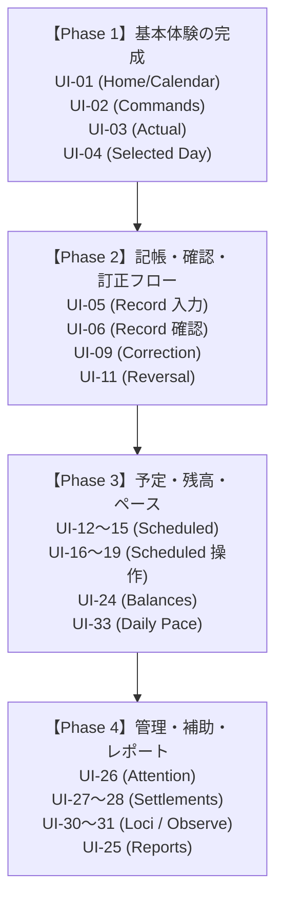

# LOAM UI 差分・移行管理台帳 (LOAM UI Gap Ledger)

## 1. 文書の目的と協調作業ルール

### この文書の目的
本書は、LOAM（Lean 4 実装）の洗練された TUI を基準とし、Bakhlo（OCaml + Bonsai 実装）の UI を**同等の職人品質（機能・見た目・操作体験・堅牢性）**へ揃え、さらに磨き上げていくための**網羅的差分管理台帳**である。

現在、複数の AI（Claude Code, Cursor, Antigravity 等）および人間が協調して作業しているため、**コンフリクトの防止、作業範囲の明確化、客観的な完了判定基準の共有**を最優先とする。

### 複数作業者（AI / 人間）協調ルール
1. **着手前の宣言**: 作業を開始する際は、本台帳のステータスを `作業中（担当: ○○）` に更新し、競合を防ぐ。
2. **1 画面・1 課題ずつの進行**: 複数画面にまたがる破壊的な共通化や一括改修を行わず、1画面ごとに「コード修正 → ビルド → スクショ/描画確認 → テスト」を完結させる。
3. **客観的な検証の必須化**:
   - 通常画面（80×24、120×36 等）でのレイアウト・余白・配色のスクショ比較
   - 極小画面（32×9、48×14 等）での縮退表示・リサイズ耐性（Bounded Layout）
   - キーバインド・下書き保護・確定拒否の挙動確認
4. **完了の定義**: 「コードを書いた」だけでなく、「LOAM のスクショ／動作と見比べて違和感がないこと」「テストが通過すること」をもって `検証待ち` → `完了` とする。

---

## 2. 職人的品質の共通評価基準（The Craftsmanship Criteria）

LOAM の設計思想（[`TUI_REFINEMENT_ROADMAP.md`](../../loam/docs/TUI_REFINEMENT_ROADMAP.md)）および Bakhlo の方針（[`UI_DIRECTION.ja.md`](UI_DIRECTION.ja.md)）に基づき、全画面共通で以下の 6 つの柱を判定基準とする。

| # | 品質基準 | 具体的な要件・配慮ポイント |
| :--- | :--- | :--- |
| **C-1** | **幾何学的堅牢性 (Bounded Layout)** | 大画面から極小（32×9, 48×14）までリサイズ時に絶対にクラッシュ・文字欠損・枠線破綻を起こさない。画面幅・高さの縮小時は情報優先順位に従い安全に縮退・畳みを行う。 |
| **C-2** | **静寂と抑制の美学 (Quiet Aesthetics)** | 派手な原色や不要な装飾ウィジェットを排し、細い丸角枠（`╭─╮`）、控えめな階調（`.normal` と `.muted`）で統一。強調色（フォーカス枠、選択行）は意図された焦点にのみ最小限用いる。 |
| **C-3** | **固定下部ナビ＆予約通知行 (Stable Navigation)** | 最下部の固定 2 段キー操作案内と、折り返し通知/フィードバック行の高さを常に確保。通知の発生・消去によって一覧やフォームの高さが上下に揺れない（レイアウトを揺らさない）。 |
| **C-4** | **フォーカスと選択の分離 (Focus vs Selection)** | 非アクティブなペインでもカーソル・選択位置を記憶・維持する。強いハイライト背景はアクティブ側にのみ適用し、非アクティブ側は控えめな枠やマーカーにとどめる。 |
| **C-5** | **金額・数値の厳密性 (Numerical Integrity)** | 符号付き整数 quanta と明示の小数桁を右寄せで整列。枠に入り切らない場合に「途中で桁を切って別の金額に見せる」ことを厳禁とし、収まらない場合は詳細画面へ安全に誘導する。ゼロと不明・対象外を明確に区別。 |
| **C-6** | **下書き保護とフェイルセーフ (Draft Safety & Fail-safe)** | 編集・作成は背景（親の文脈）が視界に残る中央フローティング枠を基本とする。`Esc` や `Cancel` でも入力中の下書きを黙って破棄せず保持する。極小画面で確認全文が読めない場合は誤認防止のため確定（Publish）を明示拒否する。 |

---

## 3. LOAM の改善余地・Bakhlo で先取りできる進化ポイント

LOAM を単に模倣するだけでなく、LOAM の改善課題として残されている項目や、Bakhlo (OCaml + Bonsai) のリアクティブな特性を活かしてさらに丁寧に作れるポイント：

1. **インクリメンタル・ファジー（あいまい）検索**:
   Commands パレットや Locus 候補選択で、文字入力に伴いリアルタイムにスコアリングして瞬時に絞り込む。
2. **Discoverability（`?` ヘルプオーバーレイ）**:
   下部フッターに収まりきらない文脈依存のショートカット一覧を `?` でいつでもポップアップ表示（which-key 風）。
3. **セマンティック枠線色（Border Semantics）**:
   画面の静けさを維持しつつ、枠線色だけでモーダルの性質を直感させる：
   - **標準入力（新規）**: 落ち着いたブルー／シアン系
   - **変更・修正（注意）**: 落ち着いたアンバー／イエロー系
   - **取消・削除・逆仕訳（警告）**: 落ち着いたローズ／レッド系
4. **端末エルゴノミクス**:
   マウスホイールやトラックパッドでの詳細ペインのスムーズなスクロール、OS クリップボードとの安全な連携。

---

## 4. 画面別 差分・移行管理マトリクス (UI-01 〜 UI-33)

- **状態フラグ**:
  - `未着手`: Bakhlo 側で未着手、または旧実装のまま
  - `一部実装`: 基本的なルーティングやロジックはあるが、見た目・操作性の統一が未完
  - `要スクショ検証`: 実装済み。LOAM 実物とのスクショ比較・セル単位の微調整待ち
  - `作業中`: 担当者が現在改修作業中
  - `完了`: スクショ検証・極小端末テスト・操作感の受入まで完了

| ID | 画面・機能名 | LOAM の状態・設計仕様 | Bakhlo 現状 | スクショ比較・細部仕上げチェックポイント | 状態 / 担当 |
| :--- | :--- | :--- | :--- | :--- | :--- |
| **UI-01** | **Home / Calendar / Detail** | 盆栽アスキーアート＋月間カレンダー＋Detail。狭小では連続週ナビ・1行ナビへ縮退。固定2段ナビ＋`?`ヘルプ。月/年集計表示。 | 一部実装 (`Daily_calendar`, `Bonsai_daily`) | ・盆栽の葉（緑）と植木鉢（Chrome）の彩色済み ・エントランスキー（シアン太字）のハイライト済み ・Home 固定フッターの過剰表示を LOAM に整列済み ・月間カレンダー・Detail・極小縮退の幾何学テスト通過 ・実機での見た目（スクショ）受入確認待ち | `要スクショ検証` （担当: Antigravity） |
| **UI-02** | **Commands パレット** | `Space` で開く階層コマンドパレット。グループ展開（`→`）、戻る（`←`/`Esc`）。余白・選択ハイライト。 | 一部実装 (`Ui_commands`, overlay) | ・タイトル「Commands」枠の統一 ・階層パス名＋説明文ヘッダーの導入 ・選択カーソル（`  > ` と反転太字）のLOAM統一 ・パレット内固定操作案内フッターの導入 ・不要なページカウンターを排除したクリーン丸角下枠 ・極小画面（全幅）/大画面（中央フローティング）縮退テスト通過 | `要スクショ検証` （担当: Antigravity） |
| **UI-03** | **Actual 一覧・検索・詳細** | 初期表示 All Current / 新しい順。`f` で選択日/全件切替。検索クエリ、Locus絞り込み。右側/下部詳細ペイン。 | 一部実装 (`ui_workspace`, route `Actual`) 列揃え・安全な金額省略・検索中の絞り込み・詳細端／ページ／リサイズ・Record下書き復帰を合成／PTY検証。3ペイン・Locus絞り込みUI・画面内検索は未対応 | ・一覧の列揃え（日付、Description、金額、Locus） ・金額の符号・桁区切り・通貨の右寄せ精度 ・検索バー入力中の枠色とカーソル位置 ・詳細ペインの折り返しとスクロールバー | `一部実装（pit: 閲覧スライス検証済／LOAM実物比較待ち）` |
| **UI-04** | **Selected Day 日別詳細** | 選択日の全取引・Scheduled のコンパクト一覧と詳細。i/Tab で詳細切替。48×14 縮退。 | 一部実装 (`ui_workspace`, route `Selected_day`) | ・ヘッダーの日付表示と曜日、サマリー収支 ・Actual と Scheduled の境界または区分表示 ・空データ時のプレースホルダー表示 ・親（Calendar）への復帰時の選択位置保持 | `要スクショ検証` |
| **UI-05** | **Record 通常入力・Locus 候補** | 中央フローティング枠。Date/Desc/Measure/Posting。Locus 候補ポップアップ。IME・末尾表示。 | 一部実装 (`record_session`, `posting_draft`) | ・フローティング枠のセンタリングと枠線色（青系） ・入力フィールドのラベル幅揃えとカーソル描画 ・Locus picker の出現位置とキーボード操作感 ・行追加（Ctrl-N）/削除（Ctrl-D）の動的追従 | `要スクショ検証` |
| **UI-06** | **Record 確認 (Preview)** | ID、日付、全Posting符号付き数量、Locus ID、支払い対応。Publish/Edit/Cancel選択。狭小確定拒否。 | 一部実装 (`record_session` preview) | ・Posting 行の整列とプラス/マイナス符号の色 ・Publish / Edit / Cancel ボタンスタイルと選択枠 ・端で切れない長文メモの折り返し ・確認文が収まらない極小端末での確定拒否警告 | `要スクショ検証` |
| **UI-07** | **Record / Original amount 入力** | 外貨・元通貨入力用の補助入力枠。IME対応。 | 未着手 / 一部 | ・元通貨フィールドの入力レイアウト ・レート換算や参考表示の補助トーン | `未着手` |
| **UI-08** | **Record / unresolved 有効化確認** | 語彙追加・未解決科目の有効化モーダル。 | 未着手 / 一部 | ・警告枠と確認メッセージの配置 ・Yes/No 選択のアクションボタン | `未着手` |
| **UI-09** | **Actual Correction 入力・確認** | 元明細を保持した訂正。アンバー枠。置換後 Effects、確認スクロール。 | 一部実装 (`daily_actions` Edit) | ・注意・修正を示すアンバー枠（セマンティック） ・訂正前と訂正後の差分表示のわかりやすさ ・変更不可フィールド（ID等）のディム表示 | `一部実装` |
| **UI-10** | **Actual 日付修正 入力・確認** | 日付変更専用モーダル。新旧日付の階層表示。 | 未着手 / 一部 | ・新旧日付の対比レイアウト ・日付バリデーションエラーの即時表示 | `未着手` |
| **UI-11** | **Actual Reversal 入力・確認** | 元明細を保持する逆仕訳。ローズ枠。符号付き逆Posting全文表示。 | 一部実装 (`reverse_entry` form) | ・警告を示すローズ/レッド枠（セマンティック） ・逆仕訳（符号反転）Posting の正確な表示 ・明示的な確定ボタン操作 | `一部実装` |
| **UI-12** | **Scheduled / Series Calendar** | 予定カレンダー。当月始まり、完了チェック（`✓`）表示。Plan Detail と連動。 | 一部実装 (`ui_workspace` route `Scheduled`) | ・カレンダーセル内の予定件数バッジと完了マーク ・未完了と完了（paid）の視覚的区別 ・選択日の予定サマリー | `要スクショ検証` |
| **UI-13** | **Scheduled / Plan Detail** | 予定の詳細表示。金額、周期、次回期日、関連科目。 | 一部実装 | ・詳細ペインの項目レイアウト・マージン ・次回到来日の強調表示 | `一部実装` |
| **UI-14** | **Scheduled / Months** | 月別の予定一覧・集計。 | 一部実装 | ・月ごとのグループヘッダーと折りたたみ ・月合計金額の右寄せ整列 | `一部実装` |
| **UI-15** | **Scheduled / List** | 全 Scheduled のフラット一覧・フィルタ。 | 一部実装 | ・一覧の列揃えとステータス表示 ・ソート順（期日順）のインジケータ | `一部実装` |
| **UI-16** | **Scheduled 作成 入力・確認** | フローティング枠。期日、周期、金額、科目入力。確認画面。 | 一部実装 (`daily_actions` Plan_new) | ・フローティング枠の配置と入力フィールド揃え ・周期（Monthly, Weekly 等）の選択 UI | `一部実装` |
| **UI-17** | **Scheduled 完了 入力・確認** | 予定の実績化（Complete）。フローティング枠。Actual日付・金額調整。 | 一部実装 (`daily_actions` Pay) | ・元予定情報の引用表示と実績入力欄の対比 ・完了時の paid-by 連動確認 | `一部実装` |
| **UI-18** | **Scheduled 取消確認** | 予定の取消モーダル。Keep / Cancel。ローズ枠。 | 一部実装 (`cancel_plan` form) | ・警告枠（ローズ枠）と取消対象のサマリー ・Keep（保持）と Cancel（取消）のボタン配置 | `一部実装` |
| **UI-19** | **Scheduled 置換 入力・確認** | 予定の内容変更・置換発行。アンバー枠。 | 一部実装 | ・置換前後の比較レイアウト ・アンバー枠による注意喚起 | `一部実装` |
| **UI-20** | **Scheduled 一括金額編集** | 複数予定の一括金額変更・チェックリスト。 | 未着手 | ・チェックボックス列と選択追従 ・変更前後のプレビューテーブル | `未着手` |
| **UI-21** | **Scheduled 生成 入力・確認** | 周期予定からのインスタンス生成画面。 | 未着手 | ・生成対象期間の入力と生成プレビュー | `未着手` |
| **UI-22** | **Scheduled 継続の操作画面** | 終了期日の延長・次回サイクルの設定。 | 未着手 | ・継続設定のパラメータ入力フォーム | `未着手` |
| **UI-23** | **Scheduled coverage 設定** | Plan Monitoring のペース選択パネル。 | 未着手 | ・ペース選択肢（5段階）のラジオ/リスト表示 | `未着手` |
| **UI-24** | **Balances / Current** | Locus × Measure・符号付き quanta・根拠状態。右側詳細。巨大数量誘導。 | 一部実装 (`balance_view_data`, route `Balances`) | ・Locus ごとの階層インデントと残高の右寄せ ・ゼロ残高、不明量、正常残高のトーン差別化 ・詳細ペインにおける根拠トランザクション一覧 | `要スクショ検証` |
| **UI-25** | **Reports (非予算 9 画面)** | メニュー、Income/Expense、Stock-Flow、Liquidity 等。 | 未着手 | ・Reports メニューの階層表示 ・各レポートのテーブル・グラフレイアウト | `未着手` |
| **UI-26** | **Attention 一覧・詳細・操作** | 要注意項目一覧、期限（due）、Add / Resolve / Drop モーダル。 | 一部実装 (`attention_data`, route `Attention`) | ・重要度・期限切れ（Overdue）のバッジ表示 ・Resolve / Drop モーダルの枠色と確認ボタン ・詳細ペインでの発生原因コンテキスト表示 | `要スクショ検証` |
| **UI-27** | **Settlements 一覧・詳細** | 精算グループ一覧、未精算残高、詳細。 | 一部実装 (`settlement_data`, route `Settlements`) | ・相手方・グループごとの未精算額の整列 ・決済済みと未決済の視覚的区別 | `一部実装` |
| **UI-28** | **Settlement 操作・確認** | 精算実行（相殺・支払い記録）モーダル。 | 一部実装 (`action_settlement` form) | ・精算対象明細のチェックリストと合計計算 ・精算トランザクション発行の確認画面 | `一部実装` |
| **UI-29** | **Exchange 入力・確認** | 通貨両替・Measure 変換入力モーダル。 | 一部実装 (`exchange` form) | ・From 通貨・数量と To 通貨・数量の対比入力 ・適用為替レートの補助表示 | `一部実装` |
| **UI-30** | **Manage Loci 一覧・追加** | Locus（勘定科目・口座・場所）一覧、追加、役割設定。 | 一部実装 (route `Loci`, `admit_locus`, `set_locus_role`) | ・Locus トークン一覧と役割（Asset, Expense等）の列揃え ・新規追加モーダルの入力フィールドとバリデーション | `一部実装` |
| **UI-31** | **Observe quantities 入力・確認** | 実地棚卸・残高観測値の入力モーダル。 | 一部実装 (`observe_quantity` form) | ・観測日・Locus・実測数量の入力行 ・計算残高との乖離（差額）のプレビュー | `一部実装` |
| **UI-32** | **Print / 補助表示** | プレーンテキスト出力、エクスポート確認。 | 未着手 | ・出力プレビュー枠と確認ダイアログ | `未着手` |
| **UI-33** | **Daily Pace / Trend 本画面** | Braille 点字グラフ、履歴推移、数量/変化/再構成の詳細。48×14 保持。 | 一部実装 (route `Daily_pace`, what_if) | ・Braille グラフ（点字描画）の正確性とアスペクト比 ・カーソル移動に追従する日別実績・目標ペース数値 ・極端な外れ値が発生した際の安全なグラフクリップ | `要スクショ検証` |

---

## 5. スクショ比較と仕上げの具体的ワークフロー

### ステップ 1: 正解（LOAM）のキャプチャ取得
1. 比較用の共有データ（`scratch/loam-comparison`）またはデモデータを用いる。
2. LOAM 側で目的の画面を開き、ターミナルサイズ（例: 80×24, 120×36）を固定してスクショを撮影（macOS `screencapture -w` または自動取得）。
3. 保存先: `scratch/ui-shots/loam/<画面ID>_<画面名>.png`

### ステップ 2: Bakhlo 側の同一画面キャプチャ取得
1. Bakhlo 側で `./ui --demo` または同一比較データで `./ui` を起動。
2. 全く同一のターミナルサイズで目的の画面を開き、スクショを撮影。
3. 保存先: `scratch/ui-shots/bakhlo/<画面ID>_<画面名>.png`

### ステップ 3: マルチモーダル視覚比較・コード修正
1. AI が `view_file` で両スクショを直接閲覧・比較。
2. 以下のピクセル/セル単位のズレをチェック：
   - 枠線の角丸文字（`╭` `╮` `╯` `╰`）と線の太さ
   - ヘッダー・フッターの余白（パディング）と区切り線の有無
   - 金額の右寄せ・符号・通貨記号のスペーシング
   - 選択カーソルの背景色とテキスト色のコントラスト
3. `bakhlo/tui/*.ml` を修正し、再コンパイル・再キャプチャして一致するまで微調整。

### ステップ 4: 堅牢性テスト（Bounded Layout）
1. ターミナルサイズを `32×9` および `48×14` に縮小した状態での表示を確認。
2. クラッシュせず、文字が折り返し/省略され、重要な情報（選択日、金額、戻るキー案内）が残っていることを確認。
3. 本台帳のステータスを `完了` に更新。

---

## 6. 作業着手の推奨ロードマップ

複数の AI で混乱なく進めるため、以下のフェーズ順で画面を着手することを推奨する。

1. **第 1 優先 (Phase 1): 日常の閲覧導線（Home / Commands / Actual / Selected Day）**
   - ユーザーが起動して最も目にする画面群。ここを LOAM と完全に一致させることで、全体のトーン＆マナー（枠・余白・色・ナビ）が確定する。
2. **第 2 優先 (Phase 2): 記帳・確認・訂正（Record / Correction / Reversal）**
   - フローティングモーダル枠、セマンティック枠色（青/アンバー/ローズ）、下書き保持、狭小画面での確定拒否など、職人品質の核心部分を仕上げる。
3. **第 3 優先 (Phase 3): 予定・残高・グラフ（Scheduled / Balances / Daily Pace）**
   - カレンダー上のマーク（`✓`）、Braille グラフ、残高の符号付き quanta 整列を仕上げる。
4. **第 4 優先 (Phase 4): 注意・精算・Loci 管理・レポート**
