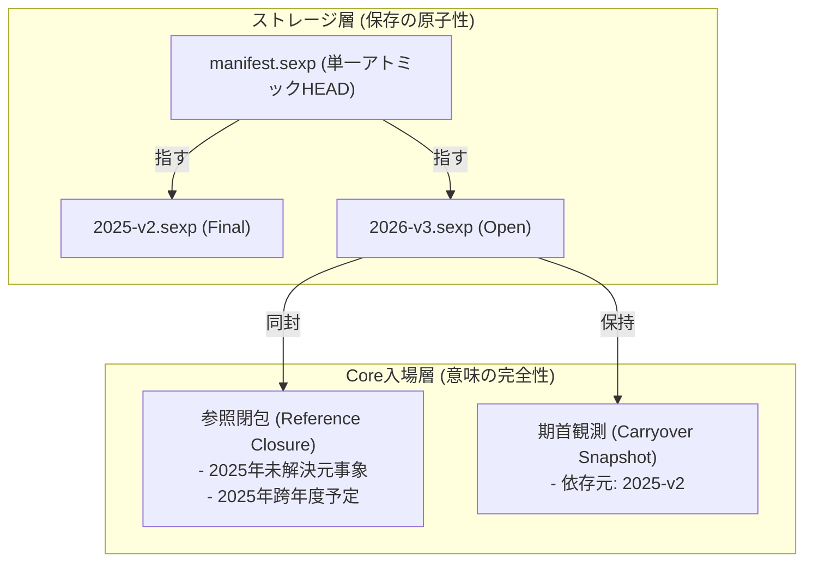

# 暦年別S式 最小合成意味検証実験レポート

状態: **合成実験完了・分析記録。本体Coreや正データ形式の移行・採用はしていません。**
ブランチ: `research/canonical-storage-checkpoint`
検証コード: [`test/year_partition_study_tests.ml`](file:///Users/user/Projects/moko/bakhlo/test/year_partition_study_tests.ml)

---

## 1. 目的と検証の枠組み

本実験では、Bakhloの正データを暦年ごとに分割して保存する方式が、現行の単一S式（Monolithic `Daily_book`）と同じ家計上の意味、回答、および拒否条件を維持できるかを、現行Coreの既存コード（`bakhlo.sexp`, `bakhlo_domain`, `bakhlo_application`）を用いて直接検証しました。

### 用意した合成台帳 (`fixture_monolithic`) の構成
- **複数通貨**: JPY (scale 0), EUR (scale 2)
- **正確な整数クォンタ**: Zarith `Z.t` による厳密計算
- **数量根拠**: `zero-origin`（明示ゼロ）、`observation`（独立観測）、`reflected`（root cut）、未指定（unknown）
- **年度またぎの予定と支払い**: 2025年に起票された予定 `p_2025_cross_year` を、2026年の実績 `e_2026_pay_plan` で支払い完了
- **年度またぎの取消 (Reversal)**: 2025年の誤った預金 `e_2025_deposit` に対する、2026年の明示的取消 `e_2026_reversal`
- **両替 (Exchange)**: 2026年の JPY から EUR への両替 `e_2026_fx`
- **日付訂正による年度移動**: 当初2025年だった取引の日付を2026年へ変更する操作

---

## 2. 三段階の検証結果

### A. Lossless Partition（可逆的分割・再結合の検証）

#### A1. 素朴な暦年物理分割の入場検証
単一S式から entries と plans を日付（YYYY-MM-DD）だけで「2025年」と「2026年」に単純分割して、それぞれ `Daily_book.of_string` で読み込ませた場合：

- **2025年単独本**: **入場拒否（Refused）**
  - エラー: `unknown-plan-payment`
  - 理由: 2025年の予定 `p_2025_cross_year` が `paid-by (some e_2026_pay_plan)` を保持しているが、支払実績 `e_2026_pay_plan` は2026年ファイルにあるため、2025年の `entry_map` から見つからず拒絶される。
- **2026年単独本**: **入場拒否（Refused）**
  - エラー: `entry-admission` (`Unresolved_endpoints`)
  - 理由: 2026年の取消 `e_2026_reversal` が `reversal-of (some e_2025_deposit)` を保持しているが、元取引 `e_2025_deposit` は2025年ファイルにあるため、2026年の `Event_memory` から見つからず拒絶される。

> [!IMPORTANT]
> **結論**: **素朴な暦年分離（エントリーと予定の日付による単純切り分け）は、現行Coreの入場条件を満たせず成立しない。**
> Coreは、すべての参照（予定の支払い元、Reversalの対象、Root cutの対象）が同一の台帳（閉じた `Actual_source` / `entry_map`）内に存在することを要求する。

#### A2. 再結合による可逆性の検証
分割された断片を元の順序で統合して再構築した台帳（`book_recombined`）は、元の `book_monolithic` と以下のすべてにおいて完全一致しました：
- エントリー数および全ID・順序: 完全一致 (`true`)
- 予定数および全ID・順序: 完全一致 (`true`)
- 各口座の数量照会（Exact / Unknown）: 完全一致 (`wallet JPY: 20000`, `wallet EUR: 10000`, `bank JPY: 0`)
- 未払予定数: 完全一致 (`1`)

---

### B. Selective Read（選択読込の検証）

#### B1. 参照閉包（Reference Retention Closure）を伴う2026年単独読込
2025年の全履歴を読み込まずに2026年を処理するために、以下の**最小参照閉包**を2026年ファイルに同封して入場させました：
1. **2026-01-01時点の期首観測**: `wallet` JPY 37,000, `bank` JPY 10,000, `wallet` EUR 0
2. **保持された元事象**: `e_2025_deposit`（Reversalの解決用）
3. **保持された過年度予定**: `p_2025_cross_year`（2026年支払い用）
4. **Root cut**: `reflected: [e_2025_deposit]`（期首残高に既に反映済みの元事象が二重加算されないよう除外）

- **結果**: **正常入場・全回答が単一S式と完全一致！**
  - `wallet JPY`: **20,000**（期首 37,000 + 取消 10,000 - 予定支払 12,000 - 両替 15,000）
  - `bank JPY`: **0**（期首 10,000 - 取消 10,000）
  - `wallet EUR`: **10,000** (100.00 EUR)
  - `open plans`: **1** (`p_2026_open` のみ未払)

#### B2. 失敗条件の検証結果

| 失敗条件 | 検証コードの挙動 | Coreの振る舞いと判定 |
| :--- | :--- | :--- |
| **期首残高への二重加算** | 保持元事象 `e_2025_deposit` に対する `reflected` cut を意図的に除外 | 残高が 20,000 から **70,000** へ不正膨張することを検出。カットの必須性が確認された。 |
| **前年度訂正後の古い繰越採用** | 2025年の雑費を 3,000 -> 5,000 に訂正後、2026年が古い繰越（37,000）を保持 | **Coreは沈黙して古い残高を算出（検出不能）**。Coreには繰越の世代依存を追跡する仕組みがない。 |
| **参照先欠落（Dangling Ref）** | 元事象のない Reversal、存在しない entry による支払完了 | `Unresolved_endpoints`, `unknown-plan-payment` で**即座に拒絶**。 |
| **予定の二重支払い** | 同一の支払エントリ `e1` を2つの予定 `p1`, `p2` に割り当て | `duplicate-plan-payment` で**即座に拒絶**。 |
| **Unknown is not zero** | 根拠のない `salary EUR` への照会 | `0` にフォールバックせず、厳密に **`unknown`** を返却。 |
| **日付訂正による年度移動** | 2025-11-15 の取引を 2026-01-05 へ `replace: true` | 単一S式では同一IDで移動可能だが、年度別ファイルでは旧年からの削除と当年への追加が必要。 |

---

### C. Cross-Year Report（年度境界をまたぐ年金サイクル集計）

2025-10-15 〜 2026-10-14 の6つの年金サイクル（各2か月、境界日は明示入力）について照会を行いました：

- **現行Coreの `daily_pace` の結果**:
  - Cycle 1 [2025-10-15 to 2025-12-15) 61日: pace = 327 JPY/日
  - Cycle 2 [2025-12-15 to 2026-02-15) 62日（**年度境界を跨ぐ**）: pace = 322 JPY/日
  - Cycle 3 [2026-02-15 to 2026-04-15) 59日: pace = 338 JPY/日
  - Cycle 4 [2026-04-15 to 2026-06-15) 61日: pace = 327 JPY/日
  - Cycle 5 [2026-06-15 to 2026-08-15) 61日: pace = 327 JPY/日
  - Cycle 6 [2026-08-15 to 2026-10-15) 61日: 未払予定 5,000 JPY 控除後 pace = 245 JPY/日
  - 変種 (Cycle 2 exclusive end を 02-13 に短縮): 60日: pace = 333 JPY/日

#### 現行Coreのクエリ能力の境界（未対応領域）
1. **期間内の実績収支集計（Windowed Period Totals）**:
   現行Coreには「ある日付区間 `[start, end)` 内に発生した支出・収入を合算する」クエリAPIが存在しない（`unsupported`）。
2. **過去時点の残高照会（Historical As-of Balance）**:
   `daily_pace` の `observed_at` は現在台帳に対する日割り計算の起点ラベルに過ぎず、過去の台帳状態への巻き戻し再生機能はない（`unsupported`）。
3. **目的別・科目別集計（Purpose/Category Grouping）**:
   Coreは物理的な Locus と保存則のみを扱い、家計簿的な費目分類の集計は持たない。

---

## 3. Core既存機能だけでは解決できない問題

実験により、既存Coreを変更せずに年度別S式を成立させる上で、以下の3点が「Coreの外側」に残る未解決課題であることが明確になりました：

1. **参照閉包の自動抽出・同封（Reference Retention Closure）**:
   過年度に存在する取引であっても、当年の取消や予定完了で参照される取引は、当年台帳に「参照元事実」として同封しなければCoreが入場を拒絶する。この閉包をどのレイヤが管理・抽出するか。
2. **期首繰越の世代追跡・失効検出（Carryover Dependency Tracking）**:
   過年度が訂正された際、当年の期首残高が「古い世代から派生した無効なもの」であることをCore自身は検知できない（Coreは与えられた観測をただ信じる）。外部のOCC/世代比較が不可欠。
3. **日付訂正による年度移動（Cross-file Entry Migration）**:
   日付の変更によって所属年度ファイルが変わる場合、旧年度ファイルからの安全な削除と新年度ファイルへのアトミックな挿入を保証する枠組みがS式レベルには存在しない。

---

## 4. 意味上の問題と保存上の原子性問題の区別

| 区分 | 課題内容 | 解決の所在 |
| :--- | :--- | :--- |
| **意味上の問題** | 参照閉包の完全性、期首繰越の依存関係、Root cutによる二重加算防止、Unknownの保全 | **Bakhlo Core / アプリケーション境界** （本実験で実証された閉包設計とOCCガード） |
| **保存上の原子性問題** | 複数年度ファイルの同時rename不可、fsync順序、クラッシュ時の片肺状態、電源断耐性 | **ストレージ層 / マニフェスト機構** （TLA+ v0.1/v0.2で検証された課題） |

---

## 5. 年度別S式の実装に必要な最小限の追加概念

現行Coreを壊さずに年度別S式を実現するために最低限必要な構成：

1. **マニフェストファイル (`manifest.sexp`)**:
   全年度の有効ファイル名と世代番号を単一ファイルで管理し、アトミックrenameで一体公開する。
2. **参照閉包の同封 (`Reference Closure`)**:
   当年ファイル内に、当年取引が参照する過年度の元事象・予定を「保持された依存事実」として埋め込む。
3. **期首観測の世代メタデータ**:
   期首観測に「どの過年度リビジョンから派生したか」を付与し、マニフェストの現在世代と照合する。
